<h1 align="center">GResume</h1>

<p align="center">
  <strong>为不同岗位准备简历，把修改、分享和面试跟进放在一起。</strong>
</p>

<p align="center">
  <a href="https://506resume.cc/">在线体验</a> ·
  <a href="#岗位定制与历史版本">历史版本</a> ·
  <a href="#简历优化找到问题并逐项修正">简历优化</a> ·
  <a href="#ai-agent在工作台内完成修改">AI Agent</a> ·
  <a href="#分享与审阅明确对外版本">分享审阅</a> ·
  <a href="#实时协作直接修改同一份简历">实时协作</a> ·
  <a href="#本地运行与自托管">本地运行</a>
</p>

<p align="center">
  <a href="./docs/assets/readme/hero.svg">
    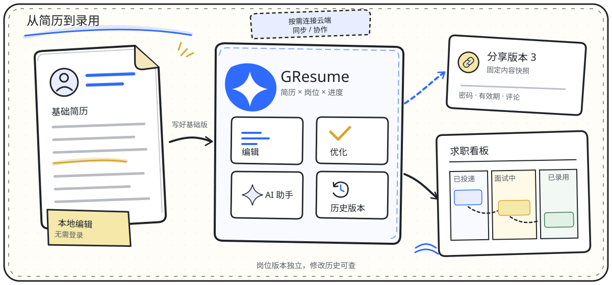
  </a>
</p>

## 岗位定制与历史版本

同一段项目经历，投前端岗位和全栈岗位时可能需要不同的侧重点。GResume 按岗位描述（JD）从基础简历派生独立副本，保留来源和改动记录，各岗位版互不影响。修改前后可以对比，不合适时从历史版本恢复。

这里区分了两种关系：岗位版本是从哪份简历派生的，同一份简历又改过哪些内容。前者用父子关系记录，后者保存文档快照。恢复时将快照写回当前文档，并新增恢复记录，让后续修改仍有迹可查。

求职看板把岗位与简历关联，面试轮次和下一步安排放在一起，方便准备面试、跟进进度。看板关联的是持续编辑的简历；要保留投递当时的内容，需要使用[固定分享快照](#分享与审阅明确对外版本)或导出文件。

<p align="center">
  <a href="./docs/assets/readme/workflow.svg">
    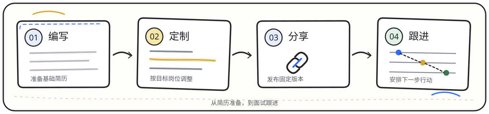
  </a>
</p>

<p align="center">
  <a href="./docs/assets/readme/screenshots/dashboard.jpg">
    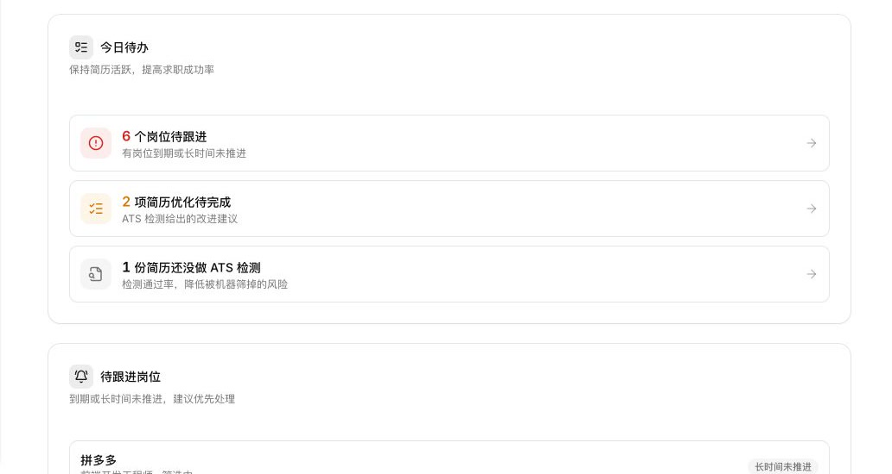
  </a>
</p>

## 简历优化：找到问题并逐项修正

一条“项目描述不具体”的建议，需要指出哪段经历缺少什么信息，才方便修改。优化系统将问题定位到原文，给出依据和建议，并记录处理进度。JD 对比用于检查经历与岗位要求的差距，ATS 纯文本预览用于检查机器能读到哪些内容。

模型可能给出没有对应字段的建议。系统先根据已填写内容确定评估范围，再统一模型返回的格式，校验问题位置和修改值的类型，避免指向不存在的模块或写入不合适的数据。评分用于辅助检查，不代表招聘系统的筛选结果。

## AI Agent：在工作台内完成修改

让 AI 修改简历，通常要先提供上下文，再把结果贴回去核对。GResume 的 Agent 直接读取工作台中的简历、评估结果和求职记录，按任务调用工具。写入前展示修改差异或操作摘要，确认后可在右侧画布查看结果。经历和数字是否真实，仍需本人判断。

分析依赖当前数据，修改结果又会影响下一步判断，因此工具执行结果会回到对话中，供 Agent 继续处理；默认最多 12 步。任务需要的技能和参考资料按需读取，减少无关内容占用上下文。

<p align="center">
  <a href="./docs/assets/readme/screenshots/assistant-workspace.jpg">
    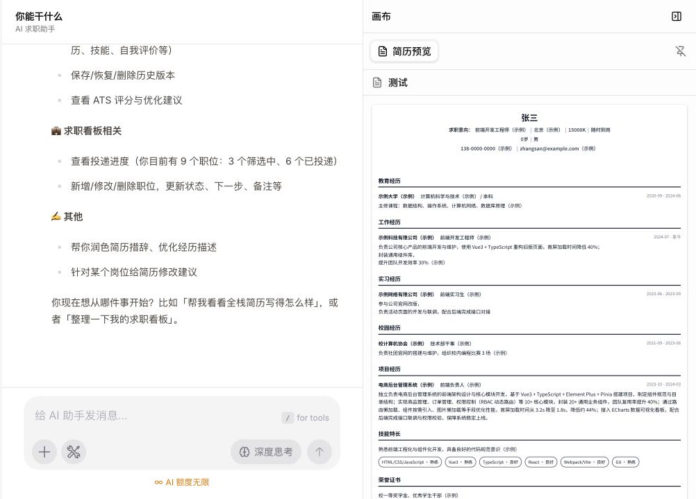
  </a>
</p>

流式响应、工具执行和用户确认并不同步。分片必须组成完整参数后才能执行，简历字段写入还要经过类型校验和确认。用户停止对话时，取消信号会传到工具和确认流程，写入前再次检查，避免等待中的操作随后继续写入；已经完成的修改则保留。

模型请求由服务端代理转发，密钥不进入浏览器。为处理重试和流中断，额度按请求唯一标识预留，再按实际交付情况结算，避免重复扣减。

<p align="center">
  <a href="./docs/assets/readme/agent-control-plane.svg">
    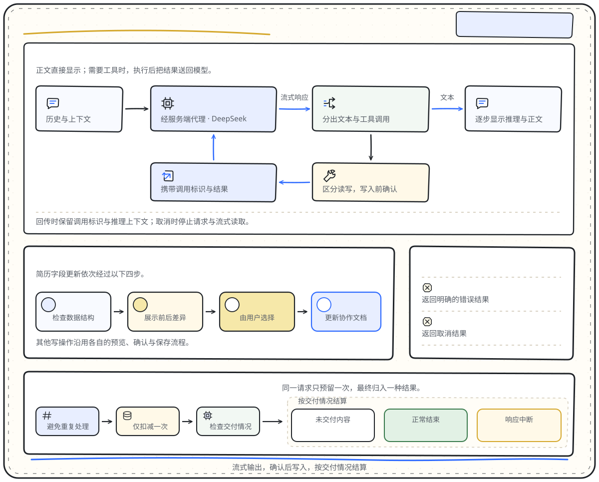
  </a>
</p>

## 分享与审阅：明确对外版本

发出简历后，继续编辑不应悄悄改变对方看到的内容。分享时同时固定正文与模板快照，让工作副本和对外版本分开。需要更新时，明确发布新版本即可沿用原链接。链接可设置密码、有效期和评论权限，也能查看访问次数与最近访问时间。

<p align="center">
  <a href="./docs/assets/readme/product-sequence.svg">
    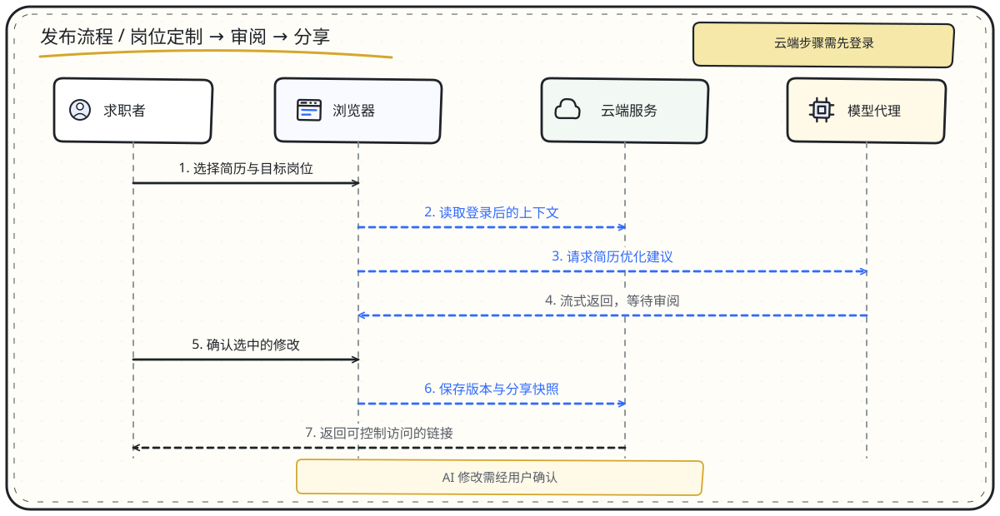
  </a>
</p>

审阅意见直接标在原文上，省去截图和解释位置。正文修改后，旧位置可能指向另一句话，因此评论按版本隔离，同时保存所在段落、原文及前后文；迁移到新版本时，只有唯一匹配才重新绑定，无法确定的意见保留为待重连。

断线还可能漏掉评论通知。实时通道只负责提醒，客户端按事件序号从日志补齐遗漏。评论同步与简历保存分别处理，评论出错不会把已经成功的保存判为失败。

<p align="center">
  <a href="./docs/assets/readme/comment-anchoring-recovery.svg">
    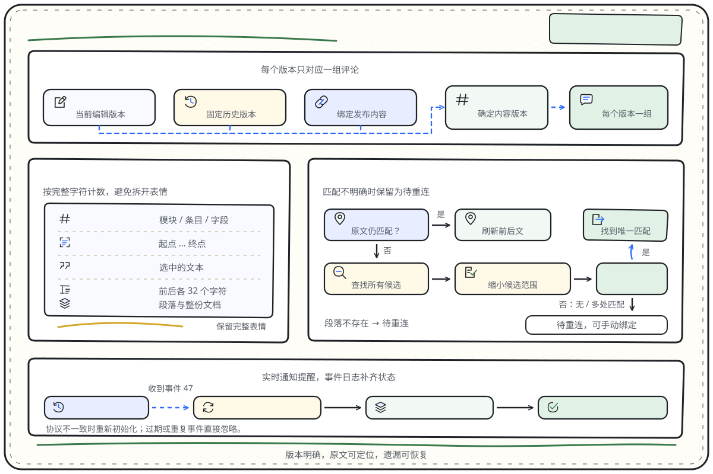
  </a>
</p>

## 实时协作：直接修改同一份简历

请朋友帮忙改简历时，双方直接编辑同一份文档，能看到彼此的改动和富文本光标。讨论可以指向正在修改的段落，免去反复传文件、解释位置和手工合并，减少沟通与操作成本。

表单修改的是字段和条目，富文本修改的是字符与格式，二者需要各自合适的合并方式。表单沿用 Automerge 文档，富文本采用编辑器已有的 Yjs 协作能力，分别合并增量。这个选择保留了原有文档模型，也能使用富文本协作光标，代价是维护两套同步状态。

接入同步后，还要避免打断正在输入的人：远端变化只回填受影响的字段，保留焦点和光标；更新携带来源标记，防止收到后又广播回去；新成员加入时先补齐状态。两套引擎共用实时传输服务，合并逻辑和持久化各自处理。

<p align="center">
  <a href="./docs/assets/readme/dual-crdt-collaboration.svg">
    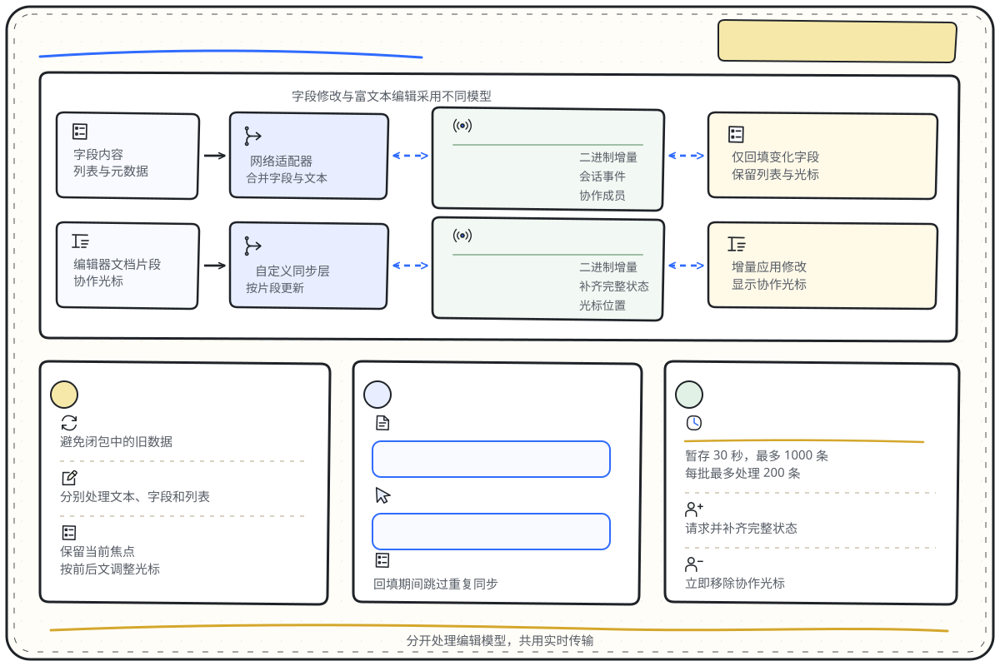
  </a>
</p>

## 分页与导出：交付前看清结果

编辑时排好的内容，导出后应保持同样的分页。PDF 复用预览的页面结构与分页规则，按浏览器实际渲染的文本行、图片边界选择断点，减少另算一套版式带来的偏差。字体或内容改变后重新测量。

测量过早会得到错误断点，因为字体加载后，行高和换行位置仍可能变化。系统等待字体就绪，连续两帧的布局测量结果一致才采用，最多尝试 8 帧。打印前再测一次克隆后的页面，核对布局摘要；结果不一致时提示错误。

Word 从同一份结构化内容生成，但排版由目标软件处理，字体和分页仍需在 Word 中复核。

<p align="center">
  <a href="./docs/assets/readme/deterministic-a4-pagination.svg">
    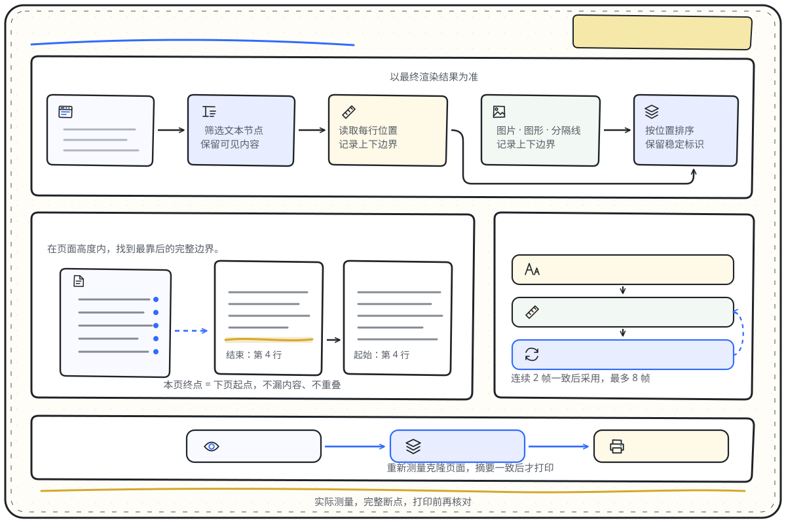
  </a>
</p>

## 本地运行与自托管

打开[在线编辑器](https://506resume.cc/)即可创建简历，无需先注册。编辑结果先保存在浏览器的 IndexedDB，输入和预览在本地完成，不必逐次等待网络响应。清理站点数据前，需要导出或确认简历已同步。

云同步、分享、协作、求职看板和 AI 在登录后使用。数据库按用户权限隔离记录，需要特权的操作放在服务端执行。AI 仅在调用时向模型服务发送所需上下文，本地编辑本身不需要模型请求。

<p align="center">
  <a href="./docs/assets/readme/architecture.svg">
    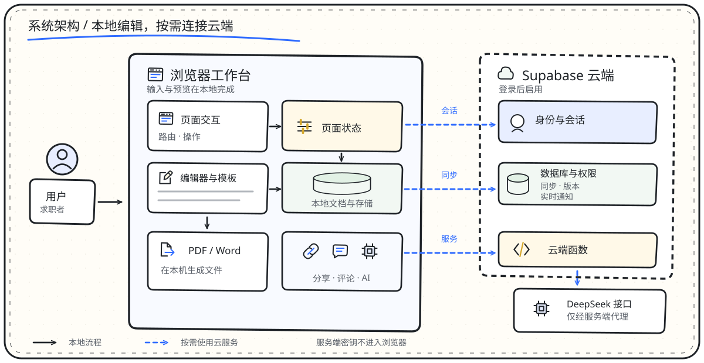
  </a>
</p>

本地开发需要 Node.js 24、pnpm 10.33.3 和可用的 Supabase 项目配置：

```bash
git clone https://github.com/506-FETL/resume.git
cd resume
corepack enable
pnpm install --frozen-lockfile
```

在根目录创建 `.env.local`：

```dotenv
VITE_SUPABASE_URL=https://your-project.supabase.co
VITE_SUPABASE_PUBLISHABLE_KEY=your-publishable-key
VITE_BASE_URL=http://localhost:5173
```

运行 `pnpm dev`，打开 `http://localhost:5173`。完整云端功能还需部署数据库与函数，步骤见[自托管指南](./docs/self-hosting.md)。`VITE_` 变量会进入浏览器，不能放服务端密钥。

<p align="center">
  <a href="./docs/assets/readme/tech-badges.svg">
    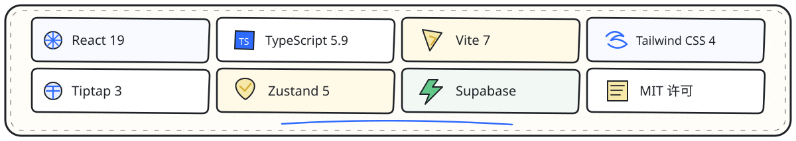
  </a>
</p>

## 开发与贡献

| 命令           | 用途                     |
| -------------- | ------------------------ |
| `pnpm dev`     | 本地开发                 |
| `pnpm lint`    | ESLint 检查              |
| `pnpm build`   | 生产构建，输出到 `dist/` |
| `pnpm preview` | 预览构建产物             |

提交 [Issue](https://github.com/506-FETL/resume/issues) 时请附复现步骤，移除真实简历和令牌。PR 请说明改动与验证结果，界面修改附截图，数据库或协议修改说明兼容性影响。安全问题通过[维护者主页](https://github.com/506-FETL)的联系方式私下沟通。

[MIT License](./LICENSE) · [更新日志](https://506resume.cc/changelog) · [第三方许可证](./public/licenses/)
