<h1 align="center">GResume</h1>

<p align="center">
  <strong>从一份基础简历开始，按岗位修改，发给朋友审阅，再跟进每次面试。</strong>
</p>

<p align="center">
  <a href="https://506resume.cc/">在线体验</a> ·
  <a href="#简历模板选好排版再写自己的经历">简历模板</a> ·
  <a href="#岗位定制与历史版本">历史版本</a> ·
  <a href="#简历优化找到问题并逐项修正">简历优化</a> ·
  <a href="#ai-agent在工作台内完成修改">AI Agent</a> ·
  <a href="#分享与审阅明确对外版本">分享审阅</a> ·
  <a href="#实时协作直接修改同一份简历">实时协作</a> ·
  <a href="#本地运行与自托管">本地运行</a>
</p>

<p align="center">
  <a href="./docs/assets/readme/hero.svg">
    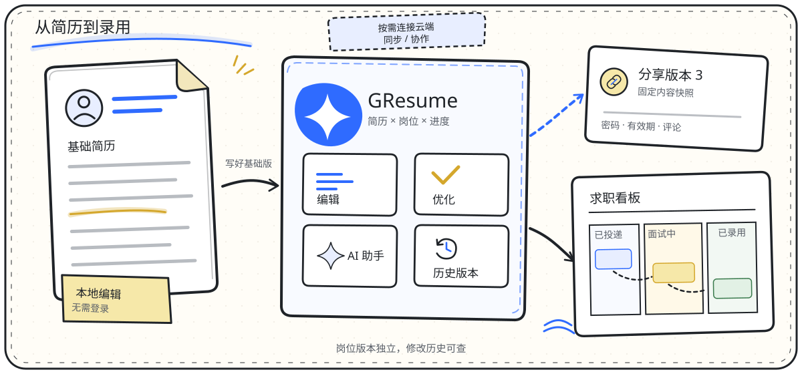
  </a>
</p>

## 简历模板：选好排版，再写自己的经历

在模板库里按风格和布局挑一套排版，再打开完整示例，看看一段经历放在纸上是什么样子。同一套模板可以分别预览应届生和前端开发的示例。选好后，进入编辑器，把示例文字换成自己的经历。加写第二段工作经历时，标题、日期和间距会沿用模板的排法。

新简历按你当前选择的模式保存在本地或云端。示例只在创建时复制一次，之后刷新页面、邀请别人协作或发出分享链接，用的都是你写的那份简历。

<p align="center">
  <a href="./docs/assets/readme/template-journey.svg">
    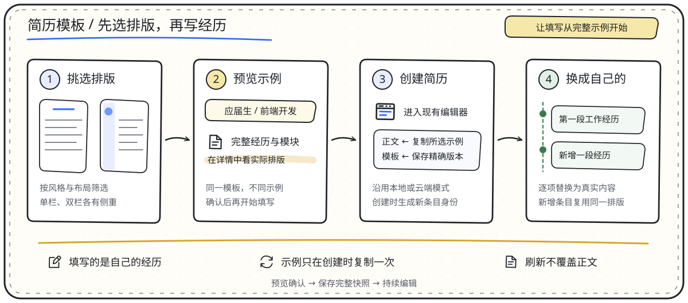
  </a>
</p>

正文、模板和示例分开保存。正文记录字段和经历，模板用声明式 JSON 描述排版，所有模板共用一个解释器。这样，加一套设计也能沿用已有的表单和导出逻辑。

| 模板中要表达的设计         | 配置如何描述                                          | 运行时如何复用                                           |
| -------------------------- | ----------------------------------------------------- | -------------------------------------------------------- |
| 整页是单栏还是双栏         | `page.regions` 指定区域宽度和模块归属                 | 共用区域布局与分页计算                                   |
| 页头、章节标题与内容容器   | `document`、`section` 组合通用节点                    | 同一套节点解释器处理容器、字段和图形                     |
| 每条经历、技能与证书的排法 | `contentByKind` 定义内容类型的排版，`repeat` 遍历条目 | 教育、工作和实习共用经历类型；新增条目直接按同一规则呈现 |
| 字号、颜色、间距与装饰     | `styles`、`tokens` 和精确素材引用                     | 共用样式解析，结合用户选择的字体、主题与页边距           |

以时间轴模板为例，日期放在哪儿、连接线怎么画、经历卡片怎样排列，都写在模板里。教育和工作经历各自提供数据。加入第二段工作经历时，解释器沿用第一段的条目结构和样式。双栏模板把模块分到左右两栏，各自测量和分页。较长的一栏决定总页数，内容始终留在原来那一栏。

<p align="center">
  <a href="./docs/assets/readme/template-architecture.svg">
    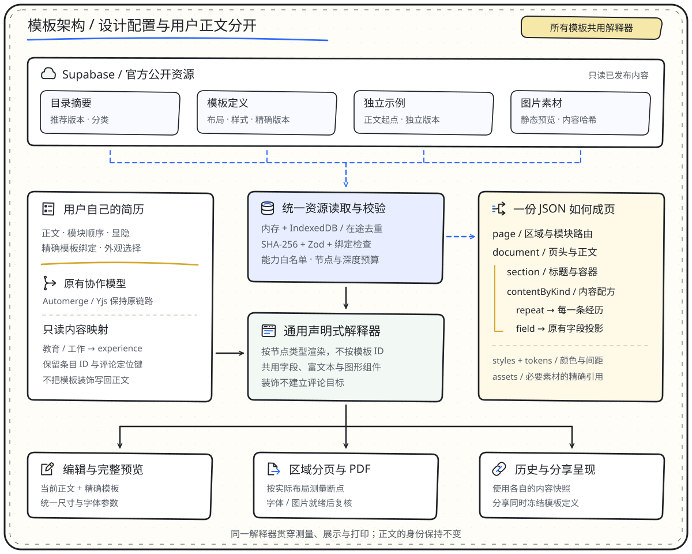
  </a>
</p>

浏览模板库时，页面从 Supabase 分页读取目录，每页展示 12 条摘要。卡片进入可见范围才加载静态预览图，打开详情时再读取对应版本的模板定义、示例和所需素材。列表向下追加，目前还没有使用虚拟网格。

数据层会合并重复请求，同时最多发出 4 个网络请求。内存和 IndexedDB 都用于缓存。目录缓存 5 分钟。校验过的资源可以按版本或内容哈希复用，缓存的资源数量和总容量都设有上限。

浏览器只读取已发布的资源。模板进入渲染器前，要核对 SHA-256 哈希，用 Zod 校验结构，还要检查字段绑定、模板需要的能力、节点数量和嵌套深度。模板里不能放任意脚本、CSS 或组件路径。找不到指定版本或必需素材时，页面会提示重试。首次加载需要联网，离线时可以继续使用已经完整缓存的模板资源。

换排版时，每条经历的 ID 和评论定位键都保留在内容映射里。表单与富文本继续通过各自的协作通道同步，评论只定位正文，跳过装饰图形。分享时会保存当时的正文、模板定义和具体素材清单，之后模板目录更新，收件人看到的仍是发出时的版本。

预览和 PDF 共用解释器及分页规则。打印前会等字体、图片和布局稳定，再检查打印副本。Word 导出保留文本顺序和基本样式，部分装饰会简化。

<p align="center">
  <a href="./docs/assets/readme/template-release.svg">
    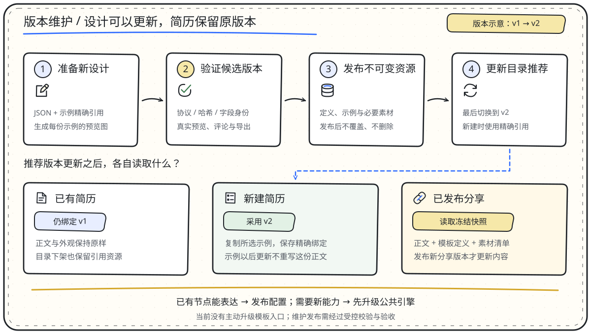
  </a>
</p>

新增模板时，如果现有节点已经能表达设计，发布 JSON、示例引用和预览素材即可。遇到解释器还不支持的排版，先扩展公共协议和解释器，发布支持它的前端，再发布模板资源。

已发布的定义、示例和素材都有固定版本。改设计时要发布新版本，最后更新目录里的推荐版本。已有简历继续使用创建时绑定的版本，模板下架后也会保留它引用的资源。目前还没有手动升级模板的入口。

模板相关代码分为[模板协议](./src/lib/resume-template/declarative/)、[内容映射](./src/lib/resume-template/content/)、[通用解释器](./src/components/resume/runtime/declarative-renderer.tsx)和[远端数据源](./src/lib/resume-template/source/)。如何维护版本、做发布前校验，以及验收协作、评论、分享和导出，见[模板维护手册](./docs/resume-template-maintenance.md)。

## 岗位定制与历史版本

同一段项目经历，投前端岗和全栈岗时，想重点写的部分可能不同。你可以根据岗位描述（JD）从基础简历创建独立副本。改动只影响这个岗位的简历，其他岗位的版本可以照常使用。

每个岗位副本都会记下它来自哪份简历。要看同一份简历前后改过什么，可以在历史版本里对比快照。如果决定恢复，系统会把选中的快照写回当前文档，并在历史里记下这次恢复。

在求职看板里，一个岗位对应哪份简历、面试到了第几轮、接下来要做什么，都能一起查看。看板里的简历可以继续编辑。想留住投递当天的内容，可以导出文件，也可以保留一份[固定分享快照](#分享与审阅明确对外版本)。

<p align="center">
  <a href="./docs/assets/readme/workflow.svg">
    
  </a>
</p>

<p align="center">
  <a href="./docs/assets/readme/screenshots/dashboard.jpg">
    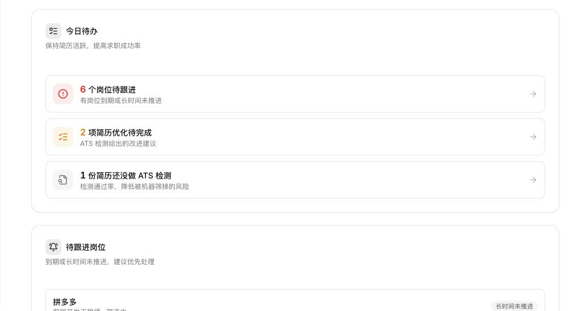
  </a>
</p>

## 简历优化：找到问题并逐项修正

如果报告指出“项目描述不具体”，你可以直接找到对应的那段经历，查看判断依据和修改建议，再逐项修改并跟踪进度。想看哪些岗位要求还没在经历里体现，可以做 JD 对比。ATS 纯文本预览则可以用来检查机器能读到哪些文字。

评估范围取决于简历里已经填写的内容。模型返回建议后，系统会整理格式，核对字段是否存在、修改值的类型是否正确。报告里的分数只供自查，不能用来判断简历能否通过招聘系统的筛选。

## AI Agent：在工作台内完成修改

在工作台里请 Agent 帮忙改简历，它可以直接读取当前的简历、评估结果和求职记录，按任务调用工具。写入之前，你会先看到改动前后的差异或操作摘要。确认后可以在右侧画布核对结果，尤其是经历和成果数字，这些需要你本人核实。

每次工具执行完，结果都会回到对话里。Agent 据此决定下一步，默认最多执行 12 步。任务用到哪项技能或参考资料，才会读取相应内容。

<p align="center">
  <a href="./docs/assets/readme/screenshots/assistant-workspace.jpg">
    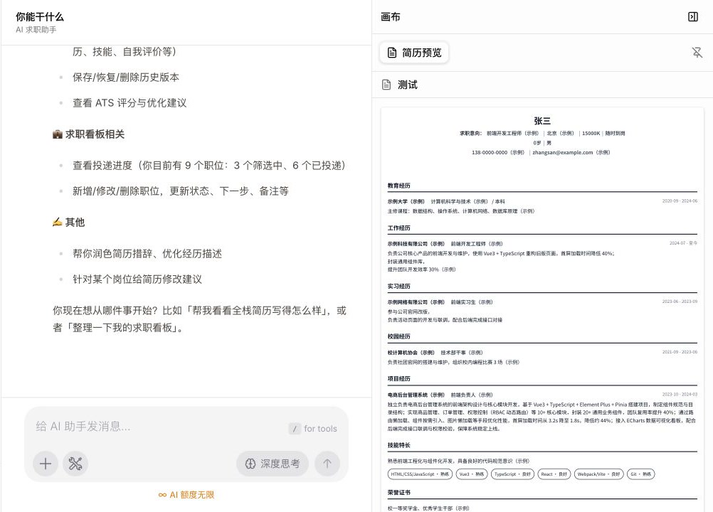
  </a>
</p>

模型会分段返回工具参数。工具要等参数收齐才执行，写入简历字段前还要校验类型，并等你确认。如果你中途停止对话，工具和等待确认的操作都会收到取消信号。每次写入前会再检查一次，已完成的修改会保留。

服务端代理负责转发模型请求，浏览器接触不到模型密钥。每个请求都有唯一标识，系统据此预留额度，再按实际交付情况结算。即使重试或响应中断，同一请求也不会重复扣减额度。

<p align="center">
  <a href="./docs/assets/readme/agent-control-plane.svg">
    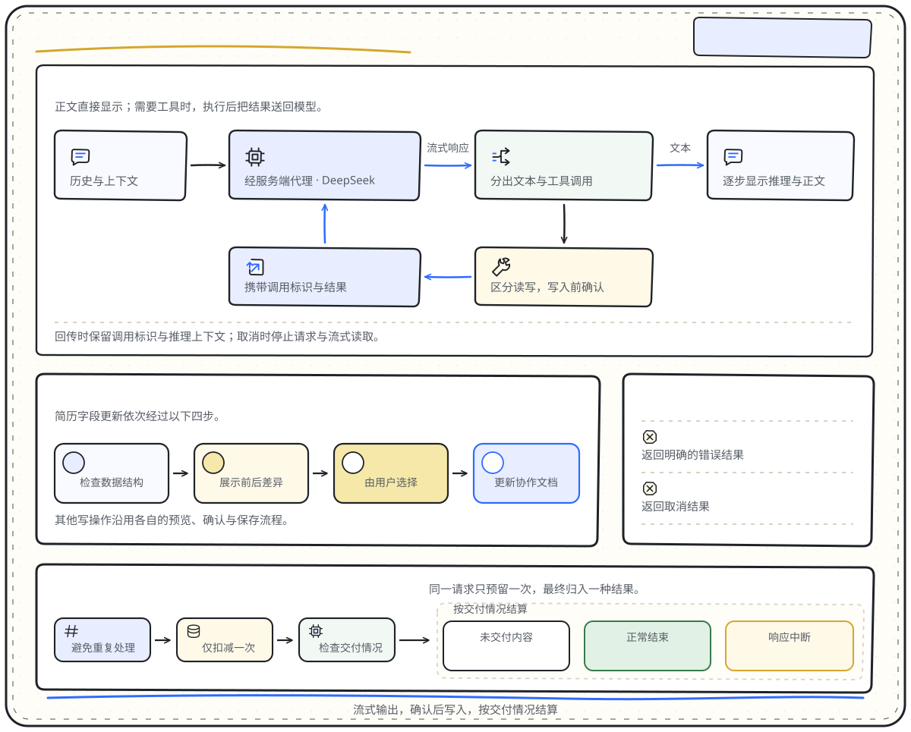
  </a>
</p>

## 分享与审阅：明确对外版本

分享链接打开的是发布那一刻的简历，正文和模板都已固定。你可以继续编辑自己的副本，等准备好让对方看到改动时，再把新版本发布到原链接。每个链接都能单独设置密码、有效期和评论权限，也能查看访问次数和最近一次访问时间。

<p align="center">
  <a href="./docs/assets/readme/product-sequence.svg">
    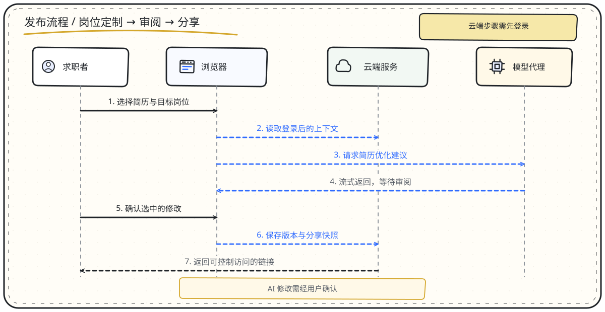
  </a>
</p>

审阅人可以直接选中原文留下意见。你改写段落后，同一个位置可能已经换成了另一句话，所以评论按版本保存，并记下所在段落、选中的原文和前后文。迁移到新版本时，只有找到唯一匹配的位置才会重新挂上评论。位置不确定的评论会保留，等待重新关联。

有新评论时，客户端会收到实时通知。如果断线漏了通知，客户端会按事件序号从日志补齐。评论同步和简历保存分别记录结果，评论同步出错不会影响已经成功的保存。

<p align="center">
  <a href="./docs/assets/readme/comment-anchoring-recovery.svg">
    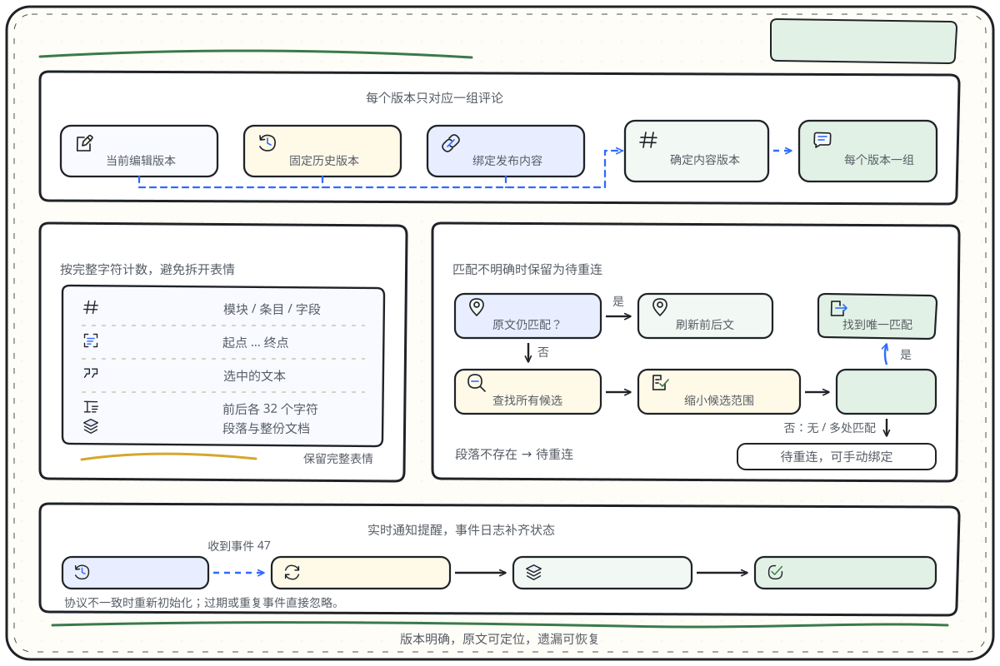
  </a>
</p>

## 实时协作：直接修改同一份简历

请朋友帮忙改简历时，你们可以同时编辑同一份文档。在富文本里能看到对方的光标和刚改过的文字，讨论时可以直接指出那一段，省去来回传文件、解释位置和合并修改的工夫。

表单按字段和条目编辑，沿用 Automerge 来合并增量修改。富文本要合并字符和格式的改动，用的是编辑器已有的 Yjs，也由它显示协作光标。这样可以保留原来的文档模型，代价是需要分别维护两套同步状态。

你正在输入时，即使收到对方的修改，也只有发生变化的字段会更新，焦点和光标留在原处。每次更新都带有来源标记，以免接收方把同一次改动再广播回去。新成员加入时会先补齐当前状态。两套引擎共用实时传输服务，各自负责合并和持久化。

<p align="center">
  <a href="./docs/assets/readme/dual-crdt-collaboration.svg">
    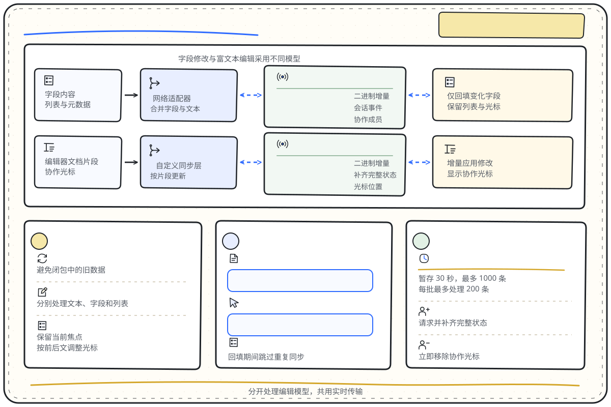
  </a>
</p>

## 分页与导出：交付前看清结果

PDF 沿用编辑器预览的页面结构和分页规则。浏览器把文字和图片排好后，程序根据实际的文本行和图片边界决定在哪儿换页。换字体或改正文都会触发重新测量。

字体加载会影响行高，也可能让一行字换到下一行。程序等字体就绪后再测量，最多尝试 8 帧，连续两帧结果一致才采用。打印前还会测量页面副本，对照预览时的布局摘要。如果两次结果不同，页面会提示错误。

Word 文件也从这份结构化内容生成。打开文件后，Word 会自行排版，交付前请在 Word 里核对字体和分页。

<p align="center">
  <a href="./docs/assets/readme/deterministic-a4-pagination.svg">
    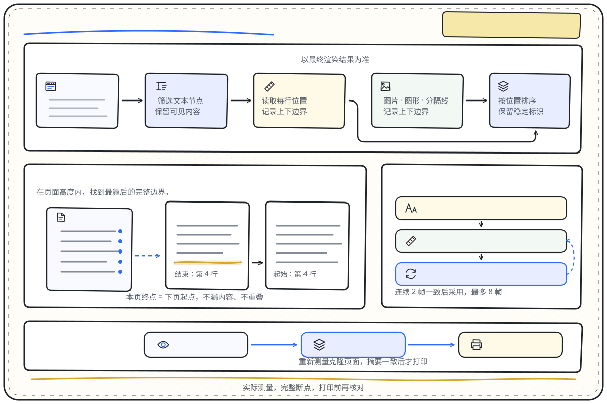
  </a>
</p>

## 本地运行与自托管

打开[工作台](https://506resume.cc/workspace)，点击“创建简历”就能开始填写，无需注册。输入和预览都在本地完成，编辑结果先存进浏览器的 IndexedDB，打字时不用等网络响应。清理站点数据前，请先导出简历，或确认已经同步。

登录后可以使用云同步、分享、协作、求职看板和 AI。数据库按用户权限隔离记录，需要特权的操作由服务端执行。本地编辑不会发起模型请求，只有调用 AI 时，服务端才会把这次任务所需的上下文发给模型。

<p align="center">
  <a href="./docs/assets/readme/architecture.svg">
    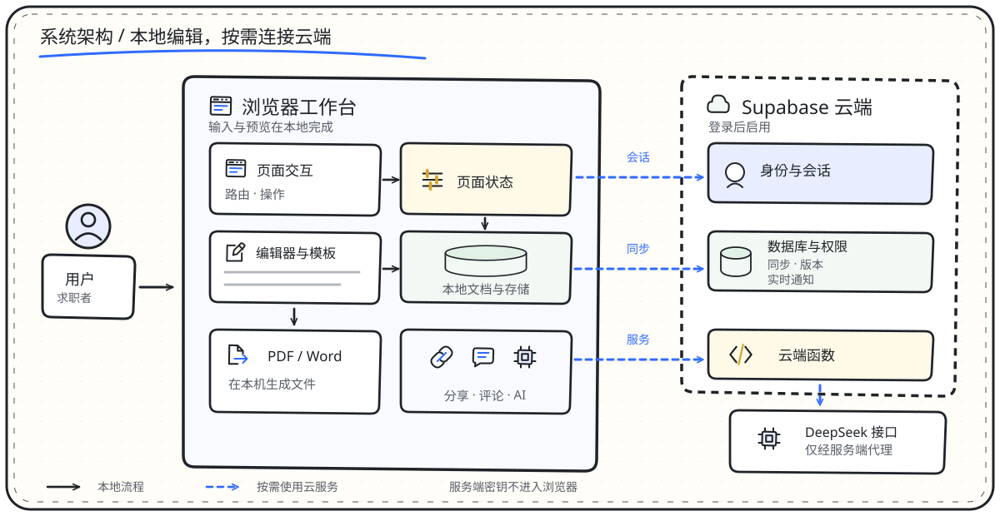
  </a>
</p>

本地开发需要 Node.js 24、pnpm 10.33.3 和可用的 Supabase 项目配置。先克隆仓库并安装依赖。

```bash
git clone https://github.com/506-FETL/resume.git
cd resume
corepack enable
pnpm install --frozen-lockfile
```

在项目根目录创建 `.env.local`，填入 Supabase 项目地址、可公开的密钥和本地访问地址。

```dotenv
VITE_SUPABASE_URL=https://your-project.supabase.co
VITE_SUPABASE_PUBLISHABLE_KEY=your-publishable-key
VITE_BASE_URL=http://localhost:5173
```

运行 `pnpm dev` 后，打开 `http://localhost:5173`。所有以 `VITE_` 开头的变量都会进入浏览器，服务端密钥请只放在服务端。要启用完整的云端功能，还需部署数据库和函数，步骤见[自托管指南](./docs/self-hosting.md)。

<p align="center">
  <a href="./docs/assets/readme/tech-badges.svg">
    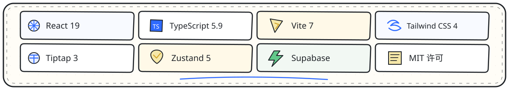
  </a>
</p>

## 开发与贡献

| 命令                | 用途                         |
| ------------------- | ---------------------------- |
| `pnpm dev`          | 本地开发                     |
| `pnpm lint`         | ESLint 代码质量检查          |
| `pnpm lint:fix`     | 自动修复 ESLint 问题         |
| `pnpm format`       | 补齐逻辑段落空行并格式化文件 |
| `pnpm format:check` | 检查代码规范、段落与格式     |
| `pnpm build`        | 生产构建，输出到 `dist/`     |
| `pnpm preview`      | 预览构建产物                 |

ESLint 检查 JavaScript、TypeScript 和 React 代码，Prettier 负责排版。`eslint-config-prettier` 会关闭两者冲突的格式规则。格式配置在 `.prettierrc`，忽略的文件在 `.prettierignore`。如果使用 VS Code，装好工作区推荐的 ESLint 和 Prettier 扩展，保存时就会自动修复和格式化。

准备变量、判断条件、处理数据和返回结果之间各留一个空行，函数和类型声明也要分段。一组简短变量或连续的提前返回可以写在一起。`@stylistic/padding-line-between-statements` 会补齐段落空行，Prettier 处理缩进、折行和多余空行。

运行 `pnpm format` 时，Prettier 先排版，ESLint 再修复布局。其他可自动修复的代码问题用 `pnpm lint:fix` 处理。完整约定见 [AGENTS.md](./AGENTS.md)。

报告问题时，请写清楚复现步骤，并移除示例中的真实简历和令牌。[提交 Issue](https://github.com/506-FETL/resume/issues)

PR 请说明改了什么、怎样验证。界面改动请附截图，数据库或协议有改动时，请说明对兼容性的影响。安全问题请通过维护者提供的联系方式私下报告。[维护者主页](https://github.com/506-FETL)

[MIT License](./LICENSE) · [更新日志](https://506resume.cc/changelog) · [第三方许可证](./public/licenses/)
