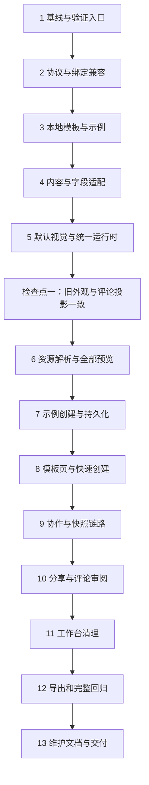

# 默认简历模板首期实现计划

> 维护状态（2026-10-23）：本地模板资源、一次性模板发布/验收工具及截图/PDF 已按用户要求清理。下文涉及这些路径和命令的内容是当时的实施记录；当前操作以 `docs/resume-template-maintenance.md` 为准。云端已发布资源保持不变。

> **面向 AI 代理的工作者：** 使用 `executing-plans` 技能按依赖顺序执行本计划，用复选框记录进度。默认在当前分支内联执行；只有用户选择子代理执行方式时，才使用 `subagent-driven-development`。仓库约定优先：不要求 TDD，不自动创建 worktree，不执行 `git push`。

**目标：** 只上线 `default@1`，贯通模板选择、示例创建与现有简历编辑链路，保留保存、实时协作、全文评论、分享、历史、PDF 和 Word 导出。

**架构：** 前端本地 `TemplateSource` 提供不可变模板定义与示例；公共内容适配器、受控视觉组件和统一运行时负责呈现。模板绑定包含精确版本，旧数据在读取边界归为默认模板；模板资源状态与简历可写状态分离。

**技术栈：** React 19、TypeScript、Zod、Zustand、Vite、现有 Automerge／Yjs、IndexedDB、Supabase 简历与分享服务、现有 A4 分页及导出组件。

**规格基线：** [简历模板架构与默认模板首期设计](/Users/shemingcong/Downloads/resume/docs/superpowers/specs/2026-10-21-resume-template-architecture-design.md)。

**编写日期：** 2026-10-21。**状态：** 实施计划已整理，尚未执行任何实施任务。

---

## 1. 执行边界与源码核对结论

本计划以仓库 `/Users/shemingcong/Downloads/resume` 为根目录；下文代码块内的文件路径均相对该目录。编写时分支为 `refactor/template`。执行时重新检查工作区，在当时的当前分支继续，不自动切换分支。

### 1.1 首期必须交付

- 模板页只展示默认模板，提供真实预览、只读预览弹窗和“使用模板”。
- 两份完整虚构示例：应届求职、前端工程师社招；快速创建固定使用应届示例。
- 使用模板后一次初始化完整快照，成功持久化后进入现有编辑器。
- 沿用当前本地／云端模式；游客可本地创建，登录不会自动上传。
- 全部旧简历、历史与旧分享按默认模板呈现；不批量迁移旧记录。
- 默认外观、已有模块与既有业务能力保持不变。
- 移除用户自定义模板工作台及其失去用途的前端代码。
- 写明增加模板、发布新版本、维护视觉组件与接入远端数据源的规则。

### 1.2 不进入执行任务

第二套正式模板、绿色时间轴视觉、双栏分页、模板切换／升级界面、所有者模板变更后端协议、远端模板读取、模板数据库表、模板发布后台、岗位筛选联动、头像、封面、求职信及 DOCX 重写。

现有云端简历、协作和分享仍然使用 Supabase；“模板配置放前端”只限制模板资源的来源。

### 1.3 需要落实的源码细节

| 代码事实                                                         | 实施约束                                                                |
| ---------------------------------------------------------------- | ----------------------------------------------------------------------- |
| `ResumeTemplateBinding` 已存在，但没有版本                       | 扩展现有字段，不另建与其竞争的绑定字段                                  |
| 预览、只读预览和历史 PDF 各自解析 manifest，失败时回退           | 统一解析；只允许明确的旧协议适配，不吞掉新引用错误                      |
| `visibility` 中 `true` 表示隐藏                                  | 沿用语义，不因命名直觉改成显示                                          |
| 评论字段含合成投影，如 `professionalDegree`、`duration`、`skill` | 复用既有投影，不自行拼出新的评论文本                                    |
| 申请信息当前显示为带边框标签                                     | 保留标签外观，不能把设计示例中的 `inline-fields@1` 理解为必须改成裸文本 |
| `createNewResume` 也供 AI `create_resume` 使用                   | 模板示例创建新增独立编排入口；AI 原有空白／指定内容语义保持             |
| `mapSourceToPersistedSnapshot` 被历史和分享复用                  | 不能在通用归一化时强制改写旧绑定、快照哈希或评论版本                    |
| `template_manifest` 是已有 JSONB，当前后端接收对象               | 首期沿用字段与接口；新定义放进 `definition` 扩展字段                    |
| `package.json` 声明的协作、评论、移动端及 AI 验证脚本有缺失      | 不把这些命令记为已通过；采用本计划的专项脚本与真实交互验证              |

编写计划时确认缺失的文件包括 `scripts/verify-realtime-collaboration.ts`、`scripts/verify-resume-comment-anchors.ts`、`scripts/verify-resume-comment-client.ts`、`scripts/verify-resume-comment-service.ts`、`scripts/verify-mobile-share-ai-stability.ts`、`scripts/verify-ai-resume-tools.ts`。执行时先复核；不为本次重构顺带恢复所有无关脚本。

## 2. 文件职责与依赖方向

先保留旧工作台可编译，在调用方全部迁移后集中移除。新协议暂放 `definition-schema.ts`，避免一开始改写 `schema.ts` 导致旧工作台、分享和运行时同时失效；清理后 `schema.ts` 只作为新协议出口，旧 manifest 类型归入兼容目录。

| 文件或目录                                                                                                         | 动作与职责                                              |
| ------------------------------------------------------------------------------------------------------------------ | ------------------------------------------------------- |
| `src/lib/resume-template/definition-schema.ts`                                                                     | 新增：模板协议、组件参数校验、精确引用与错误类型        |
| `src/lib/resume-template/source/types.ts`、`source/local.ts`                                                       | 新增：异步数据源契约及唯一的本地实现                    |
| `src/lib/resume-template/catalog/default.ts`                                                                       | 新增：默认模板目录项、默认版本和可用示例引用            |
| `src/lib/resume-template/definitions/default/v1.ts`                                                                | 新增：`default@1` 完整定义，发布后不可覆盖              |
| `src/lib/resume-template/examples/graduate-v1.ts`、`frontend-v1.ts`                                                | 新增：与视觉定义分离的完整示例                          |
| `src/lib/resume-template/compatibility/binding.ts`                                                                 | 新增：仅供读取的旧绑定识别与精确引用解析                |
| `src/lib/resume-template/compatibility/legacy-manifest.ts`、`share-manifest.ts`                                    | 新增：旧分享协议与新分享信封的解析、序列化              |
| `src/lib/resume-template/runtime/resolve-template.ts`、`resolve-appearance.ts`                                     | 新增：定义解析及无全局状态依赖的外观派生                |
| `src/lib/resume-template/content/types.ts`、`adapt-resume.ts`、`adapt-profile.ts`、`adapt-sections.ts`             | 新增：只读内容块、原字段身份和显示投影                  |
| `src/lib/resume-template/registry/visual-components.tsx`                                                           | 新增：实际实现与受控组件 ID 的映射                      |
| `src/store/resume-template/index.ts`                                                                               | 新增：跨页面模板目录、精确版本和示例资源缓存            |
| `src/hooks/use-resolved-resume-template.ts`                                                                        | 新增：解析状态、重试与过期请求隔离                      |
| `src/components/resume/fields/commentable-text/index.tsx`、`commentable-rich-text/index.tsx`、`projection.ts`      | 从旧 `renderers/shared.tsx` 提取公共字段能力            |
| `src/components/resume/template-layouts/single-column/v1/index.tsx`                                                | 提取当前单栏布局                                        |
| `src/components/resume/template-parts/*/v1/index.tsx`                                                              | 提取默认页头、标题、经历、富文本、技能与标签能力        |
| `src/components/resume/runtime/ResumeTemplateRuntime.tsx`、`TemplateRuntimeProviders.tsx`、`context/`              | 改造为配置驱动、显式快照与外观的只读运行时              |
| `src/lib/schema/resume/persisted.ts`、`entry-id.ts`                                                                | 扩展绑定版本；增加仅新建时使用的全量条目 ID 重分配      |
| `src/lib/resume-template/create/types.ts`、`prepare.ts`、`persist.ts`                                              | 新增：创建请求、完整快照构造、持久化编排                |
| `src/store/resume-creation/index.ts`                                                                               | 新增：两个创建入口共享的操作状态、固定操作 ID、失败重试 |
| `src/lib/supabase/resume/form.ts`、`src/lib/offline-resume-manager.ts`                                             | 增加完整快照插入，保留原有创建和上传 API 的兼容性       |
| `src/pages/template/{index.tsx,store.ts,types.ts,const.ts,utils.ts}`                                               | 重构为模板库页面骨架和页面状态                          |
| `src/pages/template/hooks/use-template-library.ts`                                                                 | 页面资源订阅、预览生命周期及创建衔接                    |
| `src/pages/template/components/{template-card,template-preview-dialog,template-preview,template-status}/index.tsx` | 卡片、预览、独立加载／错误状态                          |
| `src/pages/resume/components/create-resume-card/index.tsx`                                                         | 快速创建接入同一创建服务，去掉旧三类型选择              |
| `src/components/resume/scaled-readonly-preview.tsx`                                                                | 所有只读场景共用的解析与渲染入口                        |
| `src/pages/resume/editor/components/preview/index.tsx`                                                             | 编辑器和评论审阅预览接入                                |
| `src/pages/history/components/version-pdf-export/index.tsx`                                                        | 历史 PDF 使用相同解析与就绪条件                         |
| `src/lib/supabase/resume/share.ts`、`share.types.ts`                                                               | 发布和读取完整模板配置快照，保留脱敏与权限              |
| `src/pages/share/view/[token].tsx`、`src/pages/resume/editor/hooks/use-comment-review-mode.ts`                     | 使用冻结的分享配置；统一错误展示                        |
| `scripts/verify-resume-templates.ts`、`scripts/fixtures/resume-template/`                                          | 专项协议、身份、兼容、创建与渲染校验；不搭建新测试框架  |
| `docs/superpowers/plans/2026-10-21-resume-template-foundation-validation.md`                                       | 执行时创建：基线、命令结果、人工验收记录、发布限制      |
| `docs/resume-template-maintenance.md`                                                                              | 执行时创建：模板维护操作手册                            |

依赖方向固定为：`页面 → 资源 store／创建服务 → Source／纯协议`，`运行时 → 内容适配器＋视觉注册表＋公共字段`。`lib/schema/resume` 不得反向 import React、页面 store、Supabase 模板查询或完整模板目录。

## 3. 执行顺序与检查点



检查点一未通过时，不继续给用户开放新的创建入口。任务 9～12 验证的是既有业务接入，不重写这些子系统。

## 4. 实施任务

### 任务 1：固定改造前的默认模板基线

**文件：**

- 读取：`src/components/resume/runtime/renderers/`、`src/lib/template/fixtures/demo-resume.ts`、`src/features/resume-comments/anchors/document.ts`。
- 创建：`scripts/fixtures/resume-template/all-sections.json`、`legacy-cases.json`、`projection-baseline.json`。
- 创建：`scripts/verify-resume-templates.ts`、验收记录文档。
- 修改：`package.json`，只增加本任务专项命令。

- [x] **1.1 检查工作区、工具与脚本，不修复无关基线问题。**

```bash
git status --short
git branch --show-current
node --version
pnpm --version
rg --files scripts
pnpm exec tsc --noEmit -p tsconfig.app.json
pnpm build
```

记录真实退出码。若已有失败，记录文件和原因；本次影响的文件必须修复，不能把新增问题解释为基线，也不能用改配置关闭检查。

- [x] **1.2 建立虚构基线数据，不使用用户真实简历。**

以 `demoResumeData` 的字段结构为起点，固定所有条目 ID、日期和 `projectionReferenceDate = '2026-10-21'`。`all-sections.json` 包含全部 12 个模块、5 种经历、技能、荣誉、兴趣、申请信息及富文本；同一经历含正常条目、隐藏条目和空条目。富文本覆盖列表、换行、链接、中文、英文、emoji。由此派生长段落、多页、全隐藏、不同排序和第二套外观。

`legacy-cases.json` 明确包含：无绑定、无版本的 official/simple、official/modern、user、community 绑定以及旧分享 manifest。旧类型标签一律不作为独立视觉基线。

- [x] **1.3 保存原始投影与浏览器外观基线。**

用当前 `buildCommentAnchorDocument` 生成并保存文档节点、文本、块顺序及文档哈希到 `projection-baseline.json`，固定参考日期。用当前默认 manifest 渲染基线样本，记录页面数、标题／条目位置、字体加载状态、PDF 页数及 Word 内容。浏览器截图与 PDF 放到已忽略的 `.superpowers/template-baseline/`，验收文档记录路径和视口；不提交真实用户数据或二进制大文件。

- [x] **1.4 建立不依赖缺失脚本的专项检查入口。**

复用 `scripts/verify-assistant-stop-order.ts` 中 Vite `ssrLoadModule` 的加载方式，使用 `node:assert/strict`；别把源码字符串匹配当成行为验证。纯协议和适配器直接调用；浏览器状态、IndexedDB、分页、真实协作由后面的交互验收覆盖。

```json
{
  "verify:templates": "node --experimental-strip-types scripts/verify-resume-templates.ts"
}
```

脚本在异常时非零退出，在 `finally` 关闭 Vite server；每个用例输出名称和结果。最初只核对基线文件可读、投影稳定，后续任务向同一入口追加具体断言。

- [x] **1.5 记录基线并提交本任务文件。**

建议提交标题：`test(template): 固定默认简历与评论投影基线`。只暂存本任务文件，不推送。

### 任务 2：建立模板协议、精确引用与旧绑定兼容

**文件：** `definition-schema.ts`、`compatibility/binding.ts`、`src/lib/schema/resume/persisted.ts`、`scripts/verify-resume-templates.ts`。

- [x] **2.1 定义协议与错误结果，保持与数据库无关。**

使用 Zod strict object 校验所有嵌套对象；复用现有字体、主题、间距 schema 的取值范围。公开类型由 schema 推导，不维护第二套容易漂移的接口。核心形状如下，组件 ID 首期只接受列出的能力：

```ts
interface TemplateRef {
  templateId: string
  templateVersion: number
}

interface TemplateDefinition {
  schemaVersion: 1
  templateId: string
  version: number
  renderContract: 'resume-v1'
  layout: {
    component: 'single-column@1'
    sectionOrder: 'resume'
    sectionVisibility: 'resume'
  }
  header: {
    component: 'centered-profile@1'
    fieldBinding: 'profile-with-job-intent@1'
  }
  sectionHeading: { component: 'underline-heading@1' }
  contentByKind: {
    experience: {
      component: 'plain-entry-list@1'
      metaLayout: 'title-subtitle-inline-date-right'
    }
    richText: { component: 'plain-rich-text@1' }
    skills: { component: 'skill-badges@1' }
    fieldList: { component: 'inline-fields@1'; presentation: 'outlined-tags' }
    tagList: { component: 'tag-list@1' }
  }
  appearanceDefaults: ResumeAppearanceConfig
}

type TemplateErrorCode =
  | 'INVALID_BINDING'
  | 'INVALID_DEFINITION'
  | 'VERSION_NOT_FOUND'
  | 'UNSUPPORTED_CAPABILITY'
  | 'REFERENCE_MISMATCH'
  | 'LOAD_FAILED'
```

`ResumeAppearanceConfig` 使用 `src/lib/schema/resume/persisted.ts` 的现有类型。新增 `TemplateResolutionError extends Error`，携带上述 `code`，不携带用户正文。`fieldList.presentation` 是保持当前申请信息标签外观的明确参数，不增加新的产品选择项。

- [x] **2.2 扩展现有绑定，保持旧调用可读。**

```ts
export interface ResumeTemplateBinding {
  source: 'official' | 'community' | 'user'
  templateId: string
  templateVersion?: number
  basedOnResumeType?: ResumeType
}
```

`ResumeType` 的历史枚举暂不删除。`resolveResumeTemplateBinding` 遇到存在 `templateVersion` 属性的绑定时原样保留其字段，不补 `basedOnResumeType`，不把不合法版本抹掉。旧分支保持已有快照归一化行为；新协议的校验在模板读取边界完成，配置错误不能阻止正文被加载和保存。

- [x] **2.3 实现只读引用解析，不在转换器中写回文档。**

新增 `resolveTemplateReference(binding: unknown): TemplateRef`。用 `Object.prototype.hasOwnProperty.call(binding, 'templateVersion')` 区分新旧协议，不能用真值判断：版本为 `0`、`null`、字符串或缺失 ID 的新绑定都应报错。无绑定或合法旧对象没有版本时返回默认引用；数组、非对象等坏数据报 `INVALID_BINDING`。明确版本的引用要求 `source === 'official'`、非空 ID、正整数版本。

```ts
const DEFAULT_TEMPLATE_REF = {
  templateId: 'default',
  templateVersion: 1,
} as const

// 只从解析结果生成新记录；不用于重写既有历史或分享对象。
function toTemplateBinding(ref: TemplateRef): ResumeTemplateBinding {
  return { source: 'official', ...ref }
}
```

两个函数放 `compatibility/binding.ts`；低层 `persisted.ts` 不 import 模板运行时。不要把旧 `simple`／`modern` 注册成正式新模板。

- [x] **2.4 加入协议断言并执行。**

```ts
assert.deepEqual(resolveTemplateReference(undefined), DEFAULT_TEMPLATE_REF)
assert.deepEqual(
  resolveTemplateReference({ source: 'user', templateId: 'legacy-user-id' }),
  DEFAULT_TEMPLATE_REF,
)
assert.deepEqual(
  resolveTemplateReference({
    source: 'official',
    templateId: 'default',
    templateVersion: 2,
  }),
  { templateId: 'default', templateVersion: 2 },
)
assert.throws(() =>
  resolveTemplateReference({
    source: 'official',
    templateId: 'default',
    templateVersion: 0,
  }),
)
```

版本 2 的引用格式合法，但数据源必须在找不到定义时报 `VERSION_NOT_FOUND`。再覆盖 `null` 版本、未知 source、额外脚本字段、参数越界和 schemaVersion 不支持；原输入深冻结后调用，确认无原地修改。

运行 `pnpm verify:templates` 与 `pnpm exec tsc --noEmit -p tsconfig.app.json`。建议提交：`feat(template): 增加模板协议与旧绑定兼容`。

### 任务 3：提供本地默认定义、目录和独立示例

**文件：** `source/types.ts`、`source/local.ts`、`catalog/default.ts`、`definitions/default/v1.ts`、`examples/graduate-v1.ts`、`examples/frontend-v1.ts`。

- [x] **3.1 固定异步 Source 契约。**

```ts
interface ExampleRef {
  exampleId: string
  version: number
}
interface ResumeExample {
  exampleId: string
  version: number
  name: string
  projectionReferenceDate: string
  content: Pick<
    PersistedResumeSnapshot,
    keyof ResumeSchema | 'order' | 'visibility'
  >
}
interface TemplateCatalogItem {
  templateId: string
  name: string
  description: string
  currentVersion: number
  defaultExample: ExampleRef
  examples: ExampleRef[]
}
interface TemplateSource {
  listTemplates(): Promise<TemplateCatalogItem[]>
  getTemplateVersion(ref: TemplateRef): Promise<TemplateDefinition>
  getExample(ref: ExampleRef): Promise<ResumeExample>
}
```

上述类型放 `source/types.ts`，引用既有 `ResumeSchema`、`PersistedResumeSnapshot` 和任务 2 的类型。首期不增加筛选参数、分页 UI 或空壳 Remote Provider。

- [x] **3.2 建立唯一的 `default@1` 真源。**

`definitions/default/v1.ts` 导出 `defaultTemplateV1`，采用规格 §6.2 的完整配置，申请信息补 `presentation: 'outlined-tags'`。用 `templateDefinitionSchema.parse` 在资源边界校验；定义中不放示例正文、保存回调、React 组件或数据库查询。

目录项为：`templateId: 'default'`、名称“默认模板”、`currentVersion: 1`、默认示例 `{ exampleId: 'graduate', version: 1 }`，另一个示例为 `{ exampleId: 'frontend', version: 1 }`。卡片首期采用公共只读预览生成真实缩略效果，不引入截图生成服务。

- [x] **3.3 编写两份内容完整、互相独立的示例。**

两份示例都采用现有 schema。应届示例重点展示教育、实习、项目、校园、技能和荣誉；社招示例重点展示教育、两段工作、项目、技能和自我评价。未展示模块仍有合法结构，按适用性设置隐藏状态；不为凑模块编造头像等新字段。联系方式使用虚构信息与 `example.com` 邮箱。

示例 ID 固定用于预览；示例没有用户 ID、真实 resume ID、历史或评论数据。示例自身不保存模板绑定和视觉外观，预览／创建时由选择的定义补齐。

- [x] **3.4 实现本地精确版本索引。**

```ts
const definitions = new Map<string, TemplateDefinition>([
  ['default@1', defaultTemplateV1],
])

function templateKey(ref: TemplateRef): string {
  return `${ref.templateId}@${ref.templateVersion}`
}
```

`templateKey` 放 `source/types.ts` 作为共用纯函数。`localTemplateSource` 在成功读取后返回副本；内部版本常量不暴露给调用方修改。不存在的精确版本抛 `VERSION_NOT_FOUND`；不读取登录状态，不 import `src/lib/supabase/template`。

- [x] **3.5 验证目录和隔离性。**

断言目录只有一项，两个示例符合正文 schema；修改一次返回的示例不影响下一次读取；查 `default@2` 拒绝；修改目录介绍不改变 `default@1`。运行专项校验和类型检查。建议提交：`feat(template): 提供本地默认模板与独立示例`。

### 任务 4：提取公共字段和只读内容适配器

**文件：** `content/`、`fields/`、`renderers/shared.tsx`、`runtime/context/`。现有各 Renderer 作为提取依据，先不删除。

- [x] **4.1 原样提取评论字段实现。**

将 `CommentableText` 移至 `fields/commentable-text/index.tsx`，`CommentableRichText` 及其 DOM 块处理移至 `fields/commentable-rich-text/index.tsx`，`buildCommentNodeKey`、`useCommentProjectionNode` 移至 `fields/projection.ts`。旧 `shared.tsx` 暂时 re-export，保证迁移期调用方可编译。

保持 `data-comment-node-key`、`data-comment-block-ordinal`、字段标签、净化流程、投影回退和富文本 class/style 数值；不得只复制属性名称而重新实现文本算法。

- [x] **4.2 定义有来源身份的只读内容类型。**

```ts
interface ContentField {
  sectionKey: keyof ResumeSchema
  entryId: string
  fieldKey: string
  nodeKey: string
  label: string
  text: string
}
interface ExperienceContent {
  entryId: string
  title?: ContentField
  subtitle?: ContentField
  duration?: ContentField
  description?: { field: ContentField; html: string }
}
interface SkillContent {
  field: ContentField
  proficiencyLevel: SkillItem['proficiencyLevel']
  displayType: SkillItem['displayType']
}
type ContentBlock =
  | { kind: 'experience'; items: ExperienceContent[] }
  | { kind: 'richText'; field: ContentField; html: string }
  | { kind: 'skills'; items: SkillContent[] }
  | { kind: 'fieldList'; items: ContentField[] }
  | { kind: 'tagList'; items: ContentField[] }
interface ContentSection {
  key: keyof ResumeSchema
  title: string
  blocks: ContentBlock[]
}
interface ProfileContent {
  name?: ContentField
  jobIntent: ContentField[]
  meta: ContentField[]
  contact: ContentField[]
}
interface AdaptedResumeContent {
  profile: ProfileContent | null
  sections: ContentSection[]
}
```

这里的 `text` 取自现有评论投影节点，非另一次格式化；`html` 取自原业务字段，经公共字段组件净化。`SkillItem` 使用现有 `src/lib/schema/resume/form/skillSpecialty.ts` 导出的类型，保留等级和显示类型，默认标签仍只渲染原评论文本，未来进度条可读取真实等级。内容模型只用于渲染，不进入 Automerge 或数据库。

- [x] **4.3 建立页头与模块映射。**

`adaptResumeContent(data, commentNodesByKey)` 返回 `AdaptedResumeContent`；`adapt-profile.ts` 提取默认 `BasicsRenderer` 的单栏字段顺序，`adapt-sections.ts` 提取以下映射。适配前沿用 `buildTemplateResumeData` 的既有正文归一化。

| 模块                    | 名称节点／副标题节点               | 富文本原字段     | 日期投影   |
| ----------------------- | ---------------------------------- | ---------------- | ---------- |
| `edu_background`        | `schoolName`／`professionalDegree` | `eduInfo`        | `duration` |
| `work_experience`       | `companyName`／`position`          | `workInfo`       | `duration` |
| `internship_experience` | `companyName`／`position`          | `internshipInfo` | `duration` |
| `campus_experience`     | `experienceName`／`role`           | `campusInfo`     | `duration` |
| `project_experience`    | `projectName`／`participantRole`   | `projectInfo`    | `duration` |

各经历的日期原字段和空条目判断逐一沿用原 Renderer；富文本评论 `fieldKey` 仍为 `content`。技能保留一个 `skill` 节点，荣誉／兴趣保留原 `name` 节点；description 和列表输出为同一模块的不同 block。申请信息使用 `fieldList`。

页头吸收求职信息后不再生成同一份求职信息正文。不能将年龄、学历、时间范围、技能等级交给每个模板重新格式化。

- [x] **4.4 保留排序、隐藏和空内容规则。**

以 `data.order` 决定模块顺序，以 `getVisibility` 决定隐藏，保留原条目数组顺序与 `entryId`，不 sort 原数组。保留当前“模块可显示但内容为空时是否保留标题”的真实行为，不统一删掉所有空模块。只读适配器不能触发 store setter。

- [x] **4.5 比较节点投影，确认提取没有改变身份。**

```ts
const before = JSON.stringify(snapshot)
const first = adaptResumeContent(data, commentNodesByKey)
const second = adaptResumeContent(data, commentNodesByKey)
assert.deepEqual(first, second)
assert.equal(JSON.stringify(snapshot), before)
```

其中 `snapshot`、`data`、`commentNodesByKey` 均由任务 1 的固定样本和现有投影构造。专项校验还要逐项比较基线节点 key、text、blocks 与 hash；快照参考日期保持固定。建议提交：`refactor(template): 提取内容适配与公共评论字段`。

### 任务 5：提取默认视觉能力并改造统一运行时

**文件：** `template-layouts/`、`template-parts/`、`registry/visual-components.tsx`、`runtime/resolve-appearance.ts`、`ResumeTemplateRuntime.tsx`、`TemplateRuntimeProviders.tsx`、`use-resume-styles.ts`。

- [x] **5.1 按现有 DOM 和样式提取首期视觉部件。**

| 注册 ID               | 文件（均位于 `src/components/resume/`）         | 提取来源                                   |
| --------------------- | ----------------------------------------------- | ------------------------------------------ |
| `single-column@1`     | `template-layouts/single-column/v1/index.tsx`   | `runtime/layouts/SingleColumnSkeleton.tsx` |
| `centered-profile@1`  | `template-parts/centered-profile/v1/index.tsx`  | `BasicsRenderer` 单栏分支                  |
| `underline-heading@1` | `template-parts/underline-heading/v1/index.tsx` | `RuntimeSection` 的标题                    |
| `plain-entry-list@1`  | `template-parts/plain-entry-list/v1/index.tsx`  | `RuntimeEntry` 与原条目列表容器            |
| `plain-rich-text@1`   | `template-parts/plain-rich-text/v1/index.tsx`   | 公共富文本字段，无额外卡片                 |
| `skill-badges@1`      | `template-parts/skill-badges/v1/index.tsx`      | `SkillsRenderer` 的标签                    |
| `inline-fields@1`     | `template-parts/inline-fields/v1/index.tsx`     | `ApplicationInfoRenderer` 的标签           |
| `tag-list@1`          | `template-parts/tag-list/v1/index.tsx`          | 荣誉／兴趣的共同标签                       |

同类标签可共享不带业务语义的内部容器；不为教育、工作、实习各复制一份视觉实现。每个模板只选择一次标题与经历组件。

- [x] **5.2 提取纯外观计算，禁止只读预览串用全局设置。**

新增 `resolveResumeAppearanceStyles(appearance: ResumeAppearanceConfig)`，逐字保留 `useResumeStyles` 的字号比例、字体权重、主题映射和间距数值。旧 hook 只负责获取 store 或显式 override，然后调用此纯函数；运行时直接接收规范化后的完整外观。

```ts
interface ResumeTemplateRuntimeProps {
  data: TemplateResumeData
  definition: TemplateDefinition
  appearance: ResumeAppearanceConfig
  projectionReferenceDate: string
}
```

运行时 props 中外观和参考日期必填。当前编辑器传自己的外观；历史、分享和示例传自己的快照值，不默认读取当前编辑器 store。参考日期由调用方沿用当前业务规则，不能在每个部件内调用 `new Date()`。

- [x] **5.3 用注册表组合内容，不再在模块函数中决定模板风格。**

`visual-components.tsx` 按 layout、header、heading、experience、richText、skills、fieldList、tagList 分别建立类型化注册表。运行时先校验定义与能力，再由 `contentByKind[block.kind]` 选择对应部件；用判别联合的 `switch` 保证 props 类型收窄，不通过 `any` 或动态代码执行绕过类型。

所有模块继续使用 `data-section` 外层与 `resume-section-*` 定位 ID；同一文档中的字段只输出一次。章节号、图标和分隔符必须位于评论字段节点外；不把 `aria-hidden` 当成投影过滤器。

- [x] **5.4 在改调用方前保留临时兼容入口。**

旧调用尚未迁移时，可在原运行时入口把旧 manifest 转为默认定义，再调用新内部实现；这一桥接仅接受旧协议。带新 `definition` 的信封必须验证后再用，不能统一忽略 manifest。任务 6 和 10 完成后移除临时 props 双轨。

- [x] **5.5 通过检查点一。**

运行专项投影与默认渲染校验，浏览器对比任务 1 的短／长／全模块样本。姓名、求职信息、申请标签、模块标题、条目副标题、时间列、富文本与分页应与基线一致；正文身份及文本完全相同。抗锯齿像素差异可记录，节点顺序、字号、间距或页数差异必须解释并修复，不能更新基线掩盖回归。

建议提交：`refactor(template): 以可复用视觉能力渲染默认模板`。

### 任务 6：统一资源解析和所有预览入口

**文件：** `runtime/resolve-template.ts`、`src/store/resume-template/index.ts`、`src/hooks/use-resolved-resume-template.ts`，编辑预览、只读预览、历史 PDF。

- [x] **6.1 实现精确版本解析与可区分的结果。**

```ts
async function resolveTemplate(
  source: TemplateSource,
  binding: unknown,
): Promise<TemplateDefinition> {
  const ref = resolveTemplateReference(binding)
  const definition = templateDefinitionSchema.parse(
    await source.getTemplateVersion(ref),
  )
  if (
    definition.templateId !== ref.templateId ||
    definition.version !== ref.templateVersion
  ) {
    throw new TemplateResolutionError(
      'REFERENCE_MISMATCH',
      '模板版本与请求不一致',
    )
  }
  return definition
}
```

把 schema 异常映射为 `INVALID_DEFINITION`，受支持协议内未知组件映射为 `UNSUPPORTED_CAPABILITY`。不 catch 后返回默认定义。分享冻结定义的解析在任务 10 的兼容适配器中完成，不调用目录最新版本。

- [x] **6.2 建立独立的资源缓存与加载状态。**

```ts
type ResourceState<T> =
  | { status: 'idle' }
  | { status: 'loading'; requestId: number }
  | { status: 'ready'; data: T }
  | { status: 'error'; error: TemplateResolutionError }
```

模板 store 分开保存目录、`templateKey(ref)` 对应的定义、`exampleId@version` 对应的示例。相同 key 的进行中请求去重；失败可重试；不同 key 完成后各自展示。Source 通过模块组合入口固定为 `localTemplateSource`，页面和组件不直接 import 定义文件。

- [x] **6.3 处理异步切换和预览关闭。**

hook 接受绑定或经校验的冻结定义；引用变化立即进入该引用的真实状态，不让上一份定义继续冒充成功。用请求序号／effect cleanup 忽略旧结果。关闭预览只结束当前订阅，不清空其他页面共用的缓存，不把远端预留能力实现为无用轮询。

- [x] **6.4 迁移全部预览消费者。**

改造下列文件，去掉各自的 `getBuiltInTemplateManifest` 和静默回退：

```text
src/pages/resume/editor/components/preview/index.tsx
src/components/resume/scaled-readonly-preview.tsx
src/pages/history/components/version-pdf-export/index.tsx
src/pages/history/components/shared/history-resume-preview/index.tsx
src/pages/tracker/components/drawer/document/index.tsx
src/pages/assistant/components/assistant-canvas/resume-preview/index.tsx
```

后三个调用方继续传入其现有 `snapshot/data` 外观。编辑器的评论审阅 override 仍优先于实时内容，最终类型在任务 10 收口。`contentVersion`／布局签名含精确模板版本；加载或错误时导出不可用，正文表单仍可编辑和保存。

- [ ] **6.5 验证隔离与错误。**

用可控 deferred Source 让 A 请求晚于 B 完成，确认 B 预览不被覆盖；用不存在的版本确认显示错误且未写回绑定；同时打开编辑器、历史预览、模板预览，三者使用不同外观，切换编辑器主题不影响另两者。专项脚本验证资源状态；浏览器验证 DOM 与分页。

建议提交：`refactor(template): 统一模板解析与预览状态`。

### 任务 7：统一示例初始化、本地创建和云端创建

**文件：** `create/types.ts`、`create/prepare.ts`、`create/persist.ts`、`src/store/resume-creation/index.ts`、`entry-id.ts`、`form.ts`、`offline-resume-manager.ts`。

- [x] **7.1 固定创建操作契约。**

```ts
interface CreateTemplateResumeInput {
  template: TemplateRef
  example: ExampleRef
  mode: 'local' | 'cloud'
  displayName: string
  description: string
}
interface PreparedResumeCreation {
  operationId: string
  resumeId: string
  mode: 'local' | 'cloud'
  ownerId: string | null
  displayName: string
  description: string
  snapshot: PersistedResumeSnapshot
}
interface CreatedTemplateResume {
  resumeId: string
  mode: 'local' | 'cloud'
  displayName: string
  description: string
  createdAt: string
  updatedAt: string
  type: 'default'
}
```

调用开始时固定模式和云端用户身份；创建中模式／账号变化不得把原操作改投到另一处。`operationId` 使用 UUID，云端 `resumeId` 使用同一个 UUID，本地使用 `local-${operationId}`。

- [x] **7.2 为新建示例重分配全部条目 ID。**

在现有 `entry-id.ts` 中增加 `cloneResumeWithFreshEntryIds`，复用其私有集合清单和 `createResumeEntryId`，不导出另一份重复列表。

```ts
export function cloneResumeWithFreshEntryIds(
  resume: ResumeSchema,
): ResumeSchema {
  const clone = structuredClone(resume)
  for (const collection of RESUME_ENTRY_COLLECTIONS) {
    for (const entry of readCollection(clone, collection)) {
      if (isRecord(entry)) entry.entryId = createResumeEntryId()
    }
  }
  return clone
}
```

只在第一次准备新建操作时调用；重试复用同一准备结果。既有记录的打开、恢复、分享、协作、手动上传禁止调用此函数。

- [x] **7.3 构造完整快照，不调用现有编辑 store。**

`prepareTemplateResume(input, source, identity)` 并发读取定义与示例，全部校验成功后复制内容，写入 `order`、`visibility`、`type: 'default'`、`templateBinding`、模板默认外观。正文仅包含 schema 中的内容字段，不写入 `exampleId` 等目录信息；示例版本只影响初始化来源。

生成后的 `PreparedResumeCreation` 在一个操作中固定下来，失败重试不得重新抓取“当前版本”或重新随机生成条目身份。

- [x] **7.4 增加完整快照的两种持久化适配器。**

`form.ts` 新增 `createResumeFromSnapshot(prepared)`，使用既有 `RESUME_PERSISTED_FIELDS` 白名单，把 `templateBinding` 转为 `template_binding`，一次 insert 全部内容、外观及名称。写入用户 ID 来自当下认证，并与准备阶段 ownerId 相等；不要让输入覆盖 `user_id`。不经过“创建空记录→update 内容→打开编辑器”。

`offline-resume-manager.ts` 新增 `createOfflineResumeFromSnapshot(prepared)`，在现有 IndexedDB `resumes` store 单事务中 `add` 完整记录。旧的 `createOfflineResume` 和 `createNewResume` 保留原语义，避免 AI 或其他调用被强制预填示例；可共享低层插入函数，但不能共享是否播种的决策。

- [x] **7.5 处理重复提交与不确定结果。**

`persistPreparedResume(prepared)` 在重试前按预分配 `resumeId` 查询当前所有者记录。存在则确认成功并返回，不重新覆盖其内容；不存在才 insert。查询失败表示结果仍未知，保持操作身份并提示重试；不得自动换 UUID。插入唯一键冲突再次按当前所有者读取确认；云端禁止 upsert 覆盖用户随后已编辑的数据。

本地同样利用 key 唯一性，`add` 冲突后读取已存在记录。普通失败与“结果待确认”在创建 store 中分开；退出页面可以保留当前会话中的操作以重试，不能把正文副本存入 localStorage。首期不额外承诺刷新后的创建事务恢复。

- [x] **7.6 创建成功后才更新列表和当前简历。**

共享创建 store 提供 `start(input)`、`retry()`、`reset()`；`start` 在 loading 状态不创建第二个操作，`retry` 复用 prepared。成功后由 UI 衔接调用现有 `addResume`、`setCurrentResume` 和 `/resume/editor` 导航。失败不清空当前 store；账号已切换时不把旧账号结果注入新账号列表。

- [x] **7.7 验证一次初始化和幂等重试。**

专项脚本使用假的持久化适配器，断言两次 prepare 的条目 ID 集合不相交、模板／示例原件不变、一次 start 只有一次准备；模拟“服务端已写入但响应丢失”，retry 只返回同一 resumeId；模拟查询也失败时不重新插入。浏览器再做本地 IndexedDB 与云端真实创建、刷新、断网重试。

建议提交：`feat(template): 统一完整示例创建与失败重试`。

### 任务 8：接入模板库、预览弹窗和快速创建

**文件：** `src/pages/template/` 的新页面结构、`src/pages/resume/components/create-resume-card/index.tsx`、已有创建卡片调用方。

- [x] **8.1 用 history-style 页面骨架替换工作台入口。**

创建 `store.ts`、`types.ts`、`hooks/use-template-library.ts` 和四个组件目录；保留 `const.ts`、`utils.ts` 但移除工作台专用状态。页面 store 管当前预览目标与示例选择，跨入口创建操作放任务 7 的创建 store，简历正文仍只在既有 store。

旧 `store/index.ts` 在迁移期只供旧组件使用；新页面统一显式导入 `store.ts`，避免目录与文件同名解析歧义。任务 11 删除旧目录。

- [x] **8.2 渲染一张默认模板卡片，资源独立加载。**

页面挂载立即读本地目录，不等登录、不读用户模板、不读用户全部简历。卡片显示名称、说明、“预览”“使用模板”；缩略图使用默认示例与默认定义。缩略图或预览失败分别显示重试，不把页面全部锁住；创建按钮依赖的定义／示例必须准备成功。

- [x] **8.3 实现只读预览与示例切换。**

`template-preview` 使用 `ScaledReadonlyPreview` 和显式示例快照，不调用 `setCurrentResume`、`loadResume` 或 form setter。切换应届／社招仅改变预览资源引用；预览中的“使用模板”使用当前示例，卡片直接使用固定默认示例。关闭弹窗不创建记录。

弹窗有 `DialogTitle`、`DialogDescription`，内容短屏可滚动，按钮可键盘访问；按现有 primitive 使用正确状态属性，不修改共享 Dialog 动画实现来完成局部页面。

- [x] **8.4 两个入口调用相同的创建操作。**

```ts
const input: CreateTemplateResumeInput = {
  template: { templateId: 'default', templateVersion: 1 },
  example: { exampleId: 'graduate', version: 1 },
  mode: effectiveOnline ? 'cloud' : 'local',
  displayName,
  description,
}
await useResumeCreationStore.getState().start(input)
```

生产 UI 从目录项取得引用，以上展示快速创建的固定结果。`effectiveOnline` 复用列表现有模式：快速创建保留 `online ?? isOnline` 的优先级，游客按现有规则进入本地模式；不能用“已登录”替代“用户选择云端”。云端会话失效走认证错误，不偷偷本地创建。

快速创建保留名称／描述表单，移除 default／modern／simple 选择器。核对 `onCreated` 的所有调用方，确定只有一个导航责任方；两入口成功后都进入 `/resume/editor`，不能出现创建成功仍停在模板页。

- [x] **8.5 实施动效与界面验收。**

使用 `src/lib/motion.ts` 的预设，所有新增 Motion 组件接入 `useReducedMotion()`；不要让简历正文做持续缩放影响分页测量。弹窗连续两轮打开／关闭，再测退出未结束时重开；减少动效模式、Esc、焦点恢复、移动端滚动均通过。

建议提交：`feat(template): 接入默认模板选择与预览创建`。

### 任务 9：核对保存、协作、上传、历史和派生链路

**核对文件：**

```text
src/store/resume/helpers/transform.ts
src/store/resume/helpers/sync-service.ts
src/store/resume/form.ts
src/store/resume/slices/document.ts
src/lib/automerge/document/schema.ts
src/lib/automerge/document/factory.ts
src/lib/automerge/document/sync.ts
src/lib/automerge/document/persistence.ts
src/lib/offline-resume-manager.ts
src/lib/supabase/resume/form.ts
src/lib/supabase/resume/history/queries.ts
src/lib/supabase/resume/history/restore.ts
src/lib/supabase/resume/history/snapshot.ts
src/lib/supabase/resume/variant.ts
src/pages/history/utils.ts
src/pages/tracker/components/drawer/document/index.tsx
```

只修改真实丢字段或不兼容的位置，不为“接入模板”重写上述全部文件。

- [x] **9.1 跟踪模板版本在快照中的往返。**

用固定 `default@1` 完整快照，逐次经过 store payload、Automerge 文档、云端字段映射和本地 hydrate，检查版本／外观／entryId 不丢失。新绑定保持明确版本；旧绑定只在渲染时解析成默认模板，不在 hydration effect 中发整份文档迁移。

- [x] **9.2 验证主动上传与登录模式。**

本地创建并改写示例后登录，确认仍在本地；主动上传后比较全部内容、顺序、隐藏状态、外观与条目身份。允许沿用现有本地 ID 到云端 ID 的转换；不允许重置条目 ID 或重新播种示例。

- [x] **9.3 验证历史、派生与跟进快照。**

历史保存／预览／恢复、派生简历创建、跟进文档快照保留新绑定。旧快照只读前后序列化值与原哈希不变；恢复沿用原历史语义，不能在恢复后执行创建服务。跟进预览和 AI 画布不读取当前编辑器外观。

- [ ] **9.4 用两个真实会话验证协作。**

所有者和协作者同时编辑不同结构字段，再同时编辑富文本，检查光标、远端增量与刷新后的数据。增删／排序经历和隐藏条目后检查渲染一致。记录 Automerge 文档 ID、协作会话 ID、富文本 fragment key 在打开预览前后未变；不因为适配视觉内容重排底层数组或重建 Yjs 文档。

首期不开放模板变更按钮，不把现有 `setTemplateBinding` 当成已完成所有者权限保护。未来开放第二套可切换模板前，必须实施规格 §9.2 的服务端权威变更协议。

- [x] **9.5 验证 AI 创建语义未被改变。**

AI `create_resume` 选择空白时没有示例内容；传 sections 时保持传入内容。旧 type 参数可以保留兼容，但 UI 不再声称它对应首期其他正式视觉模板。记录结果，不借本任务重写 AI 工具创建流程。

建议提交：`fix(template): 保持快照与协作链路的模板版本`；如果纯验证无代码修复，写入验收记录即可，不制造空修复提交。

### 任务 10：接入分享冻结配置和评论审阅

**文件：** `compatibility/legacy-manifest.ts`、`compatibility/share-manifest.ts`、`share.ts`、`share.types.ts`、分享页、`use-comment-review-mode.ts`。

- [x] **10.1 建立分享信封类型与唯一序列化入口。**

```ts
type PublishedTemplateManifest = LegacyTemplateManifest & {
  definition: TemplateDefinition
}

declare function serializeTemplateForShare(
  definition: TemplateDefinition,
): PublishedTemplateManifest

declare function parseSharedTemplateDefinition(
  input: unknown,
): TemplateDefinition
```

`LegacyTemplateManifest` 从旧 `schema.ts` 迁入兼容目录；序列化器只支持首期 `default@1`，从它生成旧默认 layout／sections／tokens／rules，附带 `definition`。不要再保留一份人工编辑的 default manifest；当前默认定义是唯一设计真源。

- [x] **10.2 严格区分新信封和旧快照。**

输入有 `definition` 属性时，无论值是否为 null，都走新信封校验；比对外层 `id/version` 与内层 `templateId/version`，并校验协议和能力。新信封出错直接拒绝，不能再尝试旧解析。没有 `definition` 的合法旧 manifest 才转换为默认定义；转换不改原对象。

旧分享中的源类型不触发私有模板查询。未知对象不能因“没有 definition”就被认定为合法旧分享。

- [x] **10.3 发布使用同一份快照和精确定义。**

修改 `buildResumeShareSnapshotSource`：继续 `redactHiddenResumeSections`，从对应快照解析精确引用，生成信封；保留现有移除公开 `templateBinding` 的处理，公开载荷由 manifest 的 id/version/definition 自足描述，不泄露旧用户模板身份。不要从实时编辑器取另一份外观或内容。

分享的新旧读取类型在 `share.types.ts` 中收口为边界原始载荷＋解析后的 `TemplateDefinition`，移除不校验的 `as TemplateManifest`。分享页、评论审阅和只读组件接收解析后的定义。

- [x] **10.4 保留发布版本与评论作用域。**

分享预览优先使用发布的 definition，模板目录改名或 currentVersion 变化不影响它。沿用现有 version ID、`projectionReferenceDate`、document hash、访问口令／有效期、评论开关、回复／解决权限和隐藏内容脱敏；视觉兼容转换不生成新评论作用域。

- [ ] **10.5 完成协议和真实访问验证。**

专项断言：新信封往返一致；外层版本冲突拒绝；`definition: null` 拒绝；合法旧分享可读且无原地修改；脱敏字段不出现在正文或配置中。浏览器用匿名窗口打开旧／新分享，验证有无评论权限、受限访问、定位、回复和解决；修改真实简历后重新打开已发布版本，内容和外观仍冻结。

默认不改数据库或 Edge Functions。若实际环境拒绝扩展 JSON，应先定位现有约束，再把必要修改纳入同一交付并完成仓库规定的云端部署、迁移账本、函数版本与 smoke 核验；不把必要部署留给用户。

建议提交：`feat(template): 冻结分享模板配置并兼容旧快照`。

### 任务 11：移除旧工作台并收口兼容代码

**删除候选：**

```text
src/pages/template/components/editor/
src/pages/template/components/workbench/
src/pages/template/store/
src/pages/template/hooks/use-template-preview-resume.ts
src/lib/resume-template/editor/
src/lib/resume-template/registry/families.ts
src/lib/resume-template/registry/official-template-catalog.ts
src/lib/resume-template/registry/manifests.ts
src/lib/resume-template/registry/section-renderers.tsx
src/lib/resume-template/registry/layout-skeletons.tsx
src/lib/resume-template/runtime/get-manifest-from-binding.ts
src/lib/resume-template/runtime/get-built-in-manifest.ts
src/lib/resume-template/runtime/resolve-manifest.ts
src/lib/supabase/template/index.ts
```

- [x] **11.1 删除失去调用方的工作台功能。**

先搜索引用再删除，公共字段／布局已经提取的实现不重复保留。`defaults.ts`、旧 renderers、旧 layouts、旧 demo fixture 在仍有调用方时先迁移其真正公共部分；兼容 schema 与序列化器不能随工作台一起删掉。

```bash
rg -n 'useTemplateEditorStore|useUserTemplatesStore|useTemplateWorkbenchStore|getUserTemplateById|createUserTemplate|updateUserTemplate|createResumeFromTemplate' src
rg -n 'getManifestFromTemplateBinding|getBuiltInTemplateManifest|resolveTemplateManifest|builtInTemplateManifests|sectionRendererRegistry|layoutSkeletonRegistry' src
```

第二次搜索只允许明确命名的兼容层／验证代码引用，运行中的页面不得继续用旧 fallback。删除 `form.ts` 里无人调用的旧 `createResumeFromTemplate` 及 `TemplateSourceKind` 依赖，保留 AI 使用的 `createNewResume`。

- [x] **11.2 处理旧入口和类型出口。**

旧模板编辑／我的模板 URL 参数归一到 `/template` 列表，不跳入失效编辑器，不恢复 dirty beforeunload。更新导航与页面文案，去掉“我的模板”“复制模板”“发布模板”“自定义设计”等入口。

`src/lib/resume-template/schema.ts` 最终 re-export 新定义协议；旧 manifest 只从兼容目录导出。`runtime/index.ts` 收口新 resolver，避免重导出已删除的私有模板查询。

- [x] **11.3 验证没有旧模板网络请求。**

游客和登录用户访问模板页、打开旧简历、访问旧分享，Network 中均无 `resume_templates` 查询。数据库旧表和记录不删除。运行类型检查、专项检查和生产构建，确认移除代码后没有漏引用。

建议提交：`refactor(template): 移除用户模板工作台与旧解析入口`。

### 任务 12：完成导出、评论几何和端到端验收

**核对文件：** `src/components/resume/pagination/canonical-paged-document.tsx`、`src/components/resume/pagination/use-pagination-plan.ts`、`src/components/resume/pagination/use-resume-print.ts`、`src/store/resume/export.ts`、`src/features/resume-comments/anchors/dom-projection.ts`、`src/features/resume-comments/hooks/use-highlight-geometry.ts`。不为通过验收改宽松导出门禁。

- [x] **12.1 校准分页、字体和 PDF 就绪条件。**

模板 ready、字体 ready、分页完成、打印布局签名有效之后才允许 PDF。编辑器和历史 PDF 使用同一 definition 与 appearance；加载／错误时阻止导出并显示原因。多页样本逐页检查标题、条目、富文本与底部内容，不出现半页遗漏或重复测量副本。

- [ ] **12.2 验证 Word 内容完整与可编辑。**

保留现有 `.doc` HTML 导出，用 Word 或兼容编辑器打开，逐项核对姓名、经历、技能、荣誉、富文本列表和可编辑性；隐藏内容不出现。允许与 PDF 不同的简化排版，不把 `.doc` 标成 DOCX。

- [ ] **12.3 验证评论高亮和预览根节点隔离。**

固定样本覆盖长段落、多页、现有支持的跨块选区、缩放、字体／间距变化；选区文本、恢复定位与高亮范围对应当前可见页面。打开模板弹窗或历史预览不使真实简历评论命中另一棵 DOM；测量源和隐藏分页副本不参与选区。

- [ ] **12.4 按下表完成产品与兼容验收。**

| 验收组     | 必做操作                                 | 通过结果                                     |
| ---------- | ---------------------------------------- | -------------------------------------------- |
| 模板页     | 游客／已登录打开，预览与直接使用         | 一张默认卡片，无私有模板查询；直接进入编辑器 |
| 示例       | 两份示例各创建两次并独立编辑             | 完整初始化、相互隔离、新条目 ID 独立         |
| 模式       | 本地、云端、登录、主动上传、会话失效     | 模式不被登录暗改；失效不偷偷切换存储         |
| 保存       | 两种模式编辑、刷新、重新打开             | 内容、外观、绑定一致，不重播种               |
| 旧数据     | 无绑定、旧绑定、旧历史、旧分享           | 默认外观可读；读取无迁移写入                 |
| 协作       | 双用户结构字段、富文本、增删排序隐藏     | 合并正常，会话／fragment 不重建              |
| 评论       | 已有定位、新评论、回复、解决、多页几何   | 身份、作用域、权限与当前能力不变             |
| 分享       | 发布、匿名、受限、隐藏信息、冻结版本     | 内容和配置冻结，权限及脱敏生效               |
| 历史／派生 | 保存、预览、恢复、派生、跟进、AI 画布    | 快照绑定及外观不丢失，不串全局状态           |
| 导出       | 短／长内容的编辑器 PDF、历史 PDF、Word   | PDF 还原预览；Word 可编辑且完整              |
| 异常       | 连击、网络响应丢失、未知配置、迟到响应   | 不重复创建、不错误回退、不污染当前简历       |
| 界面       | 桌面、移动、键盘、两轮弹窗开关及反向切换 | 操作可用，动效和减少动效均正确               |

- [x] **12.5 执行工程检查并记录实际结果。**

```bash
pnpm verify:templates
pnpm exec tsc --noEmit -p tsconfig.app.json
pnpm exec tsc --noEmit -p tsconfig.node.json
pnpm build
git diff --check
```

ESLint 对本次变更的 TS／TSX 文件执行，使用 `git diff --name-only --diff-filter=ACMR <实施起点提交>` 取得范围，再以参数数组传给 `pnpm exec eslint`，不对全仓执行自动修复。记录真实命令、退出码和基线遗留问题。

若原有 `verify:collab` 的全部脚本在执行时已恢复，追加执行；否则明确记录“命令因仓库脚本缺失不可运行”，由本次专项校验和真实双用户／评论验收提供对应证据。不能把缺失脚本写成通过，也不能因此省略相关功能验证。

任何必要回归失败都先修复并重测受影响部分；通过后不无理由反复扩大测试。验收记录逐项写通过／失败／未验证及证据，未验证项不能据此宣称完整交付。

### 任务 13：写维护手册并完成交付审查

**文件：** `docs/resume-template-maintenance.md`、验收记录、本计划复选框；必要时同步设计文档的实施事实。

- [x] **13.1 写明本地阶段新增模板的实际操作。**

按以下分类记录，不在首期真的添加第二个模板：

| 维护目的               | 修改范围                                                       | 明确不复制的代码                       |
| ---------------------- | -------------------------------------------------------------- | -------------------------------------- |
| 用已有能力组合新设计   | 新 `definitions/<id>/v1.ts`、目录项、版本化资源和本地索引      | 表单 store、协作、评论、分享、导出业务 |
| 需要新的标题或条目排版 | 新 `template-parts/<capability>/v1`、schema 与注册表，再加定义 | 教育／工作等内容适配器                 |
| 需要新的整体布局       | 新 `template-layouts/<capability>/v1`，验证分页契约，再加定义  | 内容身份和业务持久化                   |
| 修正示例文案           | 新示例版本和目录引用                                           | 已创建的正文                           |
| 修改名称和说明         | 目录元数据                                                     | 已发布定义与既有绑定                   |
| 改变已发布模板外观     | 新模板版本；若共享部件视觉改变则新能力版本                     | 旧定义及旧能力版本                     |

新增模板配置后执行协议、字段覆盖、评论投影、视觉、分页、PDF／Word 和兼容验收。组件数量随新视觉能力增长，不能为每个模板复制整套 React 运行时。

- [x] **13.2 写明升级、下架、回滚和远端迁移边界。**

已发布版本不可原地改写；目录 currentVersion 只影响新选择，旧简历保持绑定。撤回推荐不删除被引用版本、字体或资源。将来升级必须所有者本地预览、确认、服务端校验后同步，不能以整份旧快照覆盖协作期间的新正文。

远端阶段新增 Source 实现并沿用 ID／版本／配置哈希；先发布渲染能力，再发布引用新能力的配置。列表只加载目录摘要，按引用取版本，分享仍用冻结配置。现有私有模板表不直接开放为官方目录。首期只写规则，不创建远端 Provider、表或请求。

- [ ] **13.3 完成最终范围和交付检查。**

检查无第二模板、无工作台残留入口、无远端模板读取；所有关键验收有结果。新协议、数据源、预览和持久化命名与文档一致。分阶段本地提交可以保留；不执行 push，不把部署当作默认授权。

若没有实际数据库／Edge 变更，交付只包含前端和文档；若发生必要后端变更，遵循仓库强制部署及线上核验要求。最终说明变更、验证结果、剩余限制和是否已部署，不将“写了实施代码”混同于“线上已发布”。

建议收尾提交：`docs(template): 补充模板维护与验收说明`。

> 执行状态（2026-10-21）：首期实现已落地；未勾选的验证任务包含尚未跑完的扩展矩阵，不能视为全部通过。具体结果、环境限制和实现差异见 [验收记录](2026-10-21-resume-template-foundation-validation.md)。

## 5. 规格覆盖对照

| 规格要求                             | 对应任务                            |
| ------------------------------------ | ----------------------------------- |
| §1～2 首期范围与完整链路             | 任务 3、7、8、11、12                |
| §4～6 内容边界、Source、配置和版本   | 任务 2～6                           |
| §7 旧数据兼容、默认外观、工作台退出  | 任务 1、2、5、9～11                 |
| §8 示例、创建、存储模式              | 任务 3、7、8、9                     |
| §9 首期协作和未来模板变更约束        | 任务 9、13                          |
| §10 全文评论                         | 任务 1、4、5、10、12                |
| §11 分享、历史、派生                 | 任务 6、9、10                       |
| §12 分页和导出                       | 任务 5、6、12                       |
| §13～14 页面结构、状态、动效         | 任务 6、8、11                       |
| §15～17 增加模板、版本维护、远端方向 | 任务 13，只文档化，不实施第二期功能 |
| §18 异常与一致性                     | 任务 2、6、7、10、12                |
| A01～A04、A11                        | 任务 3、7、8、11、12                |
| A05～A08                             | 任务 2、7、9、10、12                |
| A09～A10                             | 任务 1、4、5、12                    |
| A12                                  | 任务 2、6、7、12                    |
| B01～B02                             | 任务 9、12                          |
| B03～B04                             | 任务 4、10、12                      |
| B05～B06                             | 任务 10、12                         |
| B07                                  | 任务 9、12                          |
| B08～B10                             | 任务 6、8、12                       |

## 6. 执行停止条件与完成判定

以下情况应先解决实际问题，不跳过步骤继续上线：默认外观或评论投影改变、模板版本在快照中丢失、分享不再冻结、创建发生重复／重播种、协作会话被重建、PDF 或 Word 内容缺失。

只有缺少无法自行取得的测试账号、访问权限或外部授权时，才请求用户提供对应条件；记录已完成部分和确切未验证项。脚本不存在、类型报错或实现困难不属于默认停止理由。

全部首期任务完成且关键验收有证据，才可标记首期实现完成。绿色模板、远端数据库和升级界面均不作为本期完成条件，也不得在交付中宣称已支持。
