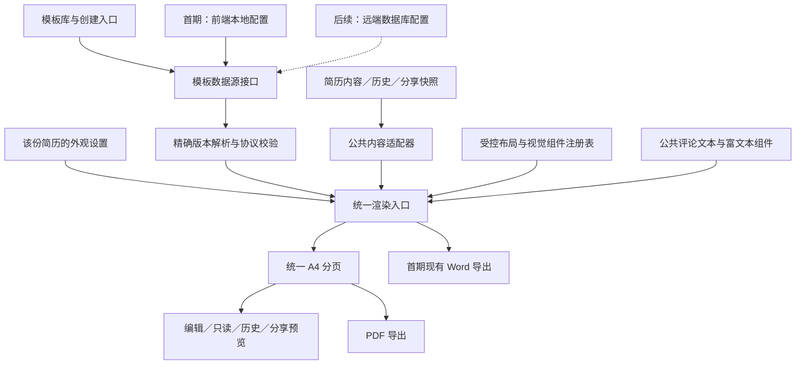

# 简历模板架构与默认模板首期设计

日期：2026-10-21

状态：设计文档，待审阅；架构方向已确认，尚未开始实现。

适用项目：Granular Resume。

本轮交付：本设计文档。配置与接口示例用于说明设计，不代表代码、数据库或线上功能已经变更。

## 1. 目标与最终决策

用户从模板库选择一套完整的简历设计，创建带有完整示例内容的简历，直接进入现有简历编辑器逐项替换内容。模板决定整份简历的布局与视觉呈现，现有业务层继续负责内容、保存、协作、评论、分享、历史和导出。

每个模板是一套完整设计。例如默认模板、绿色时间轴模板、商务双栏模板，在产品层面各自独立。模板内部的模块标题和同类条目采用一致的设计；新增工作经历是增加数据，再由当前模板的条目组件呈现。

架构采用“统一内容模型＋公共渲染引擎＋可复用视觉能力＋完整模板配置”。大量模板通过配置组合已有能力，避免每套模板复制一整套 React 组件和业务逻辑。遇到新的排版形式，再扩展受控的布局或视觉组件。

最新范围决策优先于前面关于立即使用远端数据库的讨论：

| 事项 | 首期决定 | 后续方向 |
| --- | --- | --- |
| 正式模板 | 仅 `default@1` | 按需新增完整模板 |
| 模板配置来源 | 前端本地配置，随应用发布 | 通过相同接口切换为远端数据库 |
| 绿色时间轴 | 只作为扩展示例 | 新增必要视觉能力后接入 |
| 模板工作台 | 移除用户自定义、复制、编辑、发布模板入口 | 维护者使用开发与发布工具 |
| 既有简历 | 全部归为默认模板 | 保持明确绑定的模板版本 |
| 模板更新 | 建立版本契约，仅发布一个版本 | 原简历不自动升级，用户主动确认 |
| 业务能力 | 保留协作、全文评论、分享、历史、离线与导出 | 新模板遵守相同契约 |

## 2. 首期范围

### 2.1 必须完成的产品链路

1. 模板库展示一张默认模板卡片，支持预览弹窗和直接使用。
2. 使用模板后复制完整示例，按用户当前本地／云端模式创建简历，直接进入正文编辑器。
3. 保留快速创建入口，固定使用默认模板和默认示例。
4. 用户可以编辑内容、增删条目、调整顺序与显示状态、修改现有外观设置。
5. 保存、刷新、重新打开、本地保存及主动上传云端后，内容、外观和模板版本一致。
6. 已有云端实时协作、评论、分享、历史查看与恢复、PDF 和 Word 导出继续正常工作。
7. 当前简历、历史快照、已发布分享等旧数据通过兼容入口呈现为默认模板，外观保持当前效果。

首期“完整链路”指默认模板接入已有能力，不扩大这些能力原本的登录、联网、所有者权限或分享访问范围。例如，本地简历继续遵循现有上传与协作前置条件，不新增离线多人协作。

### 2.2 首期不实现的能力

- 第二套正式模板、绿色时间轴的视觉组件、双栏排版。
- 远端模板表、远端模板配置读取、远端发布服务和管理后台。
- 岗位／场景／风格筛选联动、复杂推荐、模板热度统计。
- 用户模板工作台、用户任意调整模块设计或跨栏布局。
- 模板切换与升级的完整产品流程；首期只保留必要接口和数据表达。
- 为示例图补充头像上传、封面、求职信、多语言等新业务能力。
- 通用可视化设计器、任意 HTML／JavaScript 模板执行环境。
- 与本次默认模板链路无关的表单、协作协议或导出格式重写。

首期不展示虚假的“可升级”提示，也不为只有一个模板制造无实际选择的切换步骤。

## 3. 现有代码与改造依据

本节依据仓库源码与迁移文件，不代表已经核验所有线上状态。

| 现有能力 | 代码事实 | 设计处理 |
| --- | --- | --- |
| 统一渲染入口 | `ResumeTemplateRuntime` 按布局骨架和全局模块注册表渲染 | 保留入口职责，改为解析模板配置并组合视觉能力 |
| 模块渲染 | 教育、工作等 Renderer 读取业务字段，使用共同的 `RuntimeSection`、`RuntimeEntry` | 抽离内容适配与视觉呈现；默认外观取自现有实现 |
| 评论字段 | `CommentableText`、`CommentableRichText` 输出字段锚点与段落序号 | 保留公共字段契约，模板不重写评论逻辑 |
| 模板绑定 | `templateBinding` 已进入 store、Automerge、快照、云端 JSONB 字段 | 增加明确的模板版本，统一所有读写路径 |
| 官方模板 | 当前按前端目录中的模板 ID 解析，没有精确版本查找 | 首期改为本地、精确版本的数据源 |
| 用户模板 | 存在私有 `resume_templates` 表、登录读取和工作台编辑流程 | 产品入口退出，不扩大旧私有表的读取权限 |
| 新建简历 | 模板创建主要写入绑定与默认外观，没有统一示例初始化；本地创建也不写入完整示例 | 建立统一创建服务，一次构造完整初始快照 |
| 外观 | 字体、字号、主题、间距已有配置及派生样式 | 首期按现有数值和行为复用 |
| 协作 | 结构化内容由 Automerge 同步，富文本有 Yjs 链路 | 模板渲染不创建另一套可写文档 |
| 分享 | 发布记录保存内容快照和 `template_manifest` | 延续完整配置快照，保持版本固定 |
| PDF | 已有 A4 测量、分页和打印布局校验 | 默认模板沿用同一份分页输出 |
| Word | 当前导出经过清理的 HTML，并保存为 `.doc` | 首期保持可用；多模板阶段允许标准化简化排版 |

代码中存在多个历史内置类型和工作台结构，不据此推断用户数据使用了多种视觉设计。根据用户确认，所有实际旧简历均使用同一种现有样式，统一归入默认模板。

## 4. 概念与数据边界

| 概念 | 含义 | 是否随模板选择改变 |
| --- | --- | --- |
| 简历内容 | 基本信息、经历、技能、条目 ID、富文本等 | 新建时复制示例；未来切换模板不替换内容 |
| 简历结构偏好 | 模块顺序、模块与条目隐藏状态 | 保留用户现有选择 |
| 用户外观 | 当前主题、字体、字号、行距、模块间距、页边距 | 未来切换模板时保留 |
| 模板定义 | 布局、页头、模块标题、内容角色的呈现方式及默认外观 | 由模板 ID 与版本确定 |
| 示例内容 | 用于新建的完整虚构简历数据 | 只在创建时复制一次 |
| 模板目录 | 名称、介绍、预览图、可选版本、上架状态等 | 更新目录信息不重写已有简历 |
| 渲染能力 | 已注册的布局、视觉组件与受控参数 | 多个独立模板可以使用相同能力 |

示例数据与模板配置分开维护。首期默认模板配套应届求职、前端工程师社招示例，快速创建使用应届求职示例。模板预览可选择示例，选择示例不等于选择另一个视觉模板；首期不增加岗位筛选联动。

示例采用虚构资料与原创内容，覆盖当前支持的内容结构。切换预览示例不会修改正在编辑的真实简历。后续示例升级不会改变已经创建的简历。

## 5. 总体架构



### 5.1 模板数据源接口

界面与渲染入口不直接 import 某个正式模板文件，也不直接访问模板数据库。统一经过数据源和解析服务。

| 操作 | 输入 | 输出与约束 |
| --- | --- | --- |
| `listTemplates` | 列表请求；首期无需复杂筛选 | 目录条目；不把全部模板配置塞进列表响应 |
| `getTemplateVersion` | 模板 ID＋精确版本 | 对应的不可变完整定义；不存在时明确报错 |
| `getExample` | 示例 ID＋示例版本 | 只读示例快照；创建时必须复制 |

接口从首期就使用异步返回，调用方具备独立的加载、失败与重试状态。首期实现使用本地配置，不能因等待登录状态、用户模板接口或网络请求而阻塞默认模板展示。

后续 Remote Provider 仅替换数据取得方式，继续使用相同定义格式、版本引用和解析结果。首期不实现空壳远端请求、定时轮询或数据库表。

### 5.2 公共内容适配器

适配器读取现有简历快照，形成只读的页头字段组、模块和内容块。每个内容块包含内容角色、源字段身份、条目 ID、格式化显示值及评论节点引用。

字段适配保持语义：学校与公司可以都进入条目的“名称”位置，但它们原来的字段身份不能被一个无来源的 `title` 字符串替代。

模块可以包含多个内容块。例如技能模块包含说明富文本和技能列表；荣誉模块包含说明与证书标签。模板按内容角色呈现，不能假定一个模块永远只有一种内容结构。

公共层统一处理：

- 模块顺序与隐藏规则。现有 `visibility` 中 `true` 表示隐藏，不能反转其存储语义。
- 条目隐藏与已有空内容判断，首期不借重构改变默认输出规则。
- 时间、年龄、专业与学历等既有显示投影；沿用快照的 `projectionReferenceDate`。
- 页头已经使用的字段与正文分配，避免同一字段被意外重复呈现或遗漏。
- 教育、工作、实习、校园、项目、技能、证书、兴趣、自我评价、申请信息等现有模块覆盖。

后续模板将模块分到正文或侧栏时，只改变渲染分配，在每个区域内遵循用户顺序，不为视觉位置重排底层经历数组。

### 5.3 视觉组件与字段组件

视觉组件负责结构、装饰和样式，输入是只读内容块与最终外观。它们不执行保存、权限判断、网络请求或协作写入。

公共字段组件负责安全富文本处理、评论节点、段落投影和文本输出。视觉组件通过这些字段组件显示用户内容。

首期只注册默认模板实际用到的能力。对未来不同结构保留类型化扩展点，不提前实现任意布局语言、全部侧栏能力或大量无用组件。

### 5.4 状态归属

- 简历可写内容继续存放于现有 resume store／协作文档，不复制到模板页面 store。
- 模板目录、配置缓存等跨页面资源状态使用独立的 Zustand store，不能污染简历正文状态。
- 模板页面共享的选择、创建进度放页面 store；单组件临时弹窗开关可以使用本地状态。
- 运行时可以保留子树内只读渲染上下文，它只传递该份快照的字段和外观，不成为跨页面的第二份业务状态源。
- 历史、分享、弹窗预览必须显式传入自己的快照与外观，不能隐式取当前编辑器的全局外观。

## 6. 模板协议与版本

### 6.1 三种版本各自独立

| 字段 | 含义 |
| --- | --- |
| `schemaVersion` | 模板 JSON 协议格式版本 |
| `templateVersion`／定义中的 `version` | 某个模板的发布版本 |
| `renderContract` 与组件引用版本 | 渲染契约与具体视觉能力版本 |

这些版本均不等同于简历文档修订号、历史版本 ID、Automerge 元数据版本或评论文档版本。

首期新建简历的绑定为：

```json
{
  "source": "official",
  "templateId": "default",
  "templateVersion": 1
}
```

`basedOnResumeType` 仅作为旧结构的兼容字段，不参与新模板的精确版本选择。新流程不再以 `type` 作为真正的模板注册表；为兼容旧调用，新建记录中的旧 `type` 保持 `default`。

### 6.2 默认模板定义示例

以下配置说明首期协议的核心部分。目录信息和示例内容在各自的数据结构中保存。

```json
{
  "schemaVersion": 1,
  "templateId": "default",
  "version": 1,
  "renderContract": "resume-v1",
  "layout": {
    "component": "single-column@1",
    "sectionOrder": "resume",
    "sectionVisibility": "resume"
  },
  "header": {
    "component": "centered-profile@1",
    "fieldBinding": "profile-with-job-intent@1"
  },
  "sectionHeading": {
    "component": "underline-heading@1"
  },
  "contentByKind": {
    "experience": {
      "component": "plain-entry-list@1",
      "metaLayout": "title-subtitle-inline-date-right"
    },
    "richText": { "component": "plain-rich-text@1" },
    "skills": { "component": "skill-badges@1" },
    "fieldList": { "component": "inline-fields@1" },
    "tagList": { "component": "tag-list@1" }
  },
  "appearanceDefaults": {
    "theme": { "theme": "default" },
    "font": { "fontFamily": "noto-sans-sc", "fontSize": 14 },
    "spacing": {
      "pageMargin": 16,
      "sectionSpacing": 20,
      "lineHeight": 1.6
    }
  }
}
```

`sectionHeading` 为整份模板定义一次；所有模块使用同一标题设计，并传入自己的标题和语义信息。经历类内容统一选用同一个条目列表组件。

组件 ID 是注册表中的受控标识，不是远端脚本地址。字段绑定 ID 同样指向公共的受控字段映射，不执行字符串表达式。

### 6.3 协议校验

解析时检查 ID／版本是否匹配、协议是否受支持、引用的组件是否存在、参数类型与数值范围是否合法。仅允许声明的属性；不执行配置中的 JavaScript、任意 HTML 或未受控样式代码。

模板只允许选择现有内容的呈现方式，不能通过配置写入用户内容、请求用户私有数据或创建评论。

首期保留现有主题预设和样式派生逻辑。未来绿色等模板需要的卡片底色、浅色纸张、强调色上的文字色等语义 token，在新增视觉能力时扩展，不能声称当前六种固定主题已能完整表达这些设计。

### 6.4 外观合并规则

- 新建：复制模板默认外观，保存为该份简历自己的外观值。
- 旧简历：已保存的完整外观值优先，缺失字段按现有兼容规则补齐。
- 后续切换或升级：保持用户当前主题、字体、字号与间距；模板只能为此前不存在的装饰角色提供默认值。
- 预览新模板的默认示例与预览现有简历是两种上下文，后者必须使用现有简历的外观。
- 不能因某个用户设置恰好等于旧默认值，就将它当成可随意覆盖的“未设置”。

## 7. 默认模板接入与旧数据兼容

### 7.1 默认外观基线

`default@1` 以当前实际默认简历输出为基线，涵盖页头合并的求职信息、模块标题、条目字段位置、技能标签、富文本处理、字体派生、页边距和分页行为。

提取组件时，不顺带修改默认标题、字号比例、段落结构或空字段规则。以相同内容、相同外观配置、相同字体加载条件比较改造前后的输出。

### 7.2 统一兼容入口

| 输入 | 读取行为 |
| --- | --- |
| 旧简历没有模板绑定 | 解析为 `default@1` |
| 旧绑定没有模板版本，来自旧内置类型或旧工作台 | 按已确认的实际历史样式归为 `default@1`，不读取旧私有模板恢复其他设计 |
| 旧历史／分享 manifest | 转换为默认模板的只读定义，保留原快照与版本身份 |
| 新绑定具有合法、明确的版本 | 精确读取该 ID 与版本 |
| 新绑定格式错误、版本不存在或组件不支持 | 明确失败，保留内容，不能静默变成默认模板 |

兼容识别必须区分旧协议与新协议，不得把未来任何加载错误都解释为旧数据。

读取适配不批量重写数据库，不重新生成条目 ID，不重建评论，不修改历史快照的哈希或版本 ID。当前简历在下一次正常保存时可以带上规范绑定；仅查看旧数据不产生额外保存或历史记录。

### 7.3 全部读写路径

同一绑定与解析规则覆盖：云端配置、Automerge 初始化与保存、本地 IndexedDB、手动上传云端、历史保存／查看／恢复、派生简历、求职跟进快照、分享构建、编辑预览、只读预览、模板预览与历史 PDF。

配置缓存必须按模板 ID＋版本区分，不得按 ID 缓存后用最新定义替换历史定义。

### 7.4 旧工作台退出

模板页改为官方模板选择入口，移除“我的模板”、模板画布编辑、复制模板、另存为及发布模板等用户操作。旧工作台 URL 参数归一到模板列表，避免进入已移除的编辑状态。

不再为了展示默认模板请求用户模板接口。删除失去调用方的前端工作台代码时，保留仍被简历运行时使用的公共能力。

首期不删除线上旧模板表及记录，不做不可恢复的数据清理；其产品入口退出与数据库清理分开处理。

## 8. 选择、预览与创建

### 8.1 模板库交互

- 一张默认模板卡片，包含真实预览、名称、简短说明、“预览”和“使用模板”。
- “使用模板”直接创建并进入编辑器，不强制经过详情页。
- “预览”使用弹窗，采用与编辑器相同的渲染及分页入口。
- 预览使用只读示例，不初始化或覆盖当前 resume store，也不创建真实简历。
- 保留预览示例选择，不实现岗位／风格筛选联动；只有一套正式模板时不显示无意义的复杂筛选器。
- 用户当前处于本地模式时保持本地创建，登录状态不自动切换保存模式。

### 8.2 统一创建服务

创建请求包含模板引用、示例引用、当前保存模式以及名称／描述。快速创建和模板库使用同一个服务，避免两条入口初始化不同。

一次创建操作的语义为：

1. 取得并校验精确模板版本与示例版本。
2. 深复制示例，为新简历及所有列表条目生成身份；预览示例的 ID 不能直接成为真实条目 ID。
3. 形成完整初始快照：内容、顺序、隐藏状态、模板绑定、外观。
4. 本地模式一次写入本地记录；云端模式把完整快照写入当前所有者的简历记录。
5. 持久化成功后更新列表和当前简历身份，进入现有编辑器。
6. Automerge 初始化读取同一初始快照，不能先展示空简历再异步覆盖示例。

提交期间禁用重复操作。创建请求使用固定的操作身份／预分配简历 ID，网络结果不确定时先确认该身份是否已创建，再决定重试，防止重复简历。

不得以“先创建空记录、进入编辑器后再注入示例”的方式绕过初始化一致性。失败时不显示成功、不清空用户已有简历、不把本地内容自动上传云端。

### 8.3 本地与云端

- 游客可以在本地创建和编辑默认模板简历。
- 已登录用户仍沿用当前模式；选择云端但会话失效时按既有认证流程处理，不擅自切换模式或悄悄创建另一份本地简历。
- 登录不会自动上传本地简历；上传由用户主动触发，沿用现有身份转换与关联规则，保留条目 ID、内容、绑定和外观。
- 首期默认配置本地可用，不受模板服务器影响；离线使用仍受应用与字体资源是否已可用的既有条件约束。
- 重新打开、刷新、恢复历史和未来换模板都不能再次应用示例内容。

## 9. 协作兼容与未来模板变更

### 9.1 首期保留的协作机制

继续使用现有结构化字段更新、Automerge 文档、协作会话、Yjs 富文本同步、远端表单增量更新与光标保护。

默认模板渲染不得重建文档、切换会话 ID、重置表单或重新播种富文本。现有富文本 fragment 包含 section 和字段相对路径，数组项使用索引路径；视觉布局变化不能为了“排列好看”去改动这些底层数组。

协作者读取会话 bootstrap 与共享文档，不新增所有者私有模板查询。只读模板资源可由本地 Provider 提供。

新增的模板版本字段应通过快照、正常保存与同步链路完整保留。旧字段缺失的兼容结果供渲染读取，协作者不主动回写整个文档做迁移。

### 9.2 后续切换与升级契约

只有所有者可以更换或升级正式模板。流程为“本地预览候选配置 → 所有者确认 → 校验并保存正式引用 → 协作者同步精确版本”。

候选引用和预览状态只存在于当前页面，不进入 Automerge、协作广播、云端配置或历史快照。确认时只改变模板元数据，不恢复预览开始时保存的旧正文；期间协作者的内容编辑必须保留。

当前 `setTemplateBinding` 没有所有者专用权限校验，且“所有者负责云端持久化”不能证明协作者无法经 CRDT 影响模板字段。后续开放切换前，必须建立受保护的模板变更命令：

- 服务端校验所有者、目标版本及预期的模板修订号。
- 已确认的模板元数据是该字段的权威结果；普通协作合并和旧文档保存不得覆盖它。
- 协作文档可以保留其快照表达，但不能把任意协作者写入的值当成有效变更。
- 多个所有者标签页并发确认时检测模板元数据冲突，提示重新预览；正文协作继续独立进行。
- 客户端缺少目标能力时提示更新，并阻止使用错误预览发起评论定位或导出，不能降级为其他模板。

首期只有一个合法正式模板且不开放切换入口，不提前建设这套后端变更协议；它是以后开放第二个可切换模板前的必要条件，不能把前端隐藏按钮当成完成条件。

## 10. 全文评论兼容

沿用现有评论服务、权限、版本作用域、锚点投影和定位规则。本次不扩大已有选区能力；跨段落等现有支持范围必须保持。

### 10.1 稳定字段身份

评论节点使用 `sectionKey/entryId/fieldKey`。例如公司名称始终是 `work_experience/原条目ID/companyName`，不会因换卡片、移动到侧栏或分页而生成新身份。

公共字段组件必须保留 `data-comment-node-key`、`data-comment-block-ordinal`、字段标签、富文本块顺序和规范化文本。不能只保留属性名却改变文本投影含义。

### 10.2 装饰与内容分离

图标、CHAPTER 文案、时间轴编号、分隔符等装饰放在可评论字段容器之外。当前 DOM 文本序列化不会因为 `aria-hidden` 就自动忽略文本，因此不能仅添加该属性后把装饰插入锚点内容。

当前技能的评论文本是“名称 · 熟练度”的单个节点。未来进度卡片可以改变文字布局，但必须维持该节点的文本序列和偏移映射；进度条位于该文本字段之外。若要改变节点语义，需要单独设计评论投影迁移，不能作为视觉变更顺带实施。

### 10.3 分页与几何位置

继续排除测量源和隐藏页面副本，查询限于当前文档根节点。模板、字体、间距、页数或缩放变化后重算高亮几何。

历史和分享使用对应版本的 `projectionReferenceDate`。模板兼容映射不更改评论作用域、历史版本 ID 或现有锚点文档哈希；新版本保存仍沿用现有业务的版本与评论规则。

## 11. 分享与历史兼容

### 11.1 分享发布

沿用当前分享权限、口令／有效期、内容脱敏、评论开关及发布版本机制。分享仍保存：内容快照、有效外观、模板精确引用和完整模板配置快照。

首期继续使用已有 `template_manifest` JSONB 字段，不引入远端模板表依赖。内部新定义通过序列化适配器写入分享载荷；首期保留默认模板的旧 manifest 兼容字段，并在 `definition` 扩展字段保存带 `schemaVersion` 的新定义，防止仍在运行的旧默认模板读取路径直接遇到缺失结构。

兼容载荷由同一个默认定义生成，不维护两份人工编辑的模板真源。新客户端优先校验新定义，旧快照经明确的旧协议适配。新定义的 ID／版本与外层元数据冲突时拒绝使用，不能忽略错误改读旧字段。

分享页优先使用发布时的完整配置快照，不使用目录“最新版本”，也不读取发布者私有模板。匿名访客使用公开渲染能力即可呈现。

后续多模板配置不承诺被更早的旧客户端理解；需通过渲染契约与客户端更新处理，不能用伪装的默认 manifest 掩盖不支持的新布局。

### 11.2 历史与关联快照

历史保存、查看、PDF 导出和恢复均保留模板精确版本。旧历史按默认模板读取适配，不原地改写冻结快照。

恢复操作沿用现有历史语义。首期恢复的模板都是默认模板；未来包含不同模板版本的历史恢复，必须按所有者模板变更权限处理。

派生简历和求职跟进等复制快照的入口保留绑定与外观，不把非默认的新版本引用丢回旧 `type`。新增模板不能要求每个使用快照的页面维护自己的查找逻辑。

## 12. 分页、PDF 与 Word

### 12.1 默认模板

复用现有 A4 测量、分页、字体就绪等待、布局签名和打印校验。编辑预览、只读预览、历史、分享与 PDF 使用同一份模板定义、内容、外观和分页逻辑。

分页未完成、字体未就绪或布局错误时不得导出不完整 PDF。模板缩略图可使用生成的静态预览，但必须与指定模板版本及示例版本对应，不能把静态图当作导出的正文。

Word 首期保留现有 `.doc` 导出，内容完整、可编辑，允许排版简化，不将其描述为已实现真正的 DOCX 输出。

### 12.2 后续复杂模板

视觉组件向公共分页层提供可断点、标题与下一段的关联、长条目拆分约束；页级背景和条目装饰与内容流分开处理。

绿色卡片需定义续页圆角、内边距及时间轴是否延续；双栏需定义各区域的流动关系。现有纵向分页不能未经验证就宣称支持任意复杂布局。

未来复杂模板的 Word 导出使用公共语义内容生成标准化排版，避免直接依赖复杂网页 DOM。该适配在引入相关模板时完成，不作为首期全面重写导出功能的理由。

## 13. 页面组织、动效与可访问性

模板页沿用项目导航和现有编辑器。重构页面遵循 history-style 结构：`components/`、`hooks/`、`const.ts`、`index.tsx`、`store.ts`、`types.ts`、`utils.ts`；复杂 store 可拆为 slice 并保留统一出口。

首期关键状态包括目录加载／失败、预览加载／失败、创建中／失败与空结果。不同资源独立加载，不能用用户私有模板请求阻塞官方模板展示。

动效复用现有 `EASE`、`DURATION`、`SPRING` 和 variants，所有动效接入 `useReducedMotion()`。只给应用交互外框添加过渡，不对可测量的正文布局施加影响分页稳定性的持续动画。

预览弹窗关联 `DialogDescription`，支持键盘关闭、焦点返回和移动端滚动。底层 primitive 的状态选择器与现有组件一致。验收至少两轮完整开关，并覆盖退出过程中重新打开；如触及共享 Dialog，同时抽查创建简历、创建分享和简历优化弹窗。

移动端继续以同一 A4 源文档进行适宽／缩放展示，不通过另写一套手机简历 DOM 改变字段顺序或评论身份。

## 14. 建议代码组织

以下是实施时的目标职责示意，并非本轮已经创建的源码文件。实际提取优先沿用现有入口，避免为了目录调整重写业务。

```text
/Users/shemingcong/Downloads/resume/src/
├── lib/resume-template/
│   ├── schema.ts                  # 定义、引用与协议校验
│   ├── source/
│   │   ├── types.ts               # 数据源契约
│   │   └── local.ts               # 首期唯一数据源实现
│   ├── catalog/                   # 前端目录元数据
│   ├── definitions/default/       # default@1 不可变定义
│   ├── examples/                  # 示例内容及版本
│   ├── content/                   # 公共字段与模块适配
│   ├── compatibility/             # 旧绑定、旧 manifest 适配
│   └── runtime/                   # 精确解析、能力校验、外观解析
├── components/resume/
│   ├── runtime/                   # 保留统一渲染入口
│   ├── template-layouts/          # 首期单栏能力
│   ├── template-parts/            # 首期默认页头、标题、条目能力
│   ├── fields/                    # 公共评论文本、富文本组件
│   └── pagination/                # 现有分页、预览与打印
└── pages/template/
    ├── components/                # 卡片与预览弹窗，文件夹导出
    ├── hooks/
    ├── const.ts
    ├── index.tsx
    ├── store.ts
    ├── types.ts
    └── utils.ts
```

正式模板配置、目录元数据、示例内容、视觉组件和业务模型分别维护。不会为每个模板创建一份表单 store、协作连接、评论服务或分享实现。

## 15. 后续新增模板：绿色时间轴示例

本节只定义扩展方式，不属于首期实现或验收。

| 能力 | 默认模板 | 绿色时间轴 | 新增成本 |
| --- | --- | --- | --- |
| 单栏布局 | 单栏 | 单栏 | 复用 |
| 内容适配与评论字段 | 公共适配 | 相同适配 | 复用 |
| 页头 | 居中信息 | 横幅与右侧联系方式卡片 | 增加通用横幅页头 |
| 模块标题 | 下划线 | 图标底座、章节号、横线 | 增加通用标题能力 |
| 经历 | 普通列表 | 编号时间轴与白色卡片 | 增加时间轴卡片能力 |
| 条目信息 | 名称、副标题同行 | 名称／日期同行，副标题下一行 | 配置条目布局能力 |
| 独立富文本模块 | 普通文本 | 内容卡片 | 增加卡片容器；模块导语可保持普通正文 |
| 技能 | 标签 | 熟练度卡片与进度条 | 复用等级数据，增加呈现组件 |
| 保存、协作、评论、分享 | 现有业务链路 | 相同业务链路 | 不为该模板复制业务代码 |

绿色模板对整份简历指定一次标题风格和经历风格。教育与工作共用同一种时间轴条目能力，新增条目只是数组中多一项。

技能数据已有 `proficiencyLevel` 与百分比映射；模板不虚构技能水平。头像目前不在简历基本字段中，完整支持头像需要单独增加内容、图片保存与分享处理，不能只写一个配置键就假定功能存在。

后续新增模板分为三类：

1. 已有能力可以表达：新增完整配置、目录信息和资源，沿用公共验证。
2. 存在新的可复用结构：先增加一种受控视觉能力，再由模板引用。
3. 确实无法表达的特殊设计：增加专用布局能力，仍遵守公共内容、字段、分页和版本契约。

组件规模随排版能力增长，模板规模随组合增长。不能给每个模板新增一个只换名字的大组件，也不承诺所有未来设计都不需要任何前端改动。

## 16. 模板更新、发布与维护

### 16.1 不可变发布版本

首期 `default@1` 作为第一个正式版本。发布后的定义、所引用的视觉组件语义、关键 CSS 和字体／装饰资源应保持可重现。

仅保存 JSON 版本号不足以冻结外观。修改共享标题组件或全局样式，也可能改变旧简历，因此影响已发布外观的变更应新增视觉能力版本，再发布引用它的模板新版本。

公共数据逻辑可以维护修复，但必须验证字段身份、文本投影和旧视觉基线。不得以“公共修复”为由无提示改变旧模板排版。

### 16.2 更新类型

| 变更 | 处理方式 |
| --- | --- |
| 模板名称、介绍、标签 | 更新目录元数据 |
| 预览图纠错 | 更新对应预览资源，仍需与绑定版本一致 |
| 布局、间距、配色或字段排版改变 | 新模板版本 |
| 新的标题、页头或条目设计 | 新视觉能力版本＋使用它的模板版本 |
| 示例文字更新 | 新示例版本，不改已有简历 |
| 协作／评论公共修复 | 公共层修复与对应回归，不复制到每个模板 |

### 16.3 本地配置阶段的维护流程

维护者在版本控制中编辑新定义或新版本，使用固定示例与边界内容预览，完成协议、内容覆盖、评论、分页及导出验证后随应用发布。

一个新模板如果复用已有能力，主要增加配置与预览资源；首期不要求建设完整发布后台。辅助脚手架、预览面板、批量截图可随模板数量增加再补充。

目录的当前版本指针只影响新建与新选择，不自动改写已有引用。出现问题时可撤回目录的新版本推荐，但仍保留已经被简历引用的版本及必要资源。

### 16.4 用户升级

已有简历保持绑定版本。升级由所有者发起，用当前内容与当前外观先预览，再确认应用。升级不替换正文，不重新播种示例，不清除评论。

模板元数据升级与内容历史仍遵循现有快照规则；不能通过全量恢复预览快照覆盖协作者在此期间的内容修改。

## 17. 后期接入远端模板配置

本节是后续能力契约，首期不建表、不读取线上模板配置、不实现 Remote Provider。

### 17.1 数据与资源

建议将目录元数据与发布版本分开：模板目录保存名称、封面、标签、上架状态与当前发布版本；模板版本保存模板 ID、版本号、协议、配置 JSON、内容哈希及发布状态。模板 ID＋版本必须唯一，已发布配置禁止原地覆盖。

图片等资源进入对象存储，配置引用固定资源版本。已发布版本下架不等于删除，已有简历与分享引用的配置和资源必须持续可用。

已有私有 `resume_templates` 表不直接开放给游客作为官方目录。官方已发布资源允许游客与登录用户读取，草稿仅维护者可见，写入由受控维护通道执行，并按数据库权限和 RLS 落实。

### 17.2 本地到远端的切换

1. 将已发布的本地定义按原 ID、原版本、原内容导入远端；不能因换存储位置给所有简历强制升级。
2. 校验本地与远端定义的规范化内容哈希一致，避免同一版本对应两种内容。
3. 将统一数据源实现切换为 Remote Provider，调用方不改。
4. 保留已下载版本的本地缓存与恢复能力；不能把远端查询失败解释为模板已删除。
5. 分享继续优先使用发布快照中的定义，不因数据源切换而依赖“最新模板”。

目录分页加载摘要，打开简历时只获取精确版本。缓存键包含 ID 与版本；必要时用内容哈希核验不可变性。列表刷新不能使正在编辑的简历自动换版。

### 17.3 能力发布顺序与离线边界

仅组合已有能力的模板可以通过远端配置发布。引用新组件的模板必须在相应渲染能力部署后发布，客户端加载时检查协议及组件支持情况，未知能力显示可恢复错误。

以后完全离线且没有缓存时，无法取得尚未下载的远端模板。保留内容编辑与已有缓存，明确提示联网加载，不静默切换外观。资源失败时暂停依赖完整排版的导出，允许重试。

远端草稿、预览与发布面向维护者，不恢复面向求职者的自定义模板工作台。

## 18. 失败处理与一致性要求

| 情况 | 应有行为 |
| --- | --- |
| 默认配置本地加载或校验失败 | 提示重试，保留简历内容，不保存错误引用 |
| 新协议版本／组件未知 | 明确提示不支持或需更新，不回退成其他模板 |
| 创建失败或结果不确定 | 保留操作身份，查证后重试，不展示空白成功记录 |
| 用户快速切换预览或关闭弹窗 | 取消或忽略过期请求，结果只应用到匹配引用 |
| 模板加载尚未完成 | 展示真实加载状态；不得用旧外观冒充新模板成功 |
| 快照外观与当前编辑器不同 | 使用快照外观，禁止全局 store 串用 |
| 分享配置与发布版本不匹配 | 停止呈现并提示错误，不读取目录最新版本补救 |
| 字体、分页或打印布局失败 | 提示原因和重试，禁止导出半成品 |
| 后期模板已下架 | 不再用于新选择，已有精确版本仍可读取 |

## 19. 首期验收标准

### 19.1 产品与数据

| 编号 | 场景 | 通过条件 |
| --- | --- | --- |
| A01 | 模板页加载 | 只展示默认模板；不请求线上模板配置或旧用户模板 |
| A02 | 预览与使用 | 预览弹窗只读；直接使用进入现有编辑器，无强制详情页 |
| A03 | 完整示例创建 | 内容、顺序、隐藏状态、外观和 `default@1` 一次初始化完成 |
| A04 | 示例隔离 | 新建简历与示例原件、其他简历互不修改；新条目 ID 正确生成 |
| A05 | 模式一致 | 游客本地可用；已登录用户保持当前模式；登录不自动上传 |
| A06 | 保存与重开 | 本地与云端分别验证编辑、刷新、重新进入，内容及版本无丢失 |
| A07 | 主动上传 | 本地上传后保留内容、条目身份、模板版本及外观 |
| A08 | 旧数据兼容 | 当前简历、历史、旧分享均按默认模板显示，读取不批量写库 |
| A09 | 默认外观 | 固定样本和外观下，页头、标题、条目、字体、间距与分页保持基线 |
| A10 | 模块覆盖 | 全部现有模块、隐藏条目、长内容、空内容与用户排序保持原有语义 |
| A11 | 工作台退出 | 无用户模板编辑／复制／发布入口；旧入口不会打开失效编辑器 |
| A12 | 异常处理 | 重复点击、创建失败、配置错误、过期异步响应不污染现有简历 |

### 19.2 现有能力回归

| 编号 | 场景 | 通过条件 |
| --- | --- | --- |
| B01 | 双用户协作 | 同时修改不同字段与富文本，内容、光标和会话行为保持正常 |
| B02 | 协作结构变更 | 增删／排序条目与显示状态变化后，模板正确呈现且无错误重播种 |
| B03 | 评论 | 已有评论可定位，新评论／回复／解决状态沿用现有权限与作用域 |
| B04 | 评论几何 | 长段落、已有支持的跨块选区、多页、缩放和外观变化后高亮正确 |
| B05 | 分享 | 创建、匿名访问、访问控制、隐藏内容剔除和允许评论行为保持正常 |
| B06 | 分享冻结 | 后续编辑真实简历或修改目录信息，不改变已发布版本内容与外观 |
| B07 | 历史与派生 | 保存、查看、恢复、派生与关联快照保留绑定及外观，无身份重建 |
| B08 | PDF | 编辑器与历史 PDF 内容完整，字体、分页和预览一致 |
| B09 | Word | 默认模板导出的 `.doc` 可打开、可编辑，内容无漏项，隐藏内容不泄露 |
| B10 | 预览隔离 | 同时存在真实编辑、模板弹窗与历史预览时，不串数据、外观或评论 DOM |

### 19.3 界面与工程检查

- 桌面与移动端验证卡片、预览、创建和编辑衔接；长内容与短屏可滚动，主要操作可用键盘访问。
- 预览弹窗两轮开关、退出中重开、焦点恢复与描述关联通过；减少动效模式正确降级。
- 使用已有 `verify:collab` 验证脚本及其包含的评论检查，再做真实双用户与浏览器交互验证。脚本通过不替代完整交互验收。
- 执行适合改动范围的 TypeScript、ESLint、生产构建与导出检查；必要时使用现有移动端稳定性校验。
- 对新模板协议补充有意义的配置校验、版本解析与兼容样本验证，不强制采用 TDD，也不编写仅重复实现的测试。
- 首期不以绿色模板可用、远端模板可读或升级按钮可用作为完成条件，这些均未进入首期范围。

以上是未来实施的验收要求。本次文档编写没有执行产品回归，也没有宣称上述功能已完成。

## 20. 实施与发布边界

本次仅编写设计文档，不生成实施计划、不修改业务代码、不修改数据库、不部署应用或 Edge Functions。

后续实施优先复用既有 JSONB 字段和分享接口。前端本地模板来源不意味着停止使用已有云端简历、协作和分享服务。如果实施中确需修改数据库或 Edge Functions，仍须遵守仓库部署与线上核验约定，不能把必要部署留作用户手工步骤。

正式进入实现前，以审阅后的本设计文档为规格基线，再单独编写实施计划。未来改变首期范围时，应更新范围与验收条件，不能把扩展示例自动视为本期功能承诺。

## 附录：源码核对入口

| 主题 | 现有文件 |
| --- | --- |
| 统一运行时 | [ResumeTemplateRuntime](/Users/shemingcong/Downloads/resume/src/components/resume/runtime/ResumeTemplateRuntime.tsx) |
| 运行时上下文 | [TemplateRuntimeProviders](/Users/shemingcong/Downloads/resume/src/components/resume/runtime/TemplateRuntimeProviders.tsx) |
| 模块外观与评论字段 | [shared.tsx](/Users/shemingcong/Downloads/resume/src/components/resume/runtime/renderers/shared.tsx) |
| 模板协议与当前解析 | [schema.ts](/Users/shemingcong/Downloads/resume/src/lib/resume-template/schema.ts)、[get-manifest-from-binding.ts](/Users/shemingcong/Downloads/resume/src/lib/resume-template/runtime/get-manifest-from-binding.ts) |
| 绑定与外观快照 | [persisted.ts](/Users/shemingcong/Downloads/resume/src/lib/schema/resume/persisted.ts)、[transform.ts](/Users/shemingcong/Downloads/resume/src/store/resume/helpers/transform.ts) |
| 创建与本地存储 | [云端表单服务](/Users/shemingcong/Downloads/resume/src/lib/supabase/resume/form.ts)、[offline-resume-manager.ts](/Users/shemingcong/Downloads/resume/src/lib/offline-resume-manager.ts) |
| 当前模板业务 | [模板数据访问](/Users/shemingcong/Downloads/resume/src/lib/supabase/template/index.ts)、[模板页](/Users/shemingcong/Downloads/resume/src/pages/template/index.tsx) |
| 协作写入 | [resume form store](/Users/shemingcong/Downloads/resume/src/store/resume/form.ts)、[字段同步](/Users/shemingcong/Downloads/resume/src/hooks/collab/use-resume-form-sync.ts) |
| 富文本身份 | [fragment-key.ts](/Users/shemingcong/Downloads/resume/src/lib/collaboration/richtext/fragment-key.ts) |
| 评论投影 | [resume-comment-core.ts](/Users/shemingcong/Downloads/resume/supabase/functions/shared/resume-comment-core.ts)、[DOM 投影](/Users/shemingcong/Downloads/resume/src/features/resume-comments/anchors/dom-projection.ts) |
| 分享快照 | [share.ts](/Users/shemingcong/Downloads/resume/src/lib/supabase/resume/share.ts) |
| 分页与打印 | [canonical-paged-document.tsx](/Users/shemingcong/Downloads/resume/src/components/resume/pagination/canonical-paged-document.tsx)、[use-resume-print.ts](/Users/shemingcong/Downloads/resume/src/components/resume/pagination/use-resume-print.ts) |
| Word 导出 | [export.ts](/Users/shemingcong/Downloads/resume/src/store/resume/export.ts) |
| 页面动效规范 | [motion.ts](/Users/shemingcong/Downloads/resume/src/lib/motion.ts) |
