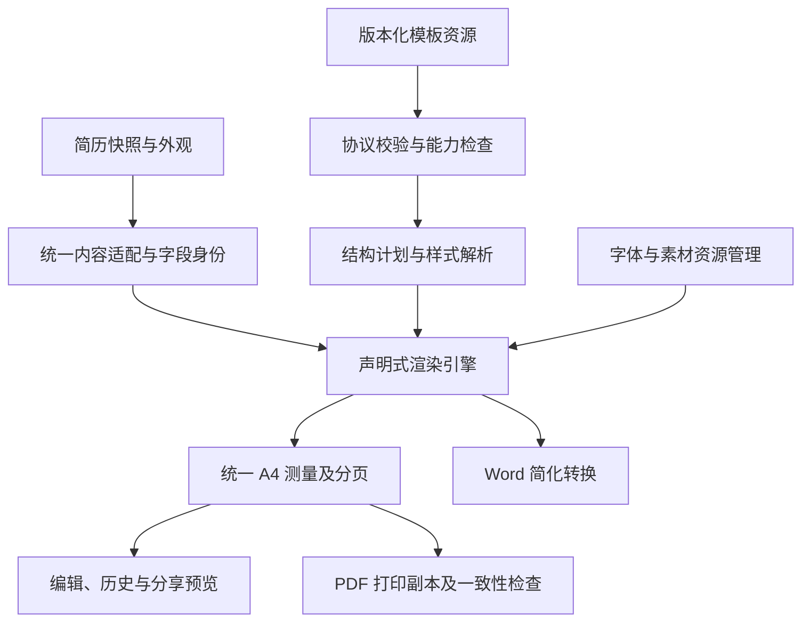

# 声明式简历模板引擎架构改造方案

> 维护状态（2026-10-23）：本地模板资源、一次性模板发布/验收工具及截图/PDF 已按用户要求清理。下文涉及这些路径和命令的内容是当时的实施记录；当前操作以 `docs/resume-template-maintenance.md` 为准。云端已发布资源保持不变。

日期：2026-10-22。

状态：用户已于 2026-10-22 批准无旧数据兼容方案并授权实施。详细任务及进度见 ../plans/2026-10-22-declarative-template-engine.md。

## 1. 目标与范围

将当前“模板定义引用具体视觉组件”的方案，演进为“版本化模板资源描述结构与样式，由通用引擎解释”。新增大量独立风格时，主要新增模板资源，而不是不断增加应用内的专属 React 部件。

本轮改造的完整交付范围包含：单一声明式协议、受控渲染与样式解析、资源加载及发布链路、两套模板的声明式重建、所有展示和导出入口统一接入，以及新体系验收。用户编辑、协作、历史存储与评论业务继续使用现有体系。

用户已确认项目尚未投入使用，因此采用一次性替换：不支持旧模板协议、旧简历绑定、旧分享信封、旧客户端或旧缓存格式，不建设兼容运行时、自动转换器、旧默认回退和存量升级流程。现有实现仅用作设计参考和技术基线，不能为了复刻历史行为而保留多余抽象。

第一批支持连续纵向文档中的堆叠、横排、换行、局部网格、字段组合、富文本、标签、技能条和装饰。真正独立流动的双栏、跨页重复侧栏、自动平衡多栏另设分页能力版本；第一批不宣称支持这些能力。模板设计后台、用户自由编写模板、任意脚本和远端可执行组件不包含在本轮。

设计规模无法消失：不同模板仍然需要定义和视觉验收。本方案控制的是应用核心的增长、每次访问加载的资源，以及重复实现业务逻辑的成本。

## 2. 当前项目的真实起点

| 已有机制 | 当前事实                                         | 改造决策                                   |
| -------- | ------------------------------------------------ | ------------------------------------------ |
| 官方资源 | 目录、定义、示例已从 Supabase 读取               | 沿用统一 Source 和版本资源表               |
| 模板协议 | v1 使用具体组件名称白名单                        | 直接替换为声明式协议，运行时只接受新格式   |
| 内容适配 | 已有个人资料、经历、富文本、技能、字段和标签模型 | 保留内容语义与字段身份，增加有限的展示视图 |
| 视觉实现 | 布局、页头、标题等集中静态注册                   | 删除专属部件注册体系，只保留通用节点引擎   |
| 外观     | 模板默认值创建时复制到简历；日常读取简历外观     | 保持原有用户设置优先级                     |
| 分页     | 真 A4 测量，按纵向断点裁切，同一排版生成各页     | 首批沿用，并增加资源就绪和样式环境校验     |
| 分享     | 冻结完整模板定义                                 | 新协议继续冻结定义及精确资源清单           |
| Word     | 从正文 HTML 生成 `.doc`，有 Tailwind 工具类映射  | 统一替换为受控样式转换；保持 `.doc` 定位   |

有七个重建设计点需要明确：

1. 默认模板目前为隐藏模块和已由页头消费的求职信息保留外层占位。新体系删除这些空占位，只按实际显示的模块计算间距。
2. 经典蓝金页头会合并、筛选并按字段名排序个人信息；“个人简历”、英文副标题等属于固定设计文案。
3. 蓝金标题包含斜角、白色斜线、折角，页头包含图标和多层色带；只提供颜色与字号参数不足以表达它。
4. 公共富文本字段目前自行设置字号、行高和颜色；不能只改外层容器而指望其自动继承。
5. 当前 A4 正文视口使用上、左、右边距，底部为零。新体系统一按四边页边距定义可用区域，现有单个页边距设置映射到四边，重新建立分页基线。
6. 旧分页断点键包含 DOM 路径，不用于约束新结构；新引擎自身的测量与打印副本仍须严格相等。
7. 目录 metadata 可直接重整为新格式，将预览图和能力信息纳入同一严格 schema，不为旧客户端保留响应投影。

## 3. 目标架构与职责

| 单元     | 输入                               | 输出与责任                                                 |
| -------- | ---------------------------------- | ---------------------------------------------------------- |
| 内容适配 | 现有简历快照、评论参考日期         | 有稳定身份的内容字段、模块、条目和显示文本                 |
| 模板读取 | 模板 ID 与精确版本，或分享冻结定义 | 经完整性校验的声明式定义                                   |
| 协议编译 | 声明式定义、引擎能力集合           | 有类型的内部渲染计划；提前拒绝错误绑定、缺失能力和循环引用 |
| 样式解析 | 样式字典、简历外观、固定排版规则   | 确定的节点样式、字体需求、纸张几何参数                     |
| 渲染引擎 | 内容与渲染计划                     | 保留评论身份的正文节点、可测量布局和装饰                   |
| 资源管理 | 版本化字体与素材清单               | 已加载并解码的必要资源，以及就绪/失败状态                  |
| 分页输出 | 确定的排版环境与正文               | 页面区间、布局签名、预览和打印                             |

编译在这里指校验和规范化数据，不生成或执行 JavaScript。编译结果可按定义哈希与引擎契约缓存；实例样式和正文不能缓存成所有简历共享的结果。

## 4. 模板怎样定义

### 4.1 一份模板包的组成

首批将布局、样式和小型矢量装饰放在同一份定义文档中，保持一次读取和原子版本。图片、预览图等二进制资源独立存储，由清单固定引用。这里的“包”是逻辑资源集合，不要求浏览器下载或解压 ZIP。

| 部分         | 应包含的信息                                              | 不承担的职责               |
| ------------ | --------------------------------------------------------- | -------------------------- |
| 身份与兼容性 | 模板 ID、模板版本、协议版本、内容契约、渲染契约、所需能力 | 目录中的推荐排序           |
| 纸张与内容流 | A4、正文边距映射、单一纵向流、局部排列规则                | 用户正文内容               |
| 文档结构     | 页头、模块容器、标题、条目结构及装饰附着位置              | 任意网页标签执行           |
| 内容绑定     | 个人资料字段、当前模块、当前条目、技能等语义绑定          | 数据库查询和业务存储路径   |
| 样式         | 颜色与排版 token、命名样式、有限状态规则                  | 全局 CSS、任意选择器       |
| 外观默认值   | 创建新简历时的字体、主题和间距                            | 每次渲染重新覆盖用户设置   |
| 分页声明     | 流内可分割内容与明确的不可拆分区域                        | 浏览器窗口尺寸驱动重排     |
| 素材清单     | 哈希、媒体类型、尺寸、引用和输出用途                      | 用户简历中的私有信息       |
| 输出策略     | PDF 必要资源、Word 装饰降级规则                           | 为不同出口重新维护完整模板 |

协议版本和模板版本必须分别管理。新协议使用 `schemaVersion: 2` 标识这次破坏性格式变更，应用只实现这一种协议。两套模板保持 `default` 与 `classic-ribbon` 身份，发布 `@2` 资源，避免覆盖已有不可变的 `@1` 记录；版本号递增不意味着提供旧版本渲染支持。正式投入使用后，模板与资源继续遵循精确版本和发布后不可变规则。

### 4.2 节点类型与表达边界

采用少量结构节点和语义节点组合，不再注册“蓝金页头”“某某模板标题”等模板专属节点。

| 节点或声明     | 语义                             | 首批用途                         |
| -------------- | -------------------------------- | -------------------------------- |
| 纵向容器       | 子项顺序排布与间距               | 整篇正文、经历条目               |
| 横向容器       | 对齐、间距、伸缩与允许换行       | 联系方式、默认经历信息           |
| 局部网格       | 有界列数、比例、行列间距         | 蓝金基本信息、三列经历、技能集合 |
| 模块列表       | 按简历顺序处理模块与可见性       | 用户排序保持生效                 |
| 条目重复       | 对当前内容集合逐项套用同一结构   | 工作、教育、项目、技能           |
| 正文字段       | 呈现字段，同时保留评论与选区身份 | 姓名、公司、时间、技能名称       |
| 富文本字段     | 复用净化、段落投影和安全链接处理 | 经历描述、自我评价               |
| 固定文案       | 模板标题、标签和连接文案         | “个人简历”“求职意向：”           |
| 分隔与向量图形 | 线、矩形、圆、路径和裁切轮廓     | 色带、折角、图标                 |
| 数值指示       | 显示经过领域映射的比例           | 技能条与百分比                   |
| 条件显示       | 有值、列表非空、枚举相等         | 隐藏空字段、按展示方式显示百分比 |

节点提供受控属性，不暴露任意 HTML 标签、事件、组件路径或脚本。条件仅检查受支持的数据状态；计算只允许 token 引用和有界数值运算。不存在任意表达式求值、外部请求或用户定义函数。

初始验证预算建议为单份定义不超过 256 KiB、结构节点不超过 512、嵌套深度不超过 16。列表展开还需独立的渲染节点预算，超过时明确提示；不删除正文、不静默截断。上述预算是拟定的资源保护策略，要由两套模板及长简历基线验证，不作为现有性能数据。

局部模板片段允许复用，但只能引用包内片段，编译时展开并拒绝循环。作者可以在维护端复用公共片段；发布时锁定或展开依赖，运行时不拉取“最新公共标题”。

### 4.3 内容绑定与领域视图

模板只绑定已有适配后的内容模型。教育、工作、实习、校园、项目继续共享经历结构；模板不直接处理各业务模块不同的数据库字段。

首批补齐三类有限视图：

- 个人资料选择与排列：允许按语义字段名单选择、排定顺序，未列出的可用字段按既有稳定顺序附后；不丢弃原字段身份。
- 可见模块列表：先按简历顺序整理，再剔除隐藏模块和已被页头消费的模块；没有可呈现内容的模块不输出标题或空容器。模块间距仅作用于实际显示的相邻模块。
- 技能展示值：由业务适配层给出熟练度对应比例，模板只决定显示条、文字或百分比，不复制领域映射。

内容仍由业务层决定，重复节点使用原条目 ID，字段沿用原 sectionKey、entryId、fieldKey、nodeKey。装饰拥有独立的布局节点 ID，不参与评论正文索引。

同一字段若要在不同位置重复展示，首批只允许一个主评论投影，其他副本明确标记为非评论显示；不得产生两个相互竞争的评论目标。

## 5. 样式怎样管理

### 5.1 选用结构化样式字典

样式与布局一起作为版本化数据发布。每个节点引用包内的命名样式，例如章节标题、经历主名称、日期、技能轨道；这些名称在包内定义，前端不为名称建立注册表。

引擎理解有限的样式属性：字体角色、字号、字重、文字色、背景、边框、圆角、内外间距、对齐、列比例、换行、允许的装饰偏移与裁切形状。尺寸采用有类型的数值和单位；禁止任意 CSS 字符串、任意 URL、全局选择器、媒体查询、`@import` 和从父应用继承未声明的视觉变量。

这使新颜色、不同边框、标题形状和局部布局多数成为数据变更。只有出现确实新的排版语义时，才扩展引擎能力。

### 5.2 四级样式解析

| 层级           | 内容                                                         | 覆盖规则                                             |
| -------------- | ------------------------------------------------------------ | ---------------------------------------------------- |
| 引擎排版底线   | 纸张几何、盒模型、正文不能被任意裁切、字体合成策略、打印保色 | 模板不可绕过                                         |
| 模板设计 token | 主色、强调色、文字角色、字号比例、固定装饰尺寸               | 属于模板版本                                         |
| 简历实例外观   | 当前快照的字体、基础字号、主题、页边距、模块间距、行高       | 覆盖明确开放给用户的 token                           |
| 节点角色样式   | 主名称用姓名字号、时间用辅助字号、色带用主色                 | 引用解析后的 token；不能重新锁死用户已调整的基础外观 |

从模板创建时，默认外观只复制一次；重新打开读取简历自己的外观。创建和保存时按新 schema 补齐合法默认值，读取时严格校验必需字段，不增加为旧快照补写模板版本的兼容分支。

字体大小允许“基础字号乘以固定比例”这样的受控派生。蓝金页头现有大标题可以表达为姓名字号再乘固定比例；装饰条高度仍可为固定尺寸。用户调大字号后，各文字角色有明确行为。

配色保留当前语义：默认主题下蓝金使用自己的蓝灰主色和金色强调色；用户切换主题时替换主色，金色强调色保持模板约定。固定白色标题属于局部设计色。模板不能将整份简历变成应用暗色主题的附属样式。

### 5.3 避免全局样式和导出漂移

运行时先解析出确定的节点样式，再以受控行内样式和文档根节点内的局部样式表呈现。几何属性使用解析后的确定值；继承变量只允许定义在实际被克隆的文档根上，不依赖外面的编辑器容器。

每个渲染实例有独立的作用域，包含定义哈希及实例标识；同模板不同外观的两个预览不会互相覆盖。基础 reset 和富文本样式也属于文档范围。字体资源由统一字体注册管理，复用现有字体清单与字重策略。字体清单和主题解析规则也要绑定到明确版本；正式使用后，部署时保留仍被有效发布版本使用的字体文件，不能仅保留字体名称而更换其实际资源。

测量文档、展示页和打印副本接收同一份排版环境，包括样式解析版本、字体资源标识、页面几何及必要素材。更新样式必须使旧分页结果失效，不能在新内容尚未就绪时沿用旧签名执行导出。

样式摘要基于规范化后的实际值和资源身份生成，不包含临时实例 ID 或随机作用域名；否则相同版式会因隔离标识不同而被误判为不一致。

当前部件中依赖页面根字号的 `rem` 间距，改为模板中明确的固定尺寸或字号比例。用现有视觉效果选择初始值，再以新规范验收；不让应用外层根字号隐式控制简历排版，也不要求复制其历史数值关系。

### 5.4 富文本和装饰分别处理

公共正文渲染继续掌握净化与评论投影，但接收有类型的正文样式角色，解决当前富文本内部固定字体参数的问题。正文中的粗体、列表、链接等编辑语义保留；模板只在文档范围内定义它们的排版，不任意重写用户文本。

装饰采用局部附着：相对当前页头、标题或容器定位，不跨越页面正文系统。首批支持矩形、圆、线和受限矢量路径，路径、描边与填充为数据；不允许原始 SVG 内脚本、外链、事件和 foreignObject。图形与评论字段分离，并声明 Word 中的隐藏或简化策略。

对于影响占位的装饰，定义明确尺寸与边界；纯装饰不得意外挤占正文宽度。折角和色带按新引擎规则声明可见边界、所属容器及分页参与方式，确保不会被裁切；不复刻旧部件的偶然测量行为。

## 6. 云端资源、缓存与发布

### 6.1 在现有资源链路上扩展

继续使用现有模板目录、模板版本和示例版本表。声明式定义保存为确定的 JSON 文本及 SHA-256。两份新资源使用 `@2`，现有 `@1` 记录可以物理留存为开发档案，但不参与运行时、目录或验收，不因此保留旧解析器。

当前模板版本表的数据库约束固定接受协议 1，实施时通过新迁移调整为可存放声明式资源的约束，新发布校验和目录发布门禁只接受新协议。保留原有开发档案所需的数据库记录容纳能力，不等于应用支持双协议。同步替换前端校验、资源缓存读取和分享解析。模板文档的 256 KiB 服务端上限和客户端校验统一；大型素材不塞入定义。

目录 metadata 直接定义为新格式，统一包含分类、默认示例、预览图引用和所需能力，由一套 Source 与 schema 读取。发布器检查这些信息与目录当前版本相符。切换时要求开发浏览器刷新至新应用，不提供旧客户端响应适配或降级读取。

新增素材清单及模板版本关联记录，记录资源哈希、媒体类型、尺寸、存储对象和发布状态。依赖关系使发布检查能够确认所有素材可读取，并阻止被已发布模板引用的资源进入常规清理流程。

二进制素材和静态预览图建议放在专门的官方模板 Storage 区域。公开模板素材可以公开读取；未发布草稿放在私有区域。公开桶的下载不受普通读取 RLS 限制，因此不能把私有正文或未发布草稿放进去再期待读取策略保护它。依据：[Supabase Storage 桶访问模型](https://supabase.com/docs/guides/storage/buckets/fundamentals)。

上传、覆盖和删除仅允许维护通道。对象路径包含内容哈希，发布器禁止覆盖已发布对象，并在写入前确认同哈希内容一致。哈希命名本身不等于对象不可变；仍需发布器、权限、引用保留和备份共同约束。公开客户端不持有服务端密钥。依据：[Supabase Storage 访问控制](https://supabase.com/docs/guides/storage/security/access-control)。

首批蓝金的小型图标和色带可由内嵌矢量数据表达，减少正文依赖的外部请求；Storage 主要先承接缩略图及后续较大图形。现有字体仍由应用维护，不在本轮引入任意外部字体地址。

### 6.2 加载与故障规则

维持目录分页、定义按版本缓存、请求合并和有界并发。新引擎统一解析素材依赖，必要资源完成加载与解码后才进入测量；资源失败时显示具体的可重试状态，不用错误模板冒充成功。

切换为新的缓存命名空间，使旧模板定义、目录和编译结果全部失效；不编写旧缓存格式迁移。可删除本应用旧的公共模板缓存，但不清空存放简历正文或其他功能数据的浏览器数据库。

缓存区分原始定义、编译计划、素材和实例排版。原始定义按项目与精确版本索引并核验内容哈希；编译计划附带引擎契约；实例排版还依赖外观、正文版本和参考日期。缓存策略同时限制条目数与字节数，并包括 Zustand 资源记录的释放，避免只淘汰底层缓存却在页面 store 永久保留所有定义。

正在使用的资源在当前会话中暂时保护，页面卸载后释放引用。离线只有在定义与全部必要资源均可用时才允许完成文档渲染；缓存淘汰后不能承诺所有模板一直离线可用。缓存损坏时删除并重取，显式协议错误和缺版本不回退默认模板。

### 6.3 模板列表采用静态预览

列表优先使用官方示例生成的预览图，完整运行时在用户打开预览或进入编辑器时加载。缩略图身份至少包含模板版本/哈希、示例版本/哈希、外观默认值、参考日期与渲染器构建信息。

切换示例必须取得对应预览图；没有匹配图时显示明确占位，不能把旧示例图当成新结果。详细预览依然实时渲染。生成图片只能使用虚构示例，不能把用户真实简历上传成公开模板预览。

### 6.4 发布流程

1. 维护者在应用源码之外的模板资源工作区编写定义、样式和素材，保留 Git 审查与版本记录，但不从前端源码批量导入这些资源。
2. 验证协议、内容绑定、节点预算、素材许可与资源完整性；运行标准简历样本。
3. 生成静态预览，形成确定的定义文本、资源清单和哈希。
4. 上传新素材并逐项读回验证；此时目录仍不指向新模板。
5. 通过受控迁移写入新版本及依赖，并检查线上读取、真实渲染与导出。
6. 完成验收后更新目录推荐版本。日后常规模板发布失败时，目录保持上一个可用的声明式版本；有效的已发布资源不删除。

存储对象与数据库不是同一个事务，因此采用先准备资源、最后切换目录的顺序，不声称跨服务原子提交。本次尚未投入使用的一次性切换采用第 9 节的完整发布流程，不建设跨新旧体系的在线灰度或双读机制。

## 7. 分页与导出的契约

### 7.1 第一批继续使用单一纵向流

局部两列或三列信息区并不等于整份简历的独立双栏分页。第一批允许局部横排和网格，但整篇正文仍形成一条确定的纵向内容流。

保留现有按真实文本行和原子区域测量的思路。模板只能使用引擎已经实现的分页声明。首批支持普通流和不可拆分区域；标题与下一段保持同页、孤行控制、跨页重复页头等高级策略在实际实现和验证前不加入可发布能力清单。

局部多列必须核验分页候选点不会切入其他列文字；不能仅因为样例刚好是一行，就宣布任意网格内容可安全分页。无法形成合法断点或原子元素高于一页时明确失败，不自动压缩正文。

两套模板统一采用四边对称的页边距：现有一个页边距设置同时作用于上、下、左、右。测量、展示与打印按同一规则计算正文宽高。删除隐藏模块空占位与补齐底部边距带来的换行、页数变化属于此次明确的规则调整，按新基线验收。

### 7.2 就绪状态与打印

统一就绪过程为：定义校验 → 所需能力可用 → 样式解析 → 字体和必要素材就绪 → 布局稳定 → 分页完成 → 打印副本一致。

保留严格签名检查，并在新排版环境中增加正文视口尺寸、外观/样式摘要及必要资源版本信息。只比较新引擎的测量与打印结果，不要求与旧结构的断点键或分页数相等。

打印副本必须携带实际需要的局部样式和资源。屏幕缩放、卡片容器尺寸及进入动画不能进入测量依据。文档内容本身不做会改变布局的动画；模板页面的交互继续复用项目动效预设及减少动效降级。

PDF 继续使用浏览器打印，统一精确保色规则，真实测试背景图形关闭和开启两种结果。

### 7.3 Word

所有模板统一以解析后的样式和语义结构生成简化 HTML `.doc`：保留正文、标题配色和基本文字格式；允许将复杂网格简化为可读结构，移除纯装饰与技能图形。移除只服务旧部件的导出类名映射和专用分支。

不能继续依赖一份手工补齐的 Tailwind 类名列表来解释所有新模板。也不把 `.doc` 声称为 DOCX，或承诺与 PDF 像素一致。验收需要确认文本、段落顺序、基本可读性和实际文件可打开。

## 8. 现有两套模板怎样迁移

### 8.1 一次性替换，不建设存量兼容

| 对象                   | 处理方式                                              |
| ---------------------- | ----------------------------------------------------- |
| 默认模板               | 用声明式结构与样式重建，发布 `default@2`              |
| 经典蓝金模板           | 用同一通用引擎重建，发布 `classic-ribbon@2`           |
| 旧模板注册表与专属部件 | 提取仍有价值的通用能力后删除，不保留兼容包            |
| 旧模板定义及校验器     | 从运行时代码和发布工具中移除，仅需参考时留在 Git 历史 |
| 旧缺省绑定与旧分享解析 | 删除回退、适配和多版本分发路径                        |
| 快速创建与模板库       | 统一读取新目录和精确模板引用，只有一种默认创建策略    |
| 示例正文               | 复用现有两份内容样本，按新创建规则生成新的测试简历    |
| 旧测试简历、历史和分享 | 不迁移、不要求继续打开，不实现转换或主动升级入口      |
| 旧公共模板缓存         | 切换命名空间并失效，不做格式兼容                      |

模板资源使用新的精确版本，是为了避免覆盖现有不可变记录和缓存混淆，不是为了继续支持旧产品。旧定义即使仍存放在数据库，也只是开发档案，应用没有对应解释器。

两套模板重建并通过新体系验收后，交付物中应只剩一条模板渲染链路。旧实现的留档由 Git 和发布备份承担，不作为产品代码依赖。

### 8.2 默认模板迁移映射

| 现有设计                     | 声明式表达方式                 | 新体系验收重点                           |
| ---------------------------- | ------------------------------ | ---------------------------------------- |
| 居中姓名                     | 居中纵向容器＋姓名字段         | 姓名角色字号、主题主色、字体字重         |
| 求职意向、个人资料、联系方式 | 字段选择＋换行横排＋条件分隔符 | 空字段不产生多余竖线，前缀和排列清晰     |
| 下划线章节标题               | 标题文字＋底边框样式           | 字号、留白、边框和原子分页标记           |
| 经历名称和补充信息           | 弹性横排与内部换行             | 长名称正常换行，不与日期重叠             |
| 靠右日期                     | 辅助文字角色＋不换行           | 可读的宽度占用及对齐                     |
| 经历描述                     | 公共富文本字段                 | 新简历的评论段落身份跨入口一致，正文完整 |
| 技能、证书、爱好             | 换行集合＋圆角边框项           | 标签清晰、间距一致、分页不截断标签       |
| 隐藏或空模块                 | 可见模块过滤                   | 不输出标题和占位，不产生多余间距         |

默认模板保留居中页头、下划线标题和简洁经历列表的设计风格。隐藏占位、空容器和隐式根字号依赖直接清理；按新的间距与四边页边距重新建立视觉和分页基线，不要求复制旧实现的细节缺陷。

### 8.3 经典蓝金模板迁移映射

| 现有设计                 | 声明式表达方式                       | 新体系验收重点                                       |
| ------------------------ | ------------------------------------ | ---------------------------------------------------- |
| “个人简历”、中英文副标题 | 固定文案＋横排/纵向组合              | 固定文字不进入正文评论                               |
| 教育与工作图标圆底       | 圆形背景＋受限矢量路径               | 图形尺寸、描边与金色底色                             |
| 蓝灰与金色斜角横条       | 多层矩形与裁切轮廓                   | 既有比例、留白、遮盖顺序                             |
| 基本信息区               | 个人资料字段排序视图＋局部两列网格   | 名称、年龄、工作年限等当前优先顺序；未列字段稳定附后 |
| 左侧纵向线               | 流容器内边距与左边线                 | 页头资料区和正文的连续对齐                           |
| 带状标题及折角           | 文字盒、局部背景、矢量斜线、附着折角 | 标题向左伸出位置、白字、色带与原子边界               |
| 时间/机构/身份三列       | 局部网格列比例与对齐                 | 现有比例、长文本换行、条目头不可拆分                 |
| 三列技能条               | 技能重复网格＋数值指示               | 熟练度映射不变，百分比仅按原设置显示                 |
| 蓝金配色                 | 主色、强调色与固定白色 token         | 默认主题和用户切换主题后的既有语义                   |

这些效果必须由通用结构、样式和图形节点完成。若实现仍出现“如果模板 ID 是 classic-ribbon 就执行特殊逻辑”的分支，说明抽象还没有达到本次目标。此次直接编写两份声明式资源，不建设生产可用的旧格式转换器，也不借兼容名义保留模板专属运行逻辑。

### 8.4 数据范围与未来版本纪律

现存旧测试简历、历史和分享不进入迁移目标，允许因格式替换而失效。验收通过现有两份示例重新创建本地与云端简历，并重新生成历史、分享和评论数据。

不需要为了“无兼容”重置整个数据库。任何开发数据清理应列明与旧模板试用有关的对象，采用限定范围的维护操作；不能扩大到账号、其他功能数据或浏览器全部存储。本轮只修改方案，不执行任何数据清理。

新建简历继续使用现有创建事务、本地/云端模式及稳定条目身份；示例仍然只在创建时复制一次。正式投入使用后，新体系内部的模板更新遵循精确版本和快照规则，不能把此次上线前的一次性替换当成未来任意覆盖用户文档的许可。本次不新增模板升级产品流程。

## 9. 分享、历史与一次性发布

分享统一使用新信封，直接冻结声明式定义、样式 token、所需渲染契约与资源清单；用户外观在正文快照中冻结。删除旧信封和 legacy manifest 适配，定义无效或缺失时明确拒绝。资源引用使用稳定版本路径与哈希，不保存短期签名 URL；哈希核验不代替发布权限控制。

历史功能继续存在，验收对象是改造后创建的新历史记录：按快照绑定解析精确模板，外观和评论参考日期来自历史快照。公开分享继续剔除隐藏正文和内部模板绑定，评论投影与可见内容保持一致。这些是新体系的正常业务能力，不是旧简历兼容。

本次发布允许开发环境短暂不可用，不追求跨旧新体系无缝滚动切换：

1. 在隔离环境完成新引擎、两套模板、数据库约束、目录格式及所有业务入口验收。
2. 保存当前构建与本次涉及的目录/资源配置，准备限定范围的恢复操作。
3. 暂停开发环境的创建与分享测试，执行增量数据库迁移，上传素材并写入新模板资源。
4. 将目录统一切到两套声明式资源，部署只支持新协议的应用，失效旧公共模板缓存并刷新开发浏览器。
5. 重新创建测试简历，完成本地/云端创建、编辑、历史、分享、评论和真实导出 smoke；通过后结束切换。

如果首次切换失败，可以整体恢复匹配的上一份构建和目录配置，或暂停使用并修复新体系。回滚依靠部署备份，不在新应用内保留旧引擎。增量迁移应尽量保持恢复所需的旧资源记录，避免把全库回滚或删除新数据当成恢复手段。

正式投入使用后的常规模板发布，在声明式体系内保留精确版本并按目录调整推荐；不因这次无需兼容，就取消未来快照与版本稳定性的要求。

## 10. 与现有模块的改造对应

| 当前职责位置                                                 | 改造内容                                                             |
| ------------------------------------------------------------ | -------------------------------------------------------------------- |
| `src/lib/resume-template/definition-schema.ts`               | 直接替换为单一声明式严格协议，删除旧组件枚举                         |
| `src/lib/resume-template/content/`                           | 保留领域模型与字段身份，补充个人资料排序、可见模块过滤和技能展示视图 |
| `src/lib/resume-template/runtime/`                           | 统一渲染计划编译、实例样式解析和能力检查，不增加旧版分发             |
| `src/components/resume/runtime/`                             | 只保留声明式运行时入口                                               |
| `src/components/resume/template-parts/`、`template-layouts/` | 提取通用能力后删除专属实现及注册依赖                                 |
| `src/components/resume/fields/`                              | 接收受控文字角色，保留评论投影和富文本净化                           |
| `src/components/resume/pagination/`                          | 统一排版环境、资源就绪、严格打印门禁与未来流策略接口                 |
| `src/lib/resume-template/source/`、模板资源 store            | 只读取新格式，管理素材清单、有界缓存与失败恢复                       |
| `src/lib/resume-template/compatibility/`                     | 删除旧绑定/旧分享适配，必要的精确引用校验和新分享序列化移到正常模块  |
| 创建入口与模板页面                                           | 统一新目录与默认创建策略，采用版本化缩略图                           |
| Word 导出                                                    | 统一结构化样式转换，删除旧模板专用映射                               |
| Supabase 资源迁移                                            | 新协议发布校验、素材引用和新目录格式；不做用户数据转换               |

模板维护源建议放在独立的 `template-resources/` 资源目录，避免前端打包入口批量导入。构建、发布与迁移工具属于 `scripts/`；本次所有新增验收脚本、固定样本及数据库测试放在 `tests/resume-template/`。如果实施时修改模板页面，继续遵循现有页面模块结构和页面状态管理约定。

## 11. 分阶段交付及完成条件

| 阶段                | 产物                                                   | 完成条件                                             |
| ------------------- | ------------------------------------------------------ | ---------------------------------------------------- |
| A：明确新基线       | 两套视觉参考、短/临界/长样本、字段覆盖与四边页边距规范 | 明确要保留的设计及要移除的历史行为                   |
| B：实现协议与引擎   | 单一协议校验、结构节点、字段绑定、样式解析和资源门禁   | 通用节点工作正常，无模板 ID 或旧协议分支             |
| C：重建默认模板     | `default@2` 声明式资源                                 | 空模块无占位、文字和标签可读、新分页基线通过         |
| D：重建蓝金模板     | `classic-ribbon@2` 声明式资源                          | 字段重排、图形、技能条、长文本及打印通过             |
| E：统一全链路并清理 | 新 Source、创建、分享、历史、Word、预览图和发布工具    | 新数据全流程可用，旧注册表、专属部件与适配路径已移除 |
| F：一次性切换       | 数据库/资源部署、新目录、新构建、缓存失效与 smoke      | 新体系可用，出现问题可按发布备份恢复                 |

阶段 B 应用两套模板的全部需求检验抽象，避免只完成默认后才发现图形、个人信息排序无法表达。阶段 C/D 可以迭代，但最终只交付一套运行时；清理旧实现属于本次完成条件，不留作后续任务。

实施包含数据库迁移或 Edge Functions 变更时，按照仓库约定由执行代理完成已链接云端项目部署、迁移账本、涉及函数的版本与线上 smoke 核验。本文只列责任，不执行部署；也不要求用户手工收尾。

## 12. 验收标准

### 12.1 架构目标

- 在冻结前端构建后，使用已声明能力制作一个新的验证模板，改变结构排列、标题造型、配色和经历形式，仅发布资源即可工作；不是仅换一个颜色证明扩展成功。
- 新引擎不依赖模板 ID 判断设计，不要求向部件注册表逐个登记模板。
- 旧协议、旧绑定回退、旧分享信封、旧部件注册表与生产转换器不出现在运行依赖中；没有为旧版单独加载的 bundle。
- 增加远端目录条目不把新模板结构与素材带入应用构建包；用构建产物及真实网络请求验证，不凭源码观感判断。
- 模板目录使用分页摘要与按需图片；打开详细预览才加载所需定义和资源。

### 12.2 两套模板的设计还原与新规范

以现有两套模板作为设计参考，检查居中/横幅页头、章节标题、经历排列、标签、蓝金装饰和技能条等核心视觉特征。使用相同的示例内容便于对照，但不要求新旧逐像素相等、页数相等或每页内容相同。

重点验证新规范：隐藏或无内容模块无空占位；四边页边距一致；可见字段完整，阅读顺序正确；长文本能正常换行；没有重叠、裁切、缺字和不合理空白页。因明确的边距与间距调整产生的新分页，记录为新基线。

只验证声明式引擎自身的测量、展示和打印副本一致。评论验证使用新建数据，要求同一条目/字段在编辑、历史和分享中的身份稳定；不承担旧评论坐标或旧 DOM 路径的兼容。

样本至少覆盖两份现有示例、短内容、接近页底临界内容、多页长内容、模块重排与隐藏、空条目、超长公司名/邮箱、中英文混排、富文本列表与链接、各现有字体及字号/间距边界。发生合法排版失败应可解释、可恢复，不能把正文缩小或删除当成通过。

### 12.3 出口与业务链路

- 两模板的 PDF 经过真实导出入口，分别检查背景图形关闭与开启，核对颜色、文本、换行、页数和图形。
- 使用新建数据覆盖编辑器、历史预览、历史 PDF、分享预览与分享 PDF；各自快照、隐藏内容脱敏和评论定位正确。
- 本地与云端创建、重复点击和结果不确定重试沿用既有保障；示例只在新建复制一次。
- 评论选区、跨段定位、回复/解决与协作过程中条目身份保持稳定。模板素材和装饰不能成为正文评论目标。
- `.doc` 实际下载并检查可读文本、顺序和基本样式；不以文件存在替代验收。
- 缺版本、缺能力、哈希不符、素材失败、离线冷/暖缓存和迟到响应均有明确状态；失败时禁止错误导出。
- 模板预览弹窗若有改动，覆盖两轮完整开关、退出中重开及减少动效；新增交互沿用项目动效预设。

### 12.4 性能与发布

分别记录模板目录首屏、详细预览冷/暖启动、必要资源字节量、长简历渲染节点和内存、分页时间、打印准备时间。现有实现可作一次性性能参考，验收以新体系的真实数据和可用性为准，不为持续比较保留旧运行时，不预先承诺倍数提升。

新增协议、数据库和故障回归放在 `tests/`；类型检查、变更文件检查和构建通过之后，仍须执行上述真实浏览器和 PDF 验收。云端核验包括单一新协议读取、草稿隔离、已发布定义不可变、声明式版本在目录下架后仍可按精确引用读取、素材可达、新目录、缓存失效和完整发布恢复。测试用的新体系版本保留与旧产品兼容是两件不同的事。

## 13. 设计限制与后续扩展

声明式定义不会自动解决所有分页难题。真正双栏应另行定义区域内容分配、各栏推进策略、续页规则、阅读顺序、评论页映射与 Word 降级，再实现相应的分页后端；第一批协议可声明所需能力，但发布器必须拒绝当前引擎不支持的能力。

正式投入使用后，已发布模板的可复现性依赖定义、引擎契约、字体和素材共同稳定。只冻结 JSON 不足以承诺不同浏览器、不同引擎升级后永远像素一致。改变排版行为的引擎升级必须明确新的渲染契约和版本策略，安全或稳定性修复也要回归有效发布版本。这一未来要求不引入本次旧模板兼容工作。

本方案不把“支持很多模板”等同于“所有设计都能零代码完成”。验收目标是在已明确支持的结构与样式范围内，新模板完全通过资源发布；需要新语义时对公共引擎做一次可复用扩展。

## 14. 依据与审阅状态

已核对当前协议、两套定义及视觉部件、内容适配、样式解析、字段投影、A4 测量与打印、副本签名、资源 Source 与缓存、创建入口、分享序列化、Word 转换和数据库资源约束。

项目依据：

- [简历模板维护手册](../../resume-template-maintenance.md)
- [现有模板基础设计](2026-10-21-resume-template-architecture-design.md)
- [经典蓝金模板设计](2026-10-22-classic-ribbon-template-design.md)
- [远端资源设计](2026-10-22-remote-template-source-design.md)

本文已按用户最新约束实施：保留两套设计、删除旧技术路径、不迁移旧简历或分享。实施任务见同日声明式模板引擎计划，实际验证结果与上线资源范围见对应验收记录。首批小型素材使用与定义相同的 Supabase 只读资源表通道；Source 保留未来切换对象存储/CDN的边界，不在客户端持有上传权限。
