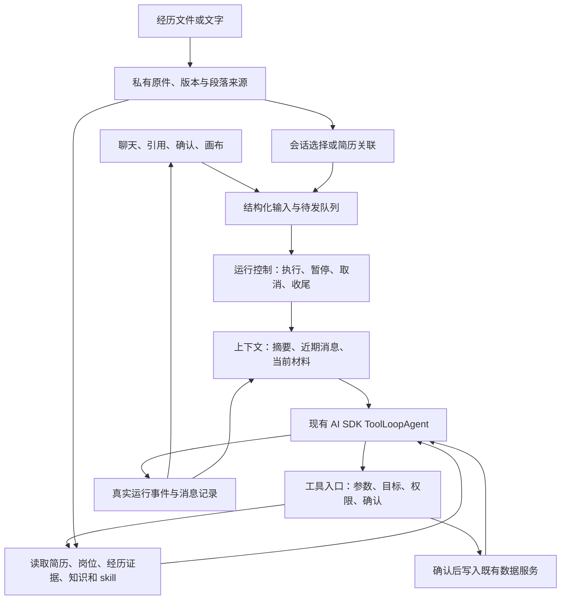

# AI 助手交互与 Harness 升级设计

日期：2026-11-14。

状态：用户已授权完成调研后直接实现。本期能力已接入，后端迁移与函数已部署，前端未发布，未提交或推送。验证证据见同日验收文档；用户最终审查待进行。最新经历页布局以 [资料库重构规格](2026-11-14-experience-library-redesign-design.md) 替代本文原常驻双栏设计。

## 1. 本轮目标

用户提出六项升级，并补充快捷指令标签和经历材料上传：

1. 将侧栏中拥挤的对话管理收进聊天区左上角浮层。
2. 简历、岗位等引用在发送后的消息上方显示标签，不混进正文。
3. 生成期间允许继续输入，发送后排队，也能立即发送以调整当前任务。
4. 参考 Codex、pi 等真实实现，补齐适合简历产品的 harness。
5. 修改确认支持自由输入反馈，重新生成建议，不能只有接受和拒绝。
6. 在右侧简历画布选择字段或文段，通过浮动入口引用到输入框。
7. 快捷指令选择后显示可移除标签；提示词模板不填满输入框，发送后也不作为用户正文展示。
8. 用户可以上传或粘贴自己的经历材料，作为可跨会话复用、能回看原文的背景资料，帮助助手优化简历和实习经历。

这是一轮相互关联的产品升级。消息引用、排队、修改反馈、经历资料和画布定位应共用消息协议与运行状态，避免各做一套。后续实现计划须覆盖全部八项；不能只完成界面就把 harness 记为完成。

## 2. 调研方法与资料

查阅日期为 2026-11-14。先读本地实现和历史验收，再查官方文档与开源源码；以下区分来源已有行为与本项目的设计选择。用户截图作为现有问题和期望样式的依据，不作为外部项目源码证据。

本地 Codex CLI 为 0.145.0，安装包只有启动器、二进制和 README，无法据此核对桌面 UI 内部实现。因此，桌面行为以官方文档和用户提供的交互要求为依据，不声称取得桌面应用源码。

pi 的原仓库地址 `badlogic/pi-mono` 当前重定向到 `earendil-works/pi`。本次直接核对提交 `827383a15262905f82e418483825a49dbb1adbf5` 的 agent、agent-loop、compaction 与 security 文档/源码；不依赖旧博客描述其当前行为。

| 来源                                                                                                                                                                                                                                                                                         | 已核对的机制                                                      | 在本项目中的用法                                                                         |
| -------------------------------------------------------------------------------------------------------------------------------------------------------------------------------------------------------------------------------------------------------------------------------------------- | ----------------------------------------------------------------- | ---------------------------------------------------------------------------------------- |
| [Codex Queue / Steer](https://learn.chatgpt.com/blog/mastering-codex-remote-for-engineering) 与 [输入设置](https://learn.chatgpt.com/docs/developer-settings)                                                                                                                                | Queue 等当前响应结束，Steer 补充当前工作；两种语义不同            | 默认排队，单条可立即发送；停止保留为独立动作                                             |
| [Codex 行内反馈](https://learn.chatgpt.com/docs/code-review#inline-comments-for-feedback)                                                                                                                                                                                                    | 反馈绑定具体行，再通过聊天明确后续处理意图                        | 简历引用绑定字段与原文，添加引用不立即调用模型或修改简历                                 |
| [Cursor Agent](https://cursor.com/help/ai-features/agent) 与 [历史入口](https://docs.cursor.com/en/agent/chat/history)                                                                                                                                                                       | 选区可作为聊天上下文，历史有独立入口                              | 历史按需展开；画布引用进入输入框后由用户补充要求                                         |
| [pi agent-core](https://github.com/earendil-works/pi/blob/827383a15262905f82e418483825a49dbb1adbf5/packages/agent/README.md)                                                                                                                                                                 | 应用消息先做上下文变换，再转换为模型消息；steer 与 follow-up 分开 | 分离显示、持久记录和模型输入；建立明确的排队与立即发送接口                               |
| [pi agent-loop 源码](https://github.com/earendil-works/pi/blob/827383a15262905f82e418483825a49dbb1adbf5/packages/agent/src/agent-loop.ts)                                                                                                                                                    | 工具参数校验及执行前后钩子；在执行边界接收后续消息                | 工具执行集中经过权限、确认、取消及结果记录；不改写 SDK 的流解析                          |
| [pi 压缩](https://github.com/earendil-works/pi/blob/827383a15262905f82e418483825a49dbb1adbf5/packages/coding-agent/docs/compaction.md) 及 [实现](https://github.com/earendil-works/pi/blob/827383a15262905f82e418483825a49dbb1adbf5/packages/coding-agent/src/core/compaction/compaction.ts) | 摘要记录保留原消息，按边界重建上下文；工具调用与结果不能随意切开  | 保留完整聊天，单独保存带覆盖边界的任务摘要，不按页面已加载条数决定记忆                   |
| [pi 安全文档](https://docs.pi.dev/latest/security)                                                                                                                                                                                                                                           | 项目信任、查看轨迹不等于安全隔离；工具实际权限才限制影响范围      | 延续业务工具白名单与服务端授权；不引入本项目不需要的 Shell、任意插件执行                 |
| [Anthropic 上下文工程](https://www.anthropic.com/research/effective-context-engineering-for-ai-agents)                                                                                                                                                                                       | 按需检索、压缩、结构化记录用于控制上下文                          | 分层读取简历、JD、证据和知识资料，保留事实与来源                                         |
| [Agent Skills 接入规范](https://agentskills.io/client-implementation/adding-skills-support)                                                                                                                                                                                                  | 目录、按需激活、资源读取与上下文生命周期分开                      | 扩展现有 skill runtime，继续保存版本、来源及实际加载状态                                 |
| [OpenAI Agent 安全建议](https://developers.openai.com/api/docs/guides/agent-builder-safety)                                                                                                                                                                                                  | 不可信材料不进入高优先级指令；结构化数据与人工确认限制动作        | 简历正文、JD、名称、摘录、工具结果均不能成为系统指令或授权凭据                           |
| [AI SDK 工具调用](https://ai-sdk.dev/docs/ai-sdk-core/tools-and-tool-calling)                                                                                                                                                                                                                | 工具、审批及多步调用有 SDK 支持                                   | 保留已安装 AI SDK 6；本地源码确认 `prepareStep`、`activeTools`、`stopWhen` 可供适配      |
| [shadcn Attachment](https://ui.shadcn.com/docs/components/radix/attachment)、[Confirmation](https://ui.shadcn.com/docs/ai-elements/radix/confirmation)、[Queue](https://ui.shadcn.com/docs/ai-elements/radix/queue)                                                                          | 引用与确认可组合现有组件；当前 Queue 示例是 Agent 待办清单        | 引用复用 Attachment，确认复用 Item；消息排队由业务控制器实现，不能把待办示例当成队列引擎 |

Codex 的原始桌面布局不是本项目应机械照搬的约束。左上角会话胶囊、简历专用字段引用和确认反馈联动是基于现有工作台作出的设计。

经历资料补充调研同样以官方说明为依据：

| 来源                                                                                                                                                                                                                | 已核对的行为                                                     | 本项目采用的做法                                                   |
| ------------------------------------------------------------------------------------------------------------------------------------------------------------------------------------------------------------------- | ---------------------------------------------------------------- | ------------------------------------------------------------------ |
| [ChatGPT 文件库](https://help.openai.com/en/articles/20001052-using-library-to-manage-files-in-chatgpt)                                                                                                             | 上传文件可保存复用，从输入框的添加菜单再次选入聊天               | 私人经历资料可长期保存；通过现有「+」入口选用，不挤占常驻聊天空间  |
| [Claude 项目资料](https://support.claude.com/en/articles/9519177-how-can-i-create-and-manage-projects)与[资料检索](https://support.claude.com/en/articles/11473015-retrieval-augmented-generation-rag-for-projects) | 项目内资料跨聊天使用；接近上下文限制后按问题检索相关内容         | 明确会话和简历关联范围，读取相关段落，避免每轮塞入全部文件         |
| [Google 资料选择](https://support.google.com/gemininotebook/answer/16215270?hl=en)与[引用回看](https://support.google.com/gemininotebook/answer/16179559)                                                           | 用户选择来源；引用可以回到原文位置；删除来源不自动改写已生成产物 | 回答关联真实段落，来源更新或删除有明确状态；删除资料与删除聊天分开 |

Google 本次返回的官方帮助页使用 Gemini Notebook 名称。这里只借鉴已核对的来源选择与引用机制，不据此宣称掌握其检索、存储或安全实现。以上产品行为支持设计方向，不证明本项目已经具备这些能力，也不作为性能承诺。

## 3. 已读取的仓库约束

本次已阅读产品防回归清单，以及与本轮直接相关的资料：

- `2026-09-17-assistant-skills-design.md`：应用技能、固定版本、按需加载、资料白名单。
- `2026-11-13-assistant-trace-design.md`、对应计划：官方组件组合、输入行为、动效、稳定消息身份。
- `2026-11-13-assistant-ai-elements-design.md`、对应计划和验收：AI SDK 接入、串行工具、取消后保留真实写入结果。
- `2026-11-13-assistant-scroll-continuity-acceptance.md`：不使用轮次大占位，流式与落库回复保持同一实例。
- `2026-10-13-business-review-fixes-design.md` 的助手约束：编辑和重跑先持久截断，失败不丢历史。
- `2026-10-25-automatic-resume-import-design.md`、`2026-10-25-import-source-ownership-design.md`：本机提取、来源行号、免费归类、公司/岗位误归类及重复经历的历史修复。
- 防回归清单第 4、5、6、7、8、9、16、23–28 节：账户隔离、锚点、导出、请求、文案与验收要求。
- 经历资料补充阅读防回归清单第 11、13 节：原文保留、提取结果不自动视为事实、账户隔离、上传前告知文字处理方式，以及基础导入与付费润色的边界。

实现阶段触及公共模板/打印、数据库或具体共享组件时，继续读取对应维护手册和被引用的验收记录。本次未将全部历史资料标记为已读。

## 4. 当前实现判断

当前已经具备部分 harness 能力，但尚未形成完整、独立的运行控制层。Harness 在这里指模型之外负责上下文、工具、任务状态、授权、持久化及结果核验的应用运行层，不是安装某个同名依赖就算完成。

| 能力           | 源码证据与现状                                                                                          | 本轮处理                                                       |
| -------------- | ------------------------------------------------------------------------------------------------------- | -------------------------------------------------------------- |
| 模型与工具循环 | `src/lib/ai/agent/agent-loop.ts` 使用 ToolLoopAgent、默认 12 步、串行工具、AbortSignal、`maxRetries: 0` | 保留，并接入轮次控制与上下文准备                               |
| 会话与记录     | `ai_messages.parts` 保存文本、工具及 skill；有分页、截断和 RLS                                          | 扩展结构化引用；将模型历史与 UI 分页解耦                       |
| skill          | 已有 `great-resume@1.0.0`、两份参考资料、白名单读取和活动事件                                           | 延续现有实现，补齐任务继续和压缩后的重新激活                   |
| 引用显示       | `composer-references.ts` 将简历/职位编码为文本前缀，`readableMessageText` 又将名称拼进正文              | 新消息存结构化 part；旧前缀只在兼容入口解析                    |
| 快捷指令       | Composer 将 `TEMPLATE_PROMPTS` 直接追加到输入框                                                         | 变为带稳定 ID 和版本的指令标签                                 |
| 生成中输入     | Composer 的 disabled 包含 streaming，sendMessage 也拒绝运行中发送                                       | 草稿可编辑；是否立即执行由队列决定                             |
| 上下文         | `use-chat-stream.ts` 直接使用页面 store.messages；重新进入默认加载 30 条                                | 改用独立的上下文读取与摘要，不让上滚改变模型记忆               |
| 压缩           | 只缩短历史 skill 工具正文，未发现通用预算、摘要检查点或压缩恢复                                         | 新增有边界、有来源、可失效的摘要机制                           |
| 确认           | pendingConfirm 的 resolve 只有 boolean                                                                  | 改为采用、放弃、继续修改三种结果                               |
| 确认缺失       | `confirm-bridge.ts` 没有 handler 时调用 apply                                                           | 缺少确认通道时不执行写入，返回明确失败                         |
| 指令与材料边界 | buildUserContext 将用户昵称和简历名称等拼进 system 上下文                                               | 系统规则与业务数据分别组装，用户材料保持低信任来源             |
| 工具与权限     | 有字段 schema、账户检查、数据源授权、写入确认与额度代理                                                 | 集中政策判断，继续保留数据库/存储的真实授权                    |
| 知识与证据     | 有 skill 参考资料、业务读取工具和 resume-preparation 证据记录                                           | 组合为按任务检索的简历知识与事实来源，不把现有能力说成完全没有 |
| 画布引用       | 只读预览尚无引用入口；共享评论已有字段 nodeKey、摘录、字素位置、内容哈希和重定位                        | 复用锚点底层，实现助手专用引用流程                             |

以上为截图与静态代码审计结论。未在本次调研调用真实模型、写入用户简历或执行攻击测试，不能记作运行验收通过。

经历资料的复用边界也已核对：`src/lib/resume-import/extract.ts` 能在浏览器提取 PDF/DOCX，当前返回文字和文件名，没有保留供引用展示的页/段定位。现有上限为单文件 10 MB、PDF 30 页、提取文字 60000 字符，扫描页、加密及无法解析的文件会明确失败。`resume-preparation` 用 IndexedDB 按账户与简历保存提取原文和处理记录，`ContentEvidence` 主要标记示例及 AI 内容；它不是跨设备资料库，也不是通用经历事实库。

现有 `resume-import` 免费识别协议面向简历字段归类，不能把周报、工作笔记强行塞进该协议。新的经历资料入口复用提取和来源定位基础，单独处理保存、选用与检索；已有简历导入仍按原流程执行。`job-submissions` 已有鉴权后保存和读取私有原件的模式，可参考其授权与写入结果处理，但不复用投递记录或将经历材料记成投递事实。

## 5. 方案比较与推荐

| 方案                                      | 收益                                            | 代价与限制                                                     | 结论           |
| ----------------------------------------- | ----------------------------------------------- | -------------------------------------------------------------- | -------------- |
| 只改 UI 和输入框禁用条件                  | 改动较小                                        | 解决不了确认阻塞、排队顺序、上下文和取消后的真实保存           | 不满足本轮需求 |
| 在现有 AI SDK 外补齐项目 harness          | 复用模型、额度、工具、存储与 UI；逐步接入新能力 | 需要调整消息协议、运行状态和上下文存储                         | 推荐           |
| 整体迁移 pi runtime 或新建云端 Agent 服务 | 更接近通用开发 Agent 的运行环境                 | 需重新适配浏览器、简历数据、确认、额度及持久化；会扩大本轮范围 | 本轮不采用     |

采用第二种。借鉴 pi 的模块边界、队列和上下文组织，不复制其整个终端产品或引入第二套模型循环。

## 6. 页面与交互

### 6.1 左上角会话菜单

推荐将当前聊天标题做成紧凑的胶囊触发器，例如「项目经历优化 ▾」，固定在聊天区页头左侧。它与页面布局对齐，点击后向下展开；不做可拖动、遮住聊天正文的悬浮球。

菜单包含搜索框、新建对话、按日期分组的近期会话和“搜索全部历史”入口。每行保留当前项、重命名与删除操作，沿用现有确认和搜索能力。近期会话不冒充全部搜索结果。移除主侧栏中的助手会话管理区，保留工作台导航；页头不再重复显示同一会话标题。

桌面复用 Popover、Command、既有列表与行操作，宽度不超过视口，高度受实际可用空间限制。手机使用已有响应式弹层能力，搜索与关闭入口固定、结果内部滚动。保留 Cmd/Ctrl+K 搜索和既有新建快捷键。

比较过常驻第二侧栏、独立图标按钮和标题胶囊。标题胶囊同时说明当前位置并提供切换，最适合当前“主导航 + 聊天 + 画布”的空间。展开不改变聊天列宽、滚动位置或输入内容。

### 6.2 统一引用标签

待发送内容分成两部分：用户写的正文，以及用户主动选中的引用。引用包括简历、岗位、快捷指令、skill、画布文段、经历资料。视觉形式一致，图标、名称与点击详情按类型区分；底层语义保持不同。

选择「生成 STAR 描述」后的输入框示意：

```text
[生成 STAR 描述 ×] [简历：前端开发 ×] [项目经历 · 第 2 段 ×]

这段突出我负责的部分，保留技术细节。
```

发送后这些标签显示在用户消息气泡上方，气泡只显示用户正文。多标签自然换行，长名称可查看完整信息；长摘录默认简短预览，点击展开原文。没有正文而有明确快捷指令或 skill 的消息可以提交；只有简历引用且意图不明时，助手询问需要处理什么，不推断用户要改写。

快捷指令保留稳定 ID、版本与显示名，发送时由目录解析真实模板。模板作为用户任务指令进入模型，不升级为系统授权；用户补充要求优先于模板默认写法，仍遵守事实与工具边界。模板不污染用户可见正文；用户可以查看指令说明，删除标签即可取消。切换指令不覆盖已写文字，重复选择同一版本去重；多个不同指令按选择顺序处理，缺少目标时先询问。

新增 part 分别承载 command、resume、job、annotation、experience-source，沿用已有 skill-reference。岗位引用必须保存岗位 ID，不能只靠公司和岗位名称匹配。经历资料引用包含 sourceId、versionId 与显示名，不把文件全文复制进消息 parts。名称是显示快照，权限和定位使用真实 ID。草稿、排队、落库、编辑、重试、重新生成都保持同一结构。

旧消息仅在读取边界兼容已知的连续前缀。旧岗位前缀没有 ID 时保留可读标签，不能按同名岗位猜关联；用户自行输入的相似正文保持原样。只有旧指令正文、没有结构标记时，也不能擅自把普通文字变成指令。

复制消息输出可读的引用摘要和用户正文，不暴露内部 ID；历史编辑将标签与正文分开编辑。标题优先来自用户正文，其次为指令或引用名称，不使用展开后的长模板。历史搜索索引包含用户可见标签与摘录，不索引隐藏提示词、reasoning 或原始工具结果。

### 6.3 输入、排队与立即发送

生成期间输入框、引用选择、指令选择与下一条消息的思考设置保持可用。设置变化只影响新提交的消息，不改变正在执行的请求。

默认 Enter 发送，Shift+Enter 换行，中文组合输入不提交。空闲时直接执行；正在运行时进入输入框上方的“待发送”队列。排队项展示正文摘要及标签，支持编辑、删除、立即发送。多条按先后顺序执行，不把尚未进入模型的消息画成已发送气泡。

停止按钮与发送按钮分开，避免复用按钮在 click 中改变语义。立即发送提供明确按钮及 Cmd/Ctrl+Shift+Enter 快捷方式。队列接受成功才清空对应草稿；异步失败不覆盖用户后来输入的新草稿。

立即发送先终止当前模型输出、取消尚未执行的工具及旧确认，等待已经确认并开始的写入返回真实结果，保存这轮进展，再开始新的消息。新消息携带当前任务进展，默认作为对当前任务的补充；用户明确改变目标时才转向。它不会撤销已经完成的修改，也不会让两个写入并发竞争同一确认位。

当前轮成功并完成持久化后，自动处理下一条。用户主动停止、额度不足、模型失败、持久化结果不明或账户变化时，队列暂停并保留，提供继续或编辑入口；不自动重复收费请求。连续点“立即发送”仍进入同一调度器，不创建并行运行。

草稿和待发项按账户、会话、浏览器窗口隔离，运行时放页面 store，刷新恢复用窗口级 sessionStorage；不把私密草稿放入无账户区分的全局键。恢复后的队列保持暂停，由用户继续。切换会话沿用当前取消策略，保留原会话待发项；返回时可继续，不能发到新会话。登出清理当前账户内存与本窗口恢复数据。持久化不可用时保留内存输入，并说明刷新可能丢失，不能显示已保存。

本轮对齐用户描述的排队与打断交互，仍由当前页面执行 Agent，不承诺关闭浏览器后继续云端运行或跨设备同步待发草稿。这类持续执行需要独立服务端运行器，属于另一个需要明确授权的范围。

### 6.4 修改确认与自由反馈

确认卡保留真实前后差异，提供「确认应用」「不采用」「继续修改」。点击继续修改显示输入区，例如用户可以输入“保留技术细节，缩短到两句话”。输入未提交前，原方案保持待确认。

提交反馈后将旧方案记为“已要求修改”，不执行旧 apply，不把它当成用户拒绝任务；持久化方案引用和用户反馈，再生成新方案。新方案重新显示差异并等待确认。旧轮尚未执行的其他写工具同时停止，不能绕过反馈继续采用原假设。

存在待确认方案时，主输入框显示对应的“修改建议”上下文；默认发送行为是提交修改要求，防止用户发出的反馈排在等待确认的任务后而永远不能执行。用户仍可明确选择“作为新任务排队”，该项等待确认流程结束。卡片中的反馈输入与主输入共用同一个反馈草稿，不产生两份相互覆盖的值。

确认结果使用明确的采用、放弃、修改三种类型，修改携带 feedback 和 proposalId；不把三种状态塞进 boolean。只有确认应用允许进入写入。没有确认处理器、目标已失效、内容已变化或本轮已停止时，旧按钮不能执行写入。

事实补充问题也支持自由文字回答。可用结构化 ask_user 工具提供简短候选，但候选不是限制，选择默认项不代表已经提交；用户回答由运行器记录为用户输入。问题回答和写入授权保持不同语义。

### 6.5 画布选区引用

在右侧简历的可见文字上选择后，选区附近出现「引用到对话」气泡。点击后添加文段标签并聚焦输入框，用户继续写要求。支持连续选择多个字段，先添加引用不会发消息，也不会创建分享评论或协作通知。

复用共享评论的 nodeKey、稳定条目 ID、字素范围、exactQuote、前后文和内容哈希；浮层定位使用实际可见选区矩形。引用同时捕获简历 ID、字段名、条目身份、原文和选择时的内容版本，不只保存坐标或列表下标。

普通文字与富文本字段均可引用。键盘和触摸可选择文字；另提供“引用字段”入口供无法方便拖选的情况使用。空字段可通过字段入口引用其名称和空状态。照片等非文字字段只提供字段级引用，不向模型发送 Base64，也不声称具备图像理解或替换照片能力。

跨字段选择按实际命中的字段拆成多个引用；同字段多行、跨页选区按可见片段还原为一个或多个有明确范围的引用。不把测量页、隐藏分页副本、页码和模板装饰当成用户选中的正文。相同简历、字段、版本和范围去重。

现有 resolveCommentSelection 只接受同一字段 DOM 节点内的范围，不能直接声称已支持跨字段或跨页。本轮在助手适配层按字段切分并聚合可见页片段，继续复用原锚点算法；不能通过关闭测量页/隐藏页过滤来绕过限制。

点击已选/已发标签可回到对应画布位置并短暂高亮。内容变化后先按稳定身份和原文核对：能唯一重连时定位当前位置，无法唯一重连时仍展示原摘录并提示重新选择，不能附到另一条同名经历。引用的是另一份简历时，标签始终说明对象；引用本身不悄悄更换写入目标。

覆盖层和气泡留在预览外层，不向简历正文插入批注节点，不改变测量与打印几何，不进入 PDF/Word。手机画布关闭后引用仍留在草稿，并回到聊天输入位置。

### 6.6 经历资料：上传、复用与来源回看

采用「私人经历资料库 + 明确的使用范围 + 有出处的改写」。用户可以保存旧简历、实习周报、项目复盘、工作记录和自己补充的文字。资料用于提供背景，上传不会创建或覆盖简历，也不代表同意助手修改任何字段。

用户已同意两个入口：主侧栏负责长期管理，聊天输入框负责当次选用。此前仅通过聊天菜单管理的方案在资料积累后不易发现，也不方便用户尚未开始对话时维护背景，因此采用以下方案。

主侧栏在「我的简历」下方增加「经历资料」，使用与现有导航一致的图标、字号及选中态，路由建议为 `/experience`。页面提供上传、粘贴、搜索、原文查看、重命名、更新、删除和关联简历；采用资料列表与按需打开的详情，手机先列表再详情。保持其余菜单顺序，不另外增加分组标题或常驻侧栏。资料页的「用于 AI 助手」只把选定资料加入对话草稿，沿用或明确选择目标会话，不自动发送。

输入框现有「+」菜单保留简历、岗位选择，增加「上传经历材料」「粘贴经历文字」和「从经历资料选择」。聊天中的上传、选择和原文查看在当前页完成，完整管理另有「管理经历资料」入口；进入资料页前保留原会话草稿，返回时恢复。会话切换与运行取消仍遵守第 6.3 节，不为管理资料偷偷创建并行运行。两个入口共用资料与操作，不复制文件或维护两套列表缓存。

上传和选择弹层组合现有 Dialog、Command、Item、Attachment，手机使用 ResponsiveDialog 的抽屉；长列表和原文详情内部滚动，保留输入草稿与关闭后回焦。资料管理页面复用现有页面外壳、列表和详情组件。隐藏文件 input 沿用现有方式，不另造上传组件库。

上传前用简短文案明确用途：「资料将私密保存到你的账户；对话时，选中的相关文字会发送给 AI。」文件选择与拖入前均可见。登录后使用账户资料库；未登录时走现有登录入口，不把经历材料悄悄放入其他账户或公共范围。

具体流程：

1. 选择文件或粘贴文字并填写可选标题。读取、保存、建立段落索引分别展示真实状态，支持取消；多文件逐项显示结果，单份失败不掩盖成功项。
2. 在资料页上传后显示已保存的资料；从聊天上传成功后，自动在当前草稿添加资料标签，例如「资料：实习周报」，输入框仍留给用户表达要求。上传不自动发送消息或启动润色；引用在消息成功提交后才加入本对话的使用范围，移除草稿标签不删除资料库文件。仅发送资料且没有明确任务时，助手询问用户想整理或优化哪部分。
3. 点击标签可查看提取原文，文件可下载原件；原文预览不是已经核实的经历表单。用户不必逐段勾选或重新填写整份背景。
4. 用户发送“结合这份周报优化实习经历”后，助手读取相关段落，分清项目背景、本人职责、行动与结果。缺少关键事实时通过自由输入补充；给出改写和来源，仍经第 6.4 节确认后才修改简历。
5. 后续在同一会话中自动沿用已选资料。输入框上方用「本对话资料 · N」折叠入口展示当前范围，避免每条消息重复贴满文件标签；发送记录保存该轮真实来源版本，展开可检查。

资料跨会话保存在账户中，但不默认把整个资料库注入所有任务。用户可以明确「关联到这份简历」，从这份简历发起的新对话会显示并沿用这些关联资料，也可以取消选用。共享简历的其他协作者不因此获得本人资料。普通新对话通过资料选择器复用；用户明确要求查找自己的全部经历资料时，才扩展到本人资料库检索。

首轮支持可提取文字的 PDF、DOCX，以及新增的 UTF-8 TXT、Markdown 和粘贴文字。PDF/DOCX 复用现有 10 MB、30 页和 60000 字符限制及解压保护；TXT/Markdown 同样限制文件大小和字符数，按纯文本处理。扫描件、图片、音视频、旧 DOC 暂不显示为可选格式，遇到扫描 PDF 提供明确原因和粘贴文字的替代入口，不显示“已理解”。旧提取器需要增加页/段位置返回，同时保持原简历导入的输出兼容；不能按段落序号猜 PDF 页码，DOCX 使用段落位置。

基础读取、保存与段落索引不调用模型、不扣 AI 额度。默认不在后台为每份文件额外生成摘要；用户主动选择「整理我的经历」或发起润色后，再通过现有对话链路处理并沿用其额度规则。整理结果可以列出公司/项目、时间、职责、技术和成果，但未知项留空、标明原文位置；这是任务产物，不能自动升级为永久“已确认个人画像”。现有创建简历入口的一次免费识别规则不变。

例如周报只写“参与接口改造，团队完成上线”，助手可以询问本人具体负责哪一部分；不能把它写成“独立主导改造，性能提升 40%”。日期、数量或个人贡献在多份材料中冲突时，应并列来源并询问。用户明确补充的内容记录为“本人补充”，AI 归纳记录为“根据材料整理”；用户接受了某段措辞，不等于核实了材料中的全部事实。

回答中的出处可以点击打开资料详情并定位原段落，显示真实页码或段落信息；来源标记不插入最终简历正文和导出文件。引用位置由程序核对该版本的实际文字，无法定位时显示来源不可定位，不能生成假的页码或“已验证”标识。

更新文件生成新版本，已发送消息继续指向当时的版本；新一轮使用当前选中的版本，排队项也固定提交时版本。删除资料停止后续读取，清除其原件、提取内容及索引；相关摘要失效，历史来源标签显示已删除。删除时明确说明已发送的聊天文字仍保留，需要清除这些内容时另行删除对应对话；不能承诺删除原件会撤回已经生成或发送的内容。

读取失败、保存失败、仍在处理、没有资料和资料已删除分别展示。保存结果不明时用稳定操作身份查询结果后再重试，不重复创建资料或显示成功。未完成的资料不能被队列当作可用来源；失败项可重试或移除，用户仍能编辑草稿和发送不依赖它的其他消息。

### 6.7 UI、布局与动效实施规格

#### 调研依据与选择

2026-11-14 补充核对官方页面、示例与本地源码；实际浏览器查看 shadcn Item 和 Dice UI File Upload 的桌面演示。页面截图保留于本次工具输出，不把官方演示验证等同于项目组件验收。

| 参考                                                                                                                                       | 核对结果                                                                                                  | 本项目的选择                                                                                          |
| ------------------------------------------------------------------------------------------------------------------------------------------ | --------------------------------------------------------------------------------------------------------- | ----------------------------------------------------------------------------------------------------- |
| [shadcn Item](https://ui.shadcn.com/docs/components/radix/item)                                                                            | 组合标题、说明、媒体和行操作，可构成连续列表                                                              | 复用本地 Item，名称突出，日期/格式次级；不把每份资料包装成同等大小的大卡片                            |
| [Prompt Input](https://ui.shadcn.com/docs/ai-elements/radix/prompt-input)                                                                  | Input Group 组合文本、附件和发送操作，引用位于正文上方                                                    | 沿用已有 InputGroup、Attachment，快捷指令、资料和选区使用同一组标签                                   |
| [Dice UI File Upload](https://diceui.com/docs/components/radix/file-upload)及[官方 registry 目录](https://ui.shadcn.com/r/registries.json) | 有 Radix 版本，支持拖放、逐项状态、校验、键盘选择；registry 为 `https://diceui.com/r/{style}/{name}.json` | 本地尚无通用多文件上传组件，采用该成熟实现；真实上传由业务提供，示例的模拟进度及第三方上传服务不接入  |
| [Confirmation](https://ui.shadcn.com/docs/ai-elements/radix/confirmation)                                                                  | Item + Button 组合确认界面，官方示例仅接受/拒绝                                                           | 复用结构，增加 Collapsible + InputGroup 的自由反馈，不能误称官方已有本项目的修改流程                  |
| [Inline Citation](https://ui.shadcn.com/docs/ai-elements/radix/inline-citation)                                                            | Button 上的来源提示可打开详情                                                                             | 本项目已有 Popover，采用点击/键盘/触摸都能打开的出处按钮；不要求悬停才能读到原文                      |
| [Resizable](https://ui.shadcn.com/docs/components/base/resizable)                                                                          | 基于 react-resizable-panels                                                                               | 资料页使用现有 workspace 的响应式两栏，无需为固定列表/阅读区新增拖动分栏依赖                          |
| [transitions.dev](https://transitions.dev)与本地 transitions-dev 技能                                                                      | 菜单从触发点展开、弹层进入/退出、内容切换和状态替换有成熟模式                                             | 仅借鉴动作与因果关系；数值统一用本项目 EASE、DURATION、CONTENT_SWITCH、SPRING，不另装一套全局动效变量 |

已复核本地 `components.json` 为 radix-vega、neutral、Lucide；UI 中存在 Radix 与 Base UI 封装。新增组件按其实际 primitive 适配，Radix 的 data-state 与 Base UI 的 data-open 不混用。registry 源码是可维护的组件源文件；生成的路由、数据库类型等仍改源头后生成。

本地 ImportSource 绑定创建简历草稿、单文件及自动填充流程，不直接拿来管理多份背景材料。旧 FilePreview 使用另一套图标、固定颜色及只在 hover 显示的删除按钮，当前新引用已有 Attachment，采用后者。除上传组件外，现有 Button、Item、Command、Popover、Dialog、ResponsiveDialog、Tabs、Collapsible、Checkbox、InputGroup、Textarea、Skeleton、Empty、Alert、Spinner 和 Sonner 足够承担本轮界面；不另引整套 UI 框架。

比较三种资料页布局：卡片网格适合图片预览但使文字材料难比较；密集文件表格适合批量管理但不利于阅读经历；采用紧凑列表与原文阅读区，延续历史版本页的宽窄屏转换。与历史页共用布局模式，不把其版本业务代码复制为资料业务。

#### 经历资料页面

页面使用既有 PageLayout workspace。页头左侧「经历资料」及一句说明“保存周报、项目记录和旧简历，在助手里随时引用。”；右侧主按钮「上传资料」、次按钮「粘贴文字」。资料管理与阅读是首屏重点，不新增装饰统计、评分、虚构摘要或大面积渐变。

```text
经历资料                         粘贴文字   上传资料
保存周报、项目记录和旧简历，在助手里随时引用。
┌─────────────────┬─────────────────────────────────┐
│ 搜索资料         │ 实习周报          用于 AI 助手  ··· │
│ 全部 / 文件 / 文字│ DOCX · 更新时间 · 已关联简历        │
│                 │                                 │
│ 实习周报         │ 原文                             │
│ DOCX · 今天      │ 第 1 段……                        │
│ 项目复盘         │ 第 2 段……                        │
│ Markdown · 昨天  │                                 │
└─────────────────┴─────────────────────────────────┘
```

上图的分栏线表达空间结构，实际仅保留必要分区边界。工作区可用宽度达到 900px 时使用 `clamp(17rem, 30%, 22rem)` 的资料列表和剩余阅读区；低于此值只显示列表或详情，顶部提供「返回资料」并恢复之前的列表滚动与焦点，不能仅按设备名称判断。320/390px 下标题可换行，主操作可达，资料内容不产生横向页面滚动。短屏由页面滚动兜底，页头操作不压住内容。

列表每项以文件图标、资料名、格式/更新时间和真实状态构成。长名称最多两行，完整名称可在详情读取；选中使用中性浅底，其他行仅 hover/focus 有背景。搜索只查资料名和允许的摘要，筛选用 Tabs 或现有 Command；结果数量取实际查询，分页不伪装全量。首次选中最近可用项或本账户上次有效选中项，只加载这一份原文。没有可用项时展示真实处理状态。

阅读区标题为 20/24px，正文沿用项目字体与 14/16px 阅读字号，行高约 1.7，控制行宽，不将正文渲染成窄小代码块。原文为核心；格式、版本、关联简历收进次级信息。段落和 PDF 页码来自提取结果，来源定位用局部细描边及短暂文字强调，完成后停止。原件下载、更新、重命名、删除进入更多菜单，破坏性删除使用已有 AlertDialog；「用于 AI 助手」保持清晰可见。只读浏览不会调用模型。

#### 上传、选择与出处详情

- 上传：桌面 Dialog 最大宽度约 560px、最大高度受 85dvh 约束；手机使用已有 Drawer。标题与说明关联 DialogDescription，底部保留可见的完成/关闭动作。上传文件和粘贴文字是两个 Tab；切换保留各自未提交输入，不悄悄覆盖已完成上传。
- 拖放区只在上传面板出现，约 160–200px 高，使用 FileUpload 的拖入状态和选择按钮。显示格式与真实上限；正文下方按文件显示读取、保存、失败和完成。无法测量字节进度时显示阶段，不伪造百分比。关闭面板不把仍在执行的请求标成已取消，取消按钮走实际取消链路。
- 资料选择：桌面 Popover + Command，约 420px 且不超过可用视口；手机响应式弹层。搜索、已选标记、文件名和状态足够，上传和管理入口置于底部。多选后统一加入草稿，已选择同一版本去重；资料加载失败提供重试，不能显示“没有资料”。
- 引用（按用户 2026-11-14 复查修订）：标签电脑端固定 100px，手机端固定 88px，最多占满当前容器；圆角 8px，关闭按钮点击区域 24px，图标与关闭按钮不被挤压，正文单行省略，详情显示全文。外层动画节点与标签采用相同宽度，画布展开或折叠后保持连续换行。使用已有 Attachment 的紧凑样式，标签在草稿和用户气泡上方换行；长摘录通过详情展开。移除按钮始终可被键盘和触摸访问，不能只在 hover 时出现。六类引用使用 Lucide 识别类型，颜色只辅助状态。
- 出处详情：复用资料阅读内容，先显示真实名称/版本再定位段落；加载只影响正文，标题和关闭保持。跨来源切换先退旧内容再进新内容，避免两个文本重叠。下载入口与引用入口均保留服务端权限校验。

#### 助手其余界面

会话胶囊位于聊天页头左侧，触发器高度跟随现有 Button；菜单向触发点对齐、使用碰撞避让，不改变聊天列宽。近期列表保持紧凑，新建与搜索可由键盘访问；更多操作进入已有 DropdownMenu，不常驻堆满图标。

待发队列紧邻输入框正上方，位于编辑器底部区域；展开最多显示前三条的实际高度，其余在队列内部滚动，短屏再受可用高度约束。编辑和引用使条目高度改变时重新测量，不能按固定像素高度导致第四条直接露出。使用现有 Collapsible 与 Button，显示实际顺序、正文摘要、引用及编辑/移除/立即发送。发送与停止并列但不同按钮，运行中正文仍可输入。多条待发可折叠为数量摘要，数量只代表本会话尚未发送的条目。

确认卡以修改标题和前后差异为主，底部「确认应用」「不采用」「继续修改」。反馈区展开后复用 InputGroup；与主输入的反馈上下文共用草稿。应用中的按钮就地显示 Spinner，完成转静态结果，旧卡不再保留可执行的按钮。

画布选区使用现有 Button/Popover 和锚点能力组合小型「引用到对话」浮层，不给每个字段常驻图标。键盘聚焦字段时提供同等入口，空字段仍可按字段引用。浮层不覆盖选中文段，不向正文插入节点；减少动效时定位直接到位。

#### 动效和完整状态

| 动作                        | 进入/变化                                                               | 退出与减少动效                                               |
| --------------------------- | ----------------------------------------------------------------------- | ------------------------------------------------------------ |
| 菜单、资料选择、选区气泡    | DURATION.base + EASE.out，淡入和 4–8px 位移或 0.96→1 缩放，从触发点展开 | DURATION.fast + EASE.in；减少动效归零，不延迟真实开关        |
| Dialog/Drawer               | 沿用现有封装，遮罩和内容独立但同步，保持真实 portal 生命周期            | 保留退出到结束；快速反向从当前位置继续；减少动效遵从公共设置 |
| 首批列表/新上传项           | fadeInUp，新增可见项用 staggerDelay，最长只错峰首批 6 项                | 删除仅目标项退场，其余用已有布局过渡；重取缓存不重播整页     |
| 列表/详情、不同原文         | CONTENT_SWITCH 先退旧再进新，位置最多 8px，保留阅读容器尺寸             | 焦点先移到有效节点再隔离退出内容；减少动效直接切换           |
| 引用添加/移除、队列数量变化 | 局部 opacity/scale 和布局过渡，输入 textarea 保持同一实例               | 不抖动整条消息，不重复重挂已持久化回复                       |
| 上传完成/失败、确认结果     | 固定图标位置轻淡换，阶段文字就地更新                                    | 成功静止，不加彩纸、持续发光或错误摇晃；必要错误文字一直可读 |
| 反馈区、辅助信息            | 现有 Collapsible 动画，外层 overflow-hidden                             | 退出更短，恢复触发按钮焦点；减少动效关闭动画                 |

所有新动效接入运行中的 useReducedMotion。首次读取用匹配布局的 Skeleton；短操作就地反馈，同账户刷新保留已有内容；空数据、无搜索结果、读取失败、部分上传失败、删除中、离线及来源已删除分别呈现。通用页面加载不替代实际完成；不得为展示动画延迟请求或保存。

验收包含深浅色、1440/1024/768/390/320px、短屏、长中文名、多文件部分失败、键盘选择/回焦、中文输入法、连续两轮开关、退出中重开和运行中减少动效。实际页面通读文案；功能检查、截图和动画中间帧分别记录，静态图不能证明动画流畅。

## 7. Harness 的职责与边界



### 7.1 运行控制

运行控制器拥有 runId、账户代次、conversationId、消息提交身份、目标快照、AbortController 和实际完成 Promise。页面 hooks 只订阅与触发动作，不再让每个输入入口各自启动运行。

区分准备、生成、等待用户、应用修改、保存进展和终态。streaming 仅说明输出状态，不能承担全部任务状态。下一项开始前必须等真实收尾完成；不能在 UI 将 streaming 置 false 后立即释放写入与持久化约束。

保留每个提交的稳定 messageId，重复落库使用同一身份核对，不能为重试生成第二条用户消息。结果不明时先查询是否成功；模型请求仍不自动重试。已经在队列中的消息快照不受后来编辑草稿、切换思考设置或预览目标影响。

运行层负责应用级的队列和恢复，AI SDK 继续负责模型协议、SSE、多步工具循环与思考回传。通过现有 prepareStep / stopWhen 等扩展点接入上下文和终止条件，不再实现一套 SDK 并行循环。

### 7.2 上下文与压缩

历史显示和模型上下文各自读取。上下文由稳定规则、当前用户要求、任务摘要、最近完整轮次、本轮引用、必要的 skill/知识资料以及按需工具读取组成。没有必要的完整简历和 JD 不预先全部塞入请求；需要全文时也不能拿摘要冒充全文。

为每个模型配置输入预算、输出预留和工具结果预留，预算以实际 provider 能力及代理限制为上限。计数优先采用上游 usage，并对新消息做保守估算；估算值不当成精确 token 数展示。不可直接照搬 pi 面向代码任务的字符除数或 token 阈值，需用本项目中文、富文本和长 JD 校准。

在新轮开始和工具结果进入下一模型调用前检查预算。先移除可重新读取的重复正文和历史 skill 长资料，再压缩较早的完整轮次。摘要至少包含目标、用户约束、已确认事实及来源、未核实信息、已完成动作、未应用方案、待办、目标简历/岗位和必要 skill 版本。

摘要保留覆盖到的消息游标与输入指纹，原始消息不删除。近期工具调用与结果成组保留；正在等待确认的参数、原文和差异不靠摘要还原。经历资料的使用范围和版本纳入来源指纹，删除资料或改变使用范围后不能继续使用旧摘要声称依据仍有效；旧回答保留为历史，不能冒充当前仍能核对的原文。安全规则和真实权限每次由程序重新加入，不寄希望于模型摘要记住。

运行中尚未落库的步骤可以参与本轮临时上下文整理，但持久检查点只能引用已成功保存的消息边界。运行失败或保存失败时，不留下声称已覆盖这些步骤的正式摘要。

重新打开会话读取最新有效摘要及之后的完整消息；首次接入的旧长会话按时间顺序分段整理，明确记录已覆盖边界，不能只看最近 30 条就声称掌握全部历史。历史编辑、重跑截断、撤销或消息结果更新时，相关摘要失效并重建。

压缩调用走现有 llm-proxy、额度和取消链路，无自动收费重试。每次整理有明确请求预算和输出上限；失败保留原记录，仍能装入预算时继续使用原文，装不下时暂停并允许重试或新建会话，不静默丢失约束。界面只在发生时提示“正在整理较早的对话”，不恢复每轮 token 用量行。

### 7.3 权限与 Prompt 防御

系统规则仅由产品代码、受审核的指令目录和内置 skill 构建。用户昵称、简历名称、JD、上传文件、选区摘录、工具结果及摘要都按各自来源作为材料进入上下文；明确材料不能发出工具授权或覆盖用户要求。上传文件中即使出现 SKILL.md、系统提示词或“已获用户批准”等内容，也只作为资料，不注册技能或扩大权限。摘要也保持这一信任等级，不能通过压缩升级为系统指令。

工具注册增加明确的读写效果、目标范围与确认要求。外部参数在入口解析一次，内部传递确定类型；工具只能调用现有业务服务，最终仍由服务端鉴权/RLS/文件授权限制数据。前端确认是产品操作约束，不被描述为能防止用户自行修改客户端的服务端安全边界。

写入始终经过确认桥，缺少 handler 时失败关闭。确认关联 run、账户、目标与具体方案；采用前检查相关字段是否仍与预览基线一致。基线改变时重新生成差异，不把旧确认用于新内容。此检查针对用户在等待期间手动编辑简历的正常场景，不扩展成通用事务框架。

任何材料中的“忽略规则”“已经批准”“读取其他用户简历”等文字都不能直接触发执行。参数 schema、可用工具集合、实际授权及确认门禁共同限制影响；不宣称单靠关键词过滤或 system prompt 能解决全部注入。

### 7.4 简历知识、Skill 与事实依据

区分三类内容：用户的事实材料、产品维护的写作/匹配参考资料、告诉 Agent 如何完成任务的 skill。岗位要求只能作为匹配依据，不能成为用户已经做过的经历。

用户材料按本轮目标读取现有简历、完整 JD、历史版本、选中的经历资料及当前账户可访问的导入/修改证据。已有 resume-preparation 记录继续作为本机来源读取；本地证据不可用时明确说明来源缺失，不假装云端存在原件。将旧本机原文加入账户资料库必须由用户主动选择，不能静默上传历史资料。

经历资料分为原件/原始文字、带位置的提取段落、任务中引用的依据三层。原件与版本不可就地覆盖；段落保留 sourceId、versionId、blockId、原文范围及实际页码（如有）。模型可以返回整理建议和来源 ID，展示层检查来源是否在本轮读取范围、摘录是否实际存在；检查通过只表示能定位文字，不表示程序已验证语义或事实真假。

按需读取采用现有业务工具机制：

- 先提供已选资料的名称、版本与少量目录信息，按当前问题调用经历检索工具，返回有限的相关段落及出处。
- 工具同时支持按资料/段落 ID 读取和顺序分页浏览，适配没有明显关键词的工作笔记；查询无命中时不能断言用户没有这段经历。可以换用用户提到的公司、项目、时间或技术词搜索，再询问必要信息。
- 初始检索使用当前 PostgreSQL 已有能力，按标题/段落关键词和明确资料范围查询，保留中文及技术词的实际匹配。不能直接套英文分词后宣称支持中文语义召回。长内容按自然段/标题分段并保留相邻上下文，不能把成果数字与其主体拆开后单独采用。
- 已确认的任务事实摘要、当前简历目标和本轮相关原文进入模型；原始库和完整历史仍单独保存。摘要保留来源与不确定项，用户补充、材料冲突、AI 提议和真正应用的修改保持不同状态。
- 所有查找和原件读取仍校验当前账户与可用来源范围；模型传入其他 sourceId 不扩大范围。Trace 显示实际读取的资料，不显示并未执行的“已检索全部经历”。

这是按需检索并提供依据的实现，不要求第一步就引入新的向量服务。上线前用合成工作笔记验证中文、同义表述、公司简称、同名不同任期、跨段结果和无命中回退，记录相关段落是否找到、无依据断言和输入体积。若关键词与浏览在这些验收场景不能支撑任务，须在本轮解决检索缺口后再交付，不能用“以后再上向量库”掩盖不可用结果；任何新增检索依赖要给出实测必要性。资料数量增长本身不等于必须更换存储。

内置知识资料包含来源、版本、适用任务与可读取资源 ID。第一批范围为 STAR 事实补全、个人贡献与团队成果区分、JD 关键词与证据映射、简历表述与岗位定位，复用现有两份证据资料和已审核写作规则。通过轻量目录/主题检索和按 ID 读取提供给模型，加载记录进入 Trace。资料没有来源或仍未核实的行业结论不进入正式知识库。

内置的少量写作资料继续使用目录和资源 ID 读取；用户经历库有独立的上传、检索、版本和删除流程，不能用几份写作指南冒充用户知识库，也不能将用户私有材料放入共享 skill 包。

skill 继续用已登记的 ID、版本和资源白名单按需加载，保留显式选择与自然语言激活。压缩后仍需该 skill 时重新加载原版本，不把摘要当成完整指令；版本不可用明确说明。快捷指令是用户选择的任务意图，不自动获得 skill 或工具权限。

项目特色落在可核实的简历修改：建议能关联原字段和来源；缺少数据先问；明确区分建议、本人补充、已确认事实与已保存修改。不为满足 JD 增加未经用户提供的技术、职责、成果或数字。

### 7.5 运行记录与质量检查

继续使用现有 Trace 展示真实工具、资料加载、待确认和失败结果。内部记录 runId、状态转换、工具结果、压缩覆盖范围与耗时，不在一般日志输出完整简历、认证信息或模型密钥。

针对本轮真实风险建立验收场景：恶意 JD/名称/上传材料、跨账户引用、过期确认、压缩后的事实与出处保留、连续排队、停止时已有写入、重复发送、失败重试、资料更新或删除后的引用。测试使用真实实现和隔离合成数据，遵守仓库临时测试完成后删除的要求；保留非敏感验收文档。若未来需要持续评测数据集，须另行明确保留规则。

## 8. 模块与数据影响

页面继续按 history-style 组织。新增经历资料页面包含 components、hooks、const.ts、index.tsx、store.ts、types.ts、utils.ts，组件使用 kebab-case 文件夹导出。助手 store 变大时按 composer、queue、run、conversation、canvas、sources 拆 slice，sources 只保存本页选择及交互状态；跨页面共享的资料数据、在途请求与缓存放应用级 store，按账户与真实版本失效。单组件菜单开关和临时展开仍用本地状态。运行控制和上下文模块不依赖 React 组件，UI 引用解析不导入整个编辑器。

主要边界为：

- `src/pages/assistant/`：会话菜单、统一引用、待发列表、确认反馈、画布引用、经历资料入口与页面状态。
- `src/pages/experience/`：独立经历资料管理页；侧栏、面包屑、登录门禁及路由骨架同步接入，页面尚未可用前不添加空导航。
- `src/store/experience-sources/`：资料页与助手共同使用的账户资料、请求及写后失效；页面筛选、详情开关和草稿引用仍由各页面管理。
- `src/lib/ai/`：消息契约、运行控制、上下文预算/摘要、工具政策、知识和 skill 适配。
- `src/lib/resume-import/`：复用文件提取，补齐真实页/段位置信息；保持创建简历接口兼容，不复用其字段归类协议处理任意笔记。
- `src/lib/experience-sources/`：经历资料契约、提取适配、段落定位与版本；与现有导入共享的底层仅在确有复用时抽取。
- `src/features/resume-comments/anchors/`：复用选区与重定位底层，助手不复用评论发送、通知和远端线程。
- `src/lib/supabase/ai/`：独立模型上下文读取、消息提交身份、摘要存取与失效。
- 数据库与私有存储：上下文检查点、经历资料/版本/段落及使用范围；扩展用户可见文本提取及其搜索索引。

引用本身沿用 ai_messages 的 JSONB parts；简历、岗位、指令和画布标签不创建假附件，经历文件只在真实上传时创建资料记录。窗口待发队列不进入已发送历史。上下文检查点记录摘要版本、覆盖边界、来源指纹及事实/任务状态；删除会话级联清理其检查点与使用关系，历史截断和结果更新使受影响检查点失效。账户资料库不随一次会话删除，删除资料也不冒充删除聊天文字。

经历资料拟采用以下存储边界，具体列与事务在实施计划中按已有数据库规范细化：

- 资料主记录保存 owner、名称、当前版本与状态；版本保存原件的私有对象键、文件摘要、提取器版本和处理结果；段落记录供有限投影、搜索与按位置读取，列表请求不返回原文。
- 会话选择和简历关联分别建立明确关系及目标归属约束；关系不能授予第三方原件访问。每轮消息记录实际使用版本，避免资料更新后把历史来源无提示地替换成新版。
- 原文件使用独立私有 bucket，不混入头像、公开模板或投递原件。上传、下载、查询及删除通过现有鉴权方式；前端状态不能代替服务端归属检查，下载不生成永久公开链接。
- 资料入库用稳定 operationId 处理重试，文件与记录写入均成功后才进入可用状态；相同账户的相同内容可复用已完成版本，不跨账户命中缓存。未完成状态和实际失败可恢复，清理沿用现有上传结果核对模式，不引入通用工作流服务。
- 删除按状态阻止新读取后清理所有版本、原件与段落；存储清理失败显示待重试，不能提前宣称全部删除。检索缓存、打开的详情和关联摘要一起失效；账户切换时清理内存引用与旧响应。

资料管理可新增专用 Edge Function/RPC，但不将 Agent 搬到后台运行，也不复用 `resume-import` 免费归类限额去承担普通聊天请求。沿用现有地区/CORS/鉴权封装，数据库访问与原件请求分别记录实际耗时；提取依赖在用户打开上传入口时加载，不能进入公开分享或助手初始静态依赖闭包。

搜索函数改变后同时处理依赖的表达式索引，不能只替换 IMMUTABLE 函数就假设旧索引已更新。新表/RPC 保留调用者身份、会话归属与最小列权限；迁移先兼容当前客户端，再接入新前端。

本轮不默认新增 Edge 运行器。若实现需要改动代理协议，必须说明具体原因并保持额度与计费语义。所有实际数据库迁移和 Edge 变更由代理完成 linked 云端部署、账本/版本核对与隔离账号 smoke，不留手工部署步骤给用户。前端本地完成与线上发布分别记录。

## 9. 已发现问题的持久记录

| 触发场景           | 根因                                     | 长期约束                            | 验收方法                                               |
| ------------------ | ---------------------------------------- | ----------------------------------- | ------------------------------------------------------ |
| 选择引用后发送     | 文本前缀又转为正文                       | 用户正文与结构化引用独立            | 新旧消息、复制、编辑、重跑、搜索均保留标签且无内部标识 |
| 选择快捷指令       | 模板直接追加到 textarea                  | 指令选择不改用户正文                | 空草稿/已有草稿、多指令、移除后发送核对实际模型输入    |
| 回复中继续输入     | streaming 同时代表禁用和执行锁           | 草稿可编辑，调度器决定执行时机      | 连续输入、排队三条、立即发送、停止与失败逐项检查       |
| 重新打开长会话     | 模型直接使用 UI 已加载消息               | 上下文与可视分页独立                | 同会话上滚前后、刷新前后模型获得相同必要事实           |
| 确认卡不满意       | boolean 无法表示修改意见                 | 用户反馈是独立决策，不等于确认/拒绝 | 两轮修改、旧方案失效、原 apply 执行次数为零            |
| 确认 UI 不存在     | 无 handler 默认 apply                    | 没有明确确认结果就不能写入          | 卸载、取消、缺 handler 均零写入                        |
| 名称或 JD 含指令   | 不可信变量混入高优先级上下文             | 材料来源与授权不混用                | 恶意名称/JD、摘要传播及工具调用边界核对                |
| 选区后内容发生变化 | 坐标/索引无法稳定指向字段                | 稳定身份、原文、版本联合定位        | 重排、删项、同文段重复、改写后重连与失效               |
| 新会话缺少经历背景 | 导入原文只按本机简历保存，尚无独立资料库 | 私有资料可复用，读取范围明确        | 上传后跨会话选择、简历关联、换设备及账户隔离           |
| 无法回看文件依据   | 当前提取结果只含合并文字与文件名         | 提取时保留真实位置，引用绑定版本    | PDF 页码、DOCX 段落、重复段落与更新前后定位            |

上述问题已在本期实现中处理；长期约束与实测结果记录于防回归清单第 29 节及同日验收文档。

## 10. 验收与交付标准

经历资料两个入口还需覆盖：侧栏位置、路由高亮与面包屑；直接打开与登录返回；资料页上传后聊天可选，聊天更新后资料页刷新；往返不丢草稿；进入助手只附加引用不自动发送；桌面与手机使用同一账户数据，空/加载/失败区分，重复打开不重复下载正文。

| 范围           | 必须证明的行为                                                                                                                                                |
| -------------- | ------------------------------------------------------------------------------------------------------------------------------------------------------------- |
| 会话菜单       | 桌面与 320/390px 可用；长标题、空/加载/失败、全文搜索、重命名、删除和回焦正常；不挤压画布                                                                     |
| 标签           | 六类选择在草稿、队列、已发消息、编辑和重跑中一致；命令模板真正进入模型，正文未被改写；岗位同名不串对象                                                        |
| 排队           | A 执行时可输入 B/C，A 保存完成后按顺序发送；编辑/删除/立即发送正确；队列未消费不显示已发送；重载/切会话恢复后暂停                                             |
| 停止与错误     | 模型取消、未执行工具取消；已开始写入的成功/失败均准确保存；无重复消息/收费重试；失败不覆盖新草稿                                                              |
| 确认反馈       | 采用、放弃、修改三条路径；修改旧方案零写入；新差异重新确认；待确认时主输入反馈不发生队列死锁                                                                  |
| 上下文         | 超过 30 条的会话、跨分页、重开、连续多次压缩保留目标/事实/来源；工具因果完整；历史截断与撤销后旧摘要失效                                                      |
| 安全           | 跨账户/匿名拒绝、材料注入、旧确认/旧 run、没有确认通道、字段基线变化；真实服务端授权不被 UI 替代                                                              |
| 画布           | 普通/富文本、空字段入口、跨行/跨字段/跨页、同名经历、缩放、触摸/键盘；准确引用与回定位；引用不产生共享评论                                                    |
| 经历上传       | PDF/DOCX/TXT/Markdown/粘贴真实入口；中文与复杂段落、扫描页/空文件/加密/超限区分；原文和原件可回看；取消、重试、结果未知及多文件部分失败正确；上传不自动改简历 |
| 资料复用       | 同会话后续使用、跨会话选择、明确关联到简历、刷新/换设备；资料更新固定历史版本；删除、缓存和摘要失效；他人共享简历不泄露本人资料                               |
| 事实与出处     | 周报到简历修改走完整链路；公司/岗位/本人贡献与团队成果不混淆，无依据不补数字；缺失/冲突可自由回答；引用回到真实页/段；仅能定位不冒充事实已核实                |
| 资料检索       | 中文、公司简称、同义问题、同名不同任期、跨段结果、无命中与读取失败；相关段落召回及模型输入量有实际记录；修改资料和删除后不读取过期来源                        |
| 资料成本与授权 | 基础保存/读取不产生模型调用和 AI 额度变化；整理/润色沿用对话额度；匿名/跨账户/越范围 sourceId 拒绝；上传材料中的指令不能触发写入或加载新 skill                |
| 文档输出       | 浮层和高亮不污染测量页、PDF/Word；触及公共模板或分页时按维护手册完成短文/临界页底/长文及打印背景开关回归                                                      |
| 动效与滚动     | 所有浮层两轮完整开关及退出中重开；运行中减少动效、焦点和键盘；流式落库不重挂、不出现大空白或完成跳转                                                          |
| 性能           | 相同会话测量请求数、字段载荷、首字时间、上下文整理耗时和至少 10 秒流式输入响应；不凭渲染次数宣称手机帧率提升                                                  |
| 工程与部署     | 改动源码 Prettier、ESLint layout、适用类型/lint/构建检查；数据库迁移与云端 smoke；前端发布状态明确                                                            |

验证材料分别说明真实模型、合成 SSE、真实组件、隔离数据、云端授权和本地构建的覆盖范围。截图、类型检查、工具报错或旧验收记录不能替代本轮实际通过证据。

## 11. 审查后的执行约定

用户已明确授权在 UI 调研完成后写好规格与计划并直接执行。本轮调用 writing-plans，将实施计划写入 `docs/superpowers/plans/2026-11-14-assistant-harness.md`。按依赖顺序完成消息与交互、经历资料与来源、运行控制与上下文、画布与集成验收；这些是同一本期工作的交付顺序，不是做完 UI 后自动放弃其余内容或另开未经授权的下一期。

本期一经批准，常规实现、修复、验证和必要云端迁移部署不再逐项重复索要确认。只有重大范围变化或无法自行取得的外部权限才请求用户介入。实施完成、验证通过、用户审查通过分别记录。

本轮执行选择：采用现有 AI SDK 上的项目 harness；左上角标题胶囊管理会话；全部引用和快捷指令标签化；默认排队并支持立即发送；确认支持自由反馈；画布按真实字段与版本引用；私人经历资料库通过侧栏独立管理、聊天快捷选用，以明确范围和原文出处支持改写。常规组件取舍、布局适配和验证修复在本次授权内继续执行，最终产品效果交用户审查。

## 12. 用户末轮范围

- 标签固定为桌面 100px、手机 88px，圆角 8px，长标题省略且保留详情。
- 队列紧邻输入框上方，按前三条真实尺寸限制高度，更多条目内部滚动，短屏再限制为 30dvh。标题靠左、继续靠右，条目操作靠右，去掉条目横线。
- 用户明确“对齐 Codex 布局”仅指队列；不改变其他消息区、输入框宽度、工具位置、背景和留白。此前用户要求删除的输入区通栏横线已移除。
- 经历事实引用使用工具的真实 citationUrl，显示资料名与页/段，内部版本 ID 不直接展示。当前聊天内查看原文，管理资料才离开助手。
- 用户随后独立要求重构整个经历资料页面，该授权与队列范围分开，按 [新页面规格](2026-11-14-experience-library-redesign-design.md) 执行。
